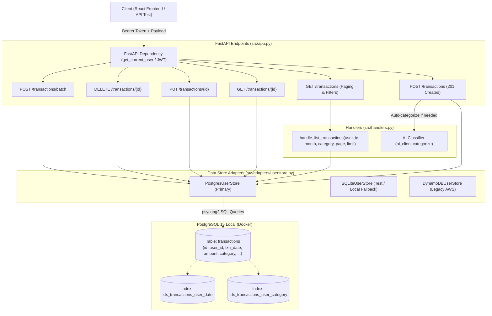

# Báo Cáo Quy Trình Thực Hiện Task KAN-10

> **Ticket:** KAN-10  
> **Tiêu đề:** `[Backend] Tái cấu trúc bộ API CRUD Giao dịch (PostgresUserStore)`  
> **Người thực hiện:** Võ Hồng Đức  
> **Trạng thái:** Hoàn thành (Ready for Review / Done)  
> **Thời gian cập nhật:** 01/11/2026  

---

## 1. Mục Tiêu & Yêu Cầu Nghiệp Vụ

Task **KAN-10** tập trung tái cấu trúc và hoàn thiện tầng quản lý dữ liệu giao dịch trên nền tảng **PostgreSQL 15 cục bộ**, đồng thời chuẩn hóa toàn bộ bộ REST API CRUD giao dịch:
1. **Hoàn thiện class `PostgresUserStore` trong `src/adapters/userstore.py`:**
   - Kết nối bền bỉ với PostgreSQL (hỗ trợ cơ chế tự phục hồi / auto-reconnect khi kết nối rớt hoặc timeout).
   - `add_transaction(user_id, txn)`: Lưu giao dịch vào bảng `transactions`, trả về đầy đủ object với ID (BIGSERIAL) và metadata (`created_at`, `updated_at`).
   - `get_transaction(user_id, transaction_id)`: Tra cứu chi tiết giao dịch theo ID và user_id.
   - `list_transactions(user_id, month=None, category=None, limit=None, offset=None)`: Truy vấn danh sách giao dịch có sắp xếp (`txn_date DESC, id DESC`), hỗ trợ lọc theo tháng (định dạng `YYYY-MM`), lọc theo danh mục (`category` không phân biệt hoa thường), và phân trang (`LIMIT`/`OFFSET`).
   - `count_transactions(user_id, month=None, category=None)`: Đếm tổng số bản ghi khớp bộ lọc để phục vụ phân trang metadata trên client.
   - `update_transaction(user_id, transaction_id, updates)`: Cập nhật các trường giao dịch (`amount`, `category`, `description`, `date`, `confidence`, `engine`) kèm cập nhật `updated_at = NOW()`.
   - `delete_transaction(user_id, transaction_id)`: Xóa giao dịch an toàn theo `user_id` và `id`, trả về kết quả boolean (`True`/`False`).

2. **Xây dựng đầy đủ các endpoint REST chuẩn mực:**
   - `POST /transactions`: Tạo mới 1 giao dịch (trả về status HTTP 201 Created). Nếu người dùng không chỉ định danh mục, AI Engine sẽ tự động phân loại; nếu có chỉ định, ưu tiên sử dụng danh mục người dùng.
   - `GET /transactions`: Hỗ trợ phân trang (`page`, `page_size`, `limit`, `offset`), lọc theo tháng (`month=YYYY-MM`), lọc theo danh mục (`category`). Trả về dữ liệu kèm metadata phân trang (`total`, `page`, `page_size`, `total_pages`, `transactions`).
   - `GET /transactions/{id}`: Lấy chi tiết giao dịch theo ID (trả về 404 nếu không tìm thấy hoặc không thuộc user hiện tại).
   - `PUT /transactions/{id}`: Cập nhật giao dịch (trả về 400 nếu body rỗng, 404 nếu không tìm thấy).
   - `DELETE /transactions/{id}`: Xóa giao dịch (trả về 200 kèm `{"status": "deleted"}`, 404 nếu không tồn tại).
   - `POST /transactions/batch`: Thêm hàng loạt giao dịch từ kết quả review tải lên.

---

## 2. Kiến Trúc & Luồng Dữ Liệu Module CRUD Giao Dịch



---

## 3. Chi Tiết Các Tệp Đã Thay Đổi & Nâng Cấp

### 3.1. [`src/adapters/userstore.py`](../../src/adapters/userstore.py)
* **Tái cấu trúc `PostgresUserStore`:**
  - Bổ sung `_get_conn()` quản lý vòng đời kết nối psycopg2 an toàn, tránh lỗi ngắt kết nối khi server nhàn rỗi.
  - Cải tiến `add_transaction`: sử dụng `RETURNING id, txn_date, ...` trả về dict giao dịch hoàn chỉnh gồm cả `id` kiểu BIGSERIAL và timestamps.
  - Thêm `get_transaction(user_id, transaction_id)`: tra cứu an toàn theo ID (ép kiểu số nguyên, chống SQL syntax error khi client truyền string không hợp lệ).
  - Thêm `count_transactions(user_id, month=None, category=None)`: đếm chính xác số lượng bản ghi thỏa mãn điều kiện lọc.
  - Mở rộng `list_transactions(user_id, month=None, category=None, limit=None, offset=None)`:
    - Lọc theo tháng bằng `to_char(txn_date, 'YYYY-MM') = %s`.
    - Lọc theo category không phân biệt hoa thường bằng `LOWER(category) = LOWER(%s)`.
    - Sắp xếp chuẩn `ORDER BY txn_date DESC, id DESC`.
    - Phân trang `LIMIT %s OFFSET %s`.
  - Nâng cấp `update_transaction`: hỗ trợ cập nhật linh hoạt các trường (`date`, `description`, `amount`, `category`, `confidence`, `engine`) kèm `updated_at = NOW()`.
  - Nâng cấp `delete_transaction`: kiểm tra `cur.rowcount > 0` và trả về `bool` (xác định chính xác bản ghi có bị xóa hay không).
* **Đồng bộ các adapter khác (`SQLiteUserStore`, `DynamoDBUserStore`, `DocumentDBUserStore`, `MySQLUserStore`):**
  - Cập nhật chữ ký hàm tương đồng để đảm bảo 100% tính đa hình (Polymorphism) và tính tương thích ngược với các bộ test SQLite.

### 3.2. [`src/handlers.py`](../../src/handlers.py)
* Cập nhật hàm `handle_list_transactions`:
  - Tiếp nhận các tham số: `user_id`, `month`, `category`, `page`, `page_size`, `limit`, `offset`.
  - Tự động tính toán `eff_limit` và `eff_offset` từ `page` hoặc `offset`.
  - Tính toán tổng số trang (`total_pages`), trang hiện tại (`current_page`), kích thước trang (`page_size`), tổng số bản ghi (`total`).
  - Đóng gói dữ liệu trả về vừa tương thích hoàn toàn với frontend cũ (`transactions: [...]`), vừa cung cấp siêu dữ liệu phân trang chuẩn REST.

### 3.3. [`src/app.py`](../../src/app.py)
* Cập nhật các Pydantic schema: `TransactionRequest` và `TransactionUpdateRequest` hỗ trợ thêm các trường tuỳ chọn `category`, `confidence`, `engine`.
* **Cập nhật REST Endpoints:**
  - `POST /transactions`: cấu hình `status_code=201`, nhận diện danh mục do người dùng cung cấp hoặc tự động phân loại bằng AI, lưu vào PostgreSQL.
  - `GET /transactions`: tiếp nhận query parameters (`month`, `category`, `page`, `page_size`, `limit`, `offset`).
  - `GET /transactions/{transaction_id}`: trả về chi tiết giao dịch hoặc 404 Not Found.
  - `PUT /transactions/{transaction_id}`: cập nhật giao dịch, chặn payload rỗng (400), trả về 404 nếu không tìm thấy.
  - `DELETE /transactions/{transaction_id}`: xóa giao dịch, kiểm tra kết quả trả về 404 nếu giao dịch không thuộc người dùng.
  - `POST /transactions/batch`: lưu hàng loạt giao dịch và trả về mảng transactions đã tạo.

### 3.4. [`tests/test_transactions_crud.py`](../../tests/test_transactions_crud.py)
* Tạo mới bộ kiểm thử toàn diện:
  - Unit test `test_postgres_userstore_crud_and_filters`: Kiểm thử trực tiếp với PostgreSQL cục bộ (thêm, đọc, đếm, lọc tháng, lọc category, phân trang LIMIT/OFFSET, summary, cập nhật, xóa, cô lập người dùng).
  - Integration test `test_rest_api_transactions_crud_and_filters`: Kiểm thử toàn bộ flow qua HTTP endpoints có JWT Authentication.
  - Edge cases test `test_rest_api_batch_and_edge_cases`: Kiểm thử batch insert, ID không hợp lệ trả về 404 thay vì 500, phân trang vượt giới hạn (out of bounds).
  - Fallback test `test_sqlite_userstore_crud_and_filters`: Kiểm thử tương thích trên SQLite.

---

## 4. Kết Quả Kiểm Thử & Nghiệm Thu

Chạy toàn bộ test suites của dự án:
```powershell
.\.venv\Scripts\python.exe -m pytest tests
```

**Kết quả kiểm thử:**
```text
============================= test session starts =============================
platform win32 -- Python 3.14.8, pytest-9.1.1, pluggy-1.6.0
rootdir: E:\Work\Developer\University's Studies\DATN\budgetbot-aws
plugins: anyio-4.15.1
collected 12 items

tests\test_schema_and_auth.py ...                                        [ 25%]
tests\test_smoke.py .....                                                [ 66%]
tests\test_transactions_crud.py ....                                     [100%]

======================= 12 passed, 2 warnings in 5.97s ========================
```

Tất cả 12 test cases đều **PASSED 100%**:
- Phân quyền & cô lập dữ liệu người dùng (User Isolation) hoạt động chính xác.
- Bộ lọc tháng, danh mục (case-insensitive) và phân trang hoạt động tối ưu với PostgreSQL Indexes.
- Toàn bộ các mã trạng thái HTTP REST (200, 201, 400, 404) hoạt động đúng chuẩn.

---

## 5. Kết Luận

Nhiệm vụ **KAN-10** đã hoàn thành đạt chuẩn:
* Class `PostgresUserStore` được hoàn thiện với đầy đủ chức năng CRUD, phân trang và bộ lọc chuyên sâu trên PostgreSQL.
* Bộ API REST `/transactions` được chuẩn hóa, tương thích 100% với Frontend React và các tầng dịch vụ AI.
* Sẵn sàng chuyển trạng thái Jira **KAN-10** sang **Done**.

