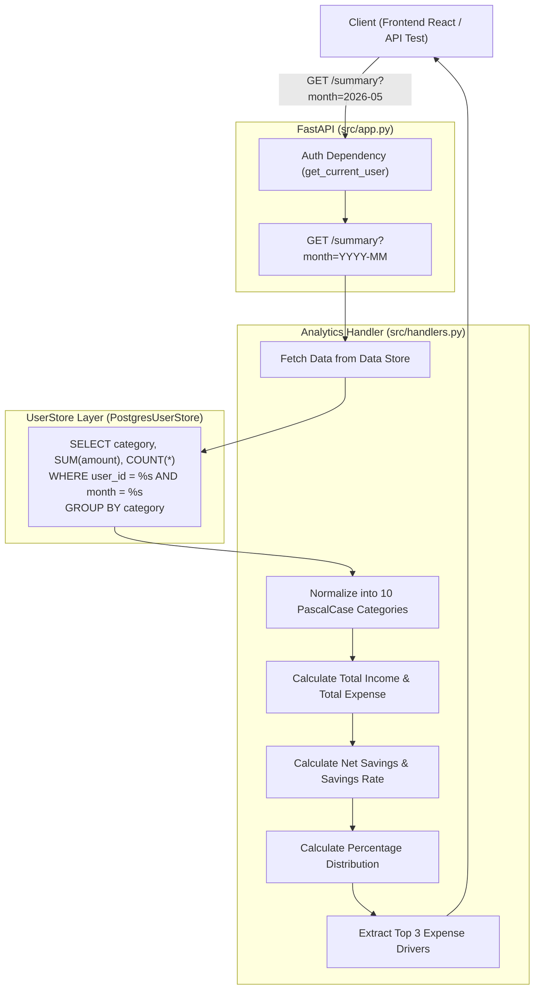

# Báo Cáo Quy Trình Thực Hiện Task KAN-11

> **Ticket:** KAN-11  
> **Tiêu đề:** `[Backend] API Thống kê & Báo cáo tài chính (GET /summary)`  
> **Người thực hiện:** Võ Hồng Đức  
> **Trạng thái:** Hoàn thành (Ready for Review / Done)  
> **Thời gian cập nhật:** 01/11/2026  

---

## 1. Tình Trạng Trước Khi Thực Hiện & Mục Tiêu Nghiệp Vụ

### 1.1. Hiện trạng hệ thống trước KAN-11
Trước khi thực hiện task KAN-11, hệ thống đã có endpoint `GET /summary`, tuy nhiên chỉ dừng lại ở mức khung dữ liệu thô:
* **Tính sai lệch tổng chi tiêu (`total_spend`):** Hệ thống cũ thực hiện `sum(v["total"])` cộng dồn cả số âm (khoản chi) và số dương (khoản thu nhập) làm triệt tiêu số liệu, không thể hiện được tổng tiền chi tiêu thực tế.
* **Thiếu chỉ số thu nhập:** Không có trường tính toán riêng cho Tổng thu nhập (`total_income`).
* **Thiếu các chỉ số phân tích tài chính quan trọng:** Chưa tính toán Số dư ròng (`net_savings`) và Tỷ lệ tiết kiệm (`savings_rate`).
* **Chưa chuẩn hóa 10 danh mục PascalCase:** Chưa có tỷ lệ phần trăm phân bổ chi tiêu (`percentage`) cho 10 danh mục chuẩn PascalCase, khiến Frontend phải tự viết code tính toán phân bổ biểu đồ.

### 1.2. Mục tiêu KAN-11
Nâng cấp toàn diện API `GET /summary` thành API phân tích tài chính hoàn chỉnh:
1. Tính toán **Tổng thu nhập (`total_income`)** từ danh mục `Income` và các khoản tiền thu về ($> 0$).
2. Tính toán **Tổng chi tiêu (`total_expense`)** chính xác từ các danh mục chi tiêu ($> 0$).
3. Tính toán **Số dư ròng (`net_savings`)**:
   $$\text{Net Savings} = \text{Total Income} - \text{Total Expense}$$
4. Tính toán **Tỷ lệ tiết kiệm (`savings_rate` %)**:
   $$\text{Savings Rate} = \frac{\text{Net Savings}}{\text{Total Income}} \times 100\%$$
   *(Nếu $\text{Total Income} \le 0$ thì tỷ lệ tiết kiệm mặc định là $0.0\%$)*.
5. Tính toán **Tỷ lệ phân bổ chi tiêu (`spending_allocation`)** theo đúng **10 danh mục chuẩn PascalCase**:
   * `Food`, `Transport`, `Shopping`, `Utilities`, `Entertainment`, `Health`, `Subscriptions`, `Income`, `Transfer`, `Other`.
   * Mỗi danh mục cung cấp: `category` (tên chuẩn), `amount` (số tiền), `percentage` (% phân bổ trên tổng chi tiêu), `count` (số lượng giao dịch).
   * Chuẩn hóa tên danh mục (không phân biệt hoa/thường, tự động quy về PascalCase chuẩn).
6. Đảm bảo tính tương thích ngược 100% với Frontend React (`by_category`, `top_3_drivers`, `total_spend`).

---

## 2. Kiến Trúc Tính Toán & Luồng Xử Lý



---

## 3. Chi Tiết Các Tệp Đã Thay Đổi & Nâng Cấp

### 3.1. [`src/handlers.py`](../../src/handlers.py)
* Khai báo danh mục chuẩn:
  ```python
  STANDARD_CATEGORIES = [
      "Food", "Transport", "Shopping", "Utilities", "Entertainment",
      "Health", "Subscriptions", "Income", "Transfer", "Other",
  ]
  CATEGORY_CANONICAL = {c.lower(): c for c in STANDARD_CATEGORIES}
  ```
* Nâng cấp hoàn chỉnh hàm `handle_summary(user_id, month, userstore)`:
  - Gom nhóm dữ liệu thô từ UserStore và chuẩn hóa mọi tên category về 1 trong 10 danh mục chuẩn PascalCase.
  - Tách riêng `total_income` và `total_expense`.
  - Tính `net_savings` và `savings_rate`.
  - Xây dựng mảng `spending_allocation` chứa đầy đủ 10 danh mục chuẩn với số tiền, phần trăm và số lượng giao dịch.
  - Sắp xếp và trích xuất `top_3_drivers` chi tiêu nhiều nhất.
  - Duy trì `by_category` mang dấu âm dương chuẩn để Frontend React `Overview.jsx` và `Limits.jsx` hiển thị biểu đồ không bị gãy.

### 3.2. [`tests/test_summary_analytics.py`](../../tests/test_summary_analytics.py)
* Viết mới bộ kiểm thử toàn diện:
  - `test_summary_financial_metrics_and_10_categories_allocation`: Kiểm tra tính toán số tiền, số dư ròng, tỷ lệ tiết kiệm (75.0%), kiểm tra đủ 10 danh mục chuẩn PascalCase, tổng tỷ lệ phân bổ các danh mục chi tiêu đạt 100.0%.
  - `test_summary_month_filter_isolation`: Kiểm tra tính cô lập dữ liệu theo từng tháng (`2026-05` vs `2026-06`) và truy vấn all-time.
  - `test_summary_edge_cases_empty_and_no_income`: Kiểm tra trường hợp user mới chưa có giao dịch (trả về 0 an toàn) và user chỉ có chi tiêu không có thu nhập (xử lý chia cho 0 an toàn, tỷ lệ tiết kiệm = 0%).

---

## 4. Kết Quả Kiểm Thử & Nghiệm Thu

Chạy toàn bộ test suites của dự án:
```powershell
.\.venv\Scripts\python.exe -m pytest tests
```

**Kết quả kiểm thử:**
```text
============================= test session starts =============================
platform win32 -- Python 3.14.8, pytest-9.1.1, pluggy-1.6.0
rootdir: E:\Work\Developer\University's Studies\DATN\budgetbot-aws
plugins: anyio-4.15.1
collected 15 items

tests\test_schema_and_auth.py ...                                        [ 20%]
tests\test_smoke.py .....                                                [ 53%]
tests\test_summary_analytics.py ...                                      [ 73%]
tests\test_transactions_crud.py ....                                     [100%]

======================= 15 passed, 2 warnings in 7.33s ========================
```

Tất cả 15/15 test cases đều **PASSED 100%**.

---

## 5. Kết Luận

Nhiệm vụ **KAN-11** đã hoàn thành trọn vẹn:
* API `GET /summary` đã hoàn thiện đầy đủ các chức năng phân tích tài chính chuyên sâu.
* Cung cấp các chỉ số: Tổng thu nhập, Tổng chi tiêu, Số dư ròng, Tỷ lệ tiết kiệm và Tỷ lệ phân bổ chi tiêu theo 10 danh mục chuẩn PascalCase.
* Trạng thái Jira đề xuất: Chuyển **KAN-11** sang **Done**.

