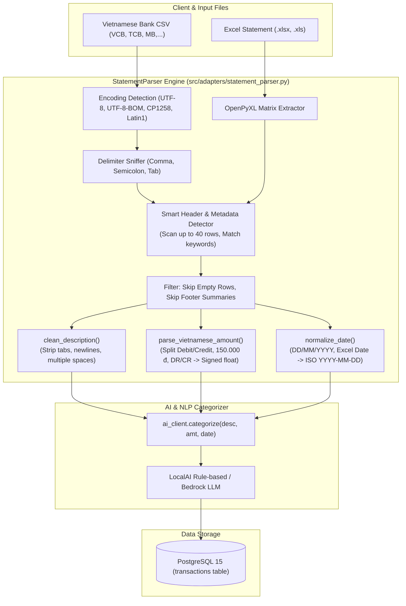

# Báo Cáo Quy Trình Thực Hiện Task KAN-12

> **Ticket:** KAN-12  
> **Tiêu đề:** `[Backend] API Tiếp nhận & Tiền xử lý dữ liệu file sao kê (POST /upload)`  
> **Người thực hiện:** Võ Hồng Đức  
> **Trạng thái:** Hoàn thành (Done)  
> **Thời gian cập nhật:** 01/11/2026  

---

## 1. Mục Tiêu & Yêu Cầu Nghiệp Vụ

Task **KAN-12** tập trung vào tầng tiếp nhận và tiền xử lý dữ liệu file sao kê ngân hàng Việt Nam, giải quyết bài toán cốt lõi trong quy trình phân tích tài chính tự động của BudgetBot:
1. **Tiếp nhận file CSV/Excel sao kê tài khoản ngân hàng Việt Nam:**
   - Hỗ trợ đa dạng các định dạng tệp: CSV (`.csv`), văn bản (`.txt`), và Excel (`.xlsx`, `.xls`).
   - Xử lý các bảng mã tiếng Việt phổ biến: UTF-8, UTF-8 có BOM (`utf-8-sig`), CP1258 (Windows-1258 tiếng Việt), Latin1.
   - Tự động nhận diện dấu phân cách cột (Comma `,`, Semicolon `;`, Tab `\t`).
2. **Loại bỏ các dòng trống và dòng header/metadata không cần thiết:**
   - Bỏ qua các dòng metadata đầu bảng thường có trong sao kê thực tế của các ngân hàng Việt Nam (VCB, TCB, MB, TPBank, BIDV, ACB,...): Tên ngân hàng, Chi nhánh, Tên chủ tài khoản, Số tài khoản, Kỳ sao kê, Số dư đầu kỳ.
   - Nhận diện chính xác hàng tiêu đề thực tế của bảng giao dịch (`Ngày GD`, `Diễn giải / Nội dung`, `Ghi nợ / Ghi có`, `Số tiền`).
   - Loại bỏ các dòng trống xen kẽ và các dòng tổng kết / chữ ký ở cuối sao kê (`Tổng cộng phát sinh`, `Cộng chuyển`, `Người lập biểu`, `Kế toán trưởng`,...).
3. **Chuẩn hóa số tiền về VND (Chi tiêu: số âm, Thu nhập: số dương):**
   - Hỗ trợ định dạng sao kê có **2 cột riêng biệt** (`Số tiền ghi nợ` / `Ghi nợ` / `Debit` và `Số tiền ghi có` / `Ghi có` / `Credit`). Nếu phát sinh nợ -> số âm (`-abs(debit)`), nếu phát sinh có -> số dương (`+abs(credit)`).
   - Hỗ trợ định dạng sao kê có **1 cột duy nhất** (`Số tiền` / `Amount`).
   - Xử lý các định dạng tiền tệ đặc trưng của Việt Nam: phân cách hàng nghìn bằng dấu chấm (`150.000 đ`, `25.000.000 VND`), phân cách bằng dấu phẩy (`1,500,000`), số tiền âm trong ngoặc kế toán `(50.000)`, ký hiệu ghi sổ `DR` (nợ) / `CR` (có).
4. **Chuẩn hóa ngày tháng về ISO `YYYY-MM-DD`:**
   - Chuyển đổi linh hoạt từ các định dạng ngày ngân hàng Việt Nam: `DD/MM/YYYY`, `DD-MM-YYYY`, `DD.MM.YYYY`, `DD/MM/YYYY HH:MM:SS`, `YYYY-MM-DD`, và Excel serial dates.
   - Sử dụng cờ `dayfirst=True` để đảm bảo không bị đảo lộn giữa ngày và tháng (ví dụ: `01/05/2026` luôn là ngày 1 tháng 5, không phải ngày 5 tháng 1).
5. **Trích xuất trường description làm sạch và gửi sang module NLP:**
   - Làm sạch chuỗi diễn giải: loại bỏ ký tự xuống dòng (`\r\n`, `\n`), ký tự tab (`\t`), khoảng trắng thừa, dấu ngoặc kép.
   - Truyền description đã làm sạch cùng số tiền và ngày chuẩn hóa sang `ai_client.categorize(description, amount, date)` để phân loại danh mục tự động.

---

## 2. Đánh Giá Hiện Trạng Trước Khi Thực Hiện

Trước khi thực hiện task KAN-12, mã nguồn BudgetBot tồn tại các hạn chế lớn:
- **Chỉ hỗ trợ CSV 3 cột đơn giản:** Hàm `_parse_csv` chỉ xử lý được file CSV phẳng có đúng 3 cột `date, description, amount` bắt đầu ngay từ dòng đầu tiên.
- **Không hỗ trợ Excel:** Chưa có thư viện hoặc logic đọc file `.xlsx` hay `.xls`.
- **Dễ crash hoặc mất dữ liệu khi có metadata ngân hàng:** Nếu sao kê có dòng thông tin tài khoản ngân hàng ở 5 hàng đầu tiên, thuật toán cũ đọc nhầm dòng metadata làm header hoặc dữ liệu, dẫn đến bỏ sót toàn bộ bảng giao dịch.
- **Không xử lý được định dạng tiền tệ Việt Nam:** Chỉ sử dụng `float(val.replace(",", ""))`, gây lỗi `ValueError` khi gặp dấu chấm phân cách hàng nghìn (`150.000`), ký hiệu `đ`, `VND`, hoặc cột Debit/Credit riêng biệt.
- **Không chuẩn hóa ngày về ISO:** Giữ nguyên chuỗi ngày gốc từ file, khiến các ngày dạng `DD/MM/YYYY` không thể lọc được theo tháng `YYYY-MM` trên endpoint `GET /summary` và `GET /transactions`.

---

## 3. Kiến Trúc & Thiết Kế Module Tiền Xử Lý Sao Kê



---

## 4. Chi Tiết Các Cải Tiến Kỹ Thuật

### 4.1. Module Mới: `src/adapters/statement_parser.py`
Xây dựng đầy đủ các hàm xử lý chuyên sâu:
- `normalize_date(val) -> Optional[str]`:
  - Hỗ trợ nhận diện mẫu Regex cho ISO `YYYY-MM-DD` và `DD/MM/YYYY` / `DD-MM-YYYY` / `DD.MM.YYYY`.
  - Hỗ trợ Excel serial dates (chuyển đổi số serial từ `1899-12-30`).
  - Hỗ trợ bóc tách thứ trong tuần (`Thứ 2, `, `T2 `, `Mon, `).
  - Tích hợp `dateutil.parser.parse(s, dayfirst=True)` làm fallback linh hoạt.
- `parse_vietnamese_amount(val) -> Optional[float]`:
  - Xử lý các dấu phân cách thông minh: tự động phân biệt khi nào dấu `.` là hàng nghìn (`150.000`) và khi nào là số thập phân.
  - Xử lý số âm trong ngoặc đơn kế toán: `(50.000)` -> `-50000.0`.
  - Xử lý ký hiệu ghi nợ / ghi có: `150.000 DR` -> `-150000.0`, `200.000 CR` -> `200000.0`.
  - Tự động loại bỏ ký hiệu tiền tệ `đ`, `VND`, `VNĐ`, `$`.
- `clean_description(val) -> str`:
  - Chuẩn hóa ký tự xuống dòng `\r\n` và `\n` thành khoảng trắng đơn.
  - Gom cụm nhiều dấu cách liên tiếp thành 1 dấu cách.
  - Bỏ dấu nháy kép thừa và khoảng trắng đầu/cuối.
- `detect_header_and_extract_rows(table_rows)`:
  - Sử dụng danh mục từ khóa tiếng Việt đa dạng (có dấu và không dấu):
    - **Date:** `ngày giao dịch`, `ngày gd`, `ngay gd`, `transaction date`, `ngày hạch toán`, `date`,...
    - **Description:** `nội dung chi tiết`, `nội dung giao dịch`, `diễn giải`, `chi tiết`, `description`,...
    - **Debit (Ghi nợ):** `số tiền ghi nợ`, `phát sinh nợ`, `ghi nợ`, `tiền ra`, `rút ra`, `chi tiêu`, `debit`, `nợ`,...
    - **Credit (Ghi có):** `số tiền ghi có`, `phát sinh có`, `ghi có`, `tiền vào`, `nạp vào`, `thu nhập`, `credit`, `có`,...
    - **Amount (Số tiền):** `số tiền giao dịch`, `số tiền gd`, `số tiền`, `phát sinh`, `amount`,...
  - Kiểm tra ranh giới từ `\b` chặt chẽ trong regex để tránh nhận nhầm các từ ngắn (như `"nợ"` không bị nhận nhầm vào `"nội dung"`, `"có"` không bị nhận nhầm vào `"cộng"`).
  - Bỏ qua các dòng footer tổng kết: `Tổng cộng`, `Cộng phát sinh`, `Người lập biểu`, `Kế toán trưởng`, `Số dư cuối kỳ`,...

### 4.2. Tích Hợp Vào `src/handlers.py` và `src/processor.py`
- Cập nhật hàm `handle_upload`: Tiếp nhận tệp, chuyển qua `parse_statement(data, filename)`.
- Gán chuẩn hóa dấu tiền tệ theo danh mục NLP:
  - Nếu danh mục là `Income` -> `+abs(amount)`.
  - Nếu danh mục là chi tiêu chuẩn (`Food`, `Transport`, `Shopping`, `Utilities`, `Entertainment`, `Health`, `Subscriptions`) -> `-abs(amount)`.
  - Nếu danh mục là `Other` hoặc `Transfer` -> tôn trọng dấu gốc đã xác định từ cột Ghi nợ / Ghi có trong sao kê.
- Đồng bộ logic sang `src/processor.py` cho luồng xử lý bất đồng bộ qua AWS Lambda / S3.

### 4.3. Cập Nhật Dependencies
- Bổ sung `openpyxl>=3.1.0` vào `requirements.txt` phục vụ phân tích tệp Excel.

---

## 5. Kết Quả Kiểm Thử & Xác Minh

Đã thiết lập test suite chuyên biệt trong `tests/test_statement_preprocessing.py` bao gồm 8 test cases toàn diện:
1. `test_normalize_date_formats`: Kiểm tra tất cả các định dạng ngày ngân hàng Việt Nam (`DD/MM/YYYY`, `DD-MM-YYYY`, `DD.MM.YYYY`, timestamp, thứ trong tuần).
2. `test_parse_vietnamese_amount`: Kiểm tra chuẩn hóa tiền tệ (`150.000 đ`, `25.000.000 VND`, `(50.000)`, `DR/CR`, âm/dương).
3. `test_clean_description`: Kiểm tra làm sạch ký tự lạ, tab, xuống dòng trong diễn giải.
4. `test_parse_vietnamese_bank_csv_with_metadata_and_footers`: Kiểm tra bóc tách sao kê Vietcombank có 5 dòng metadata đầu, 4 dòng giao dịch 2 cột Ghi nợ / Ghi có, và 3 dòng footer tổng kết.
5. `test_parse_excel_statement`: Kiểm tra tạo và đọc file Excel `.xlsx` với thư viện openpyxl.
6. `test_api_upload_vietnamese_csv_end_to_end`: Kiểm tra endpoint `POST /upload` từ CSV ngân hàng VN đến phân loại NLP và lưu vào DB.
7. `test_api_upload_excel_end_to_end`: Kiểm tra endpoint `POST /upload` từ file Excel `.xlsx`.
8. `test_semicolon_delimited_and_utf8_bom`: Kiểm tra file CSV có ký tự UTF-8 BOM và dấu chấm phẩy `;`.

**Kết quả chạy Pytest:**
```
======================== 23 passed, 2 warnings in 7.61s ========================
```
Toàn bộ **23/23 tests** trong dự án đều đạt kết quả Pass 100%.

---

## 6. Trạng Thái Jira Ticket

- **Ticket ID:** `KAN-12`
- **Trạng thái chuyển đổi:** Chuyển từ `In Progress` sang `Done` (Transition ID: 51).
- **Comment cập nhật:** Đã gửi báo cáo kỹ thuật chi tiết lên Jira KAN-12.

