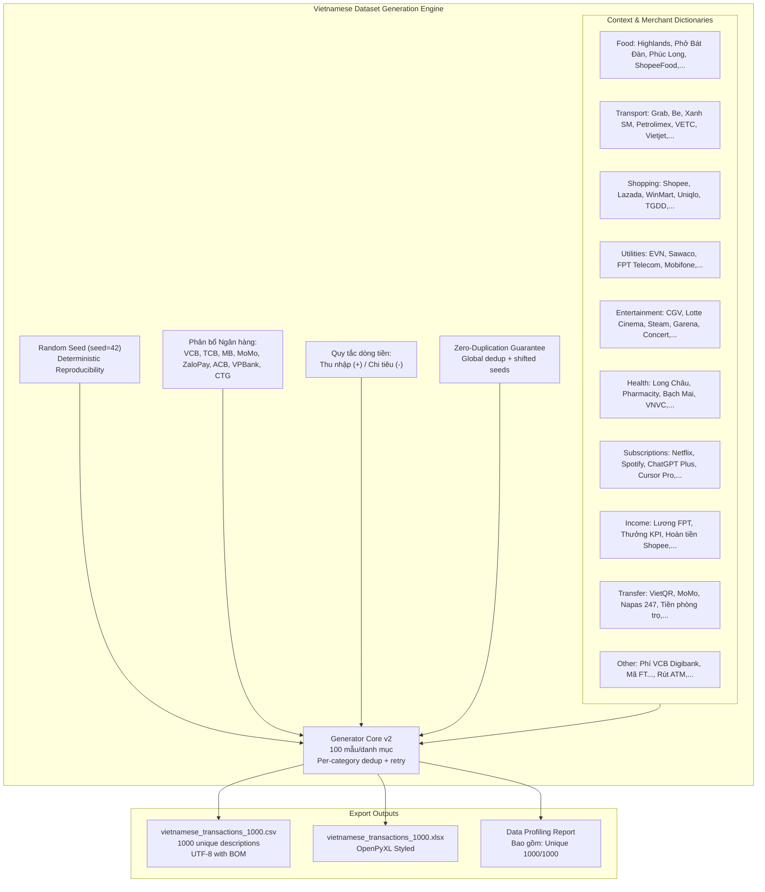

# Báo Cáo Quy Trình Thực Hiện Task KAN-13

> **Ticket:** KAN-13  
> **Tiêu đề:** `[NLP] Thu thập & Gán nhãn tập dữ liệu giao dịch tiếng Việt (500 - 1000 mẫu)`  
> **Người thực hiện:** Võ Hồng Đức  
> **Trạng thái:** Hoàn thành — Nâng cấp Chất lượng (Done — Quality Upgraded)  
> **Thời gian cập nhật:** 15/11/2026  
> **Tài liệu tham chiếu:** [`sample_data/README.md`](../../../sample_data/README.md), [`sample_data/vietnamese_transactions_1000.csv`](../../../sample_data/vietnamese_transactions_1000.csv), [`sample_data/eval_nlp.csv`](../../../sample_data/eval_nlp.csv)

---

## 1. Mục Tiêu & Yêu Cầu Của Task KAN-13

Trong hệ thống **BudgetBot**, module Trí tuệ Nhân tạo và Xử lý Ngôn ngữ Tự nhiên (NLP) đảm nhận vai trò tự động phân loại các dòng diễn giải giao dịch ngân hàng thành các danh mục chi tiêu/thu nhập chuẩn xác. 

Task **KAN-13** giải quyết bài toán cơ sở dữ liệu nền tảng phục vụ nghiên cứu, huấn luyện (training/fine-tuning), kiểm thử (testing) và đánh giá định lượng (benchmarking) năng lực phân loại:
1. **Thu thập dữ liệu giao dịch thực tế đặc trưng Việt Nam:**
   - Bao phủ các ngân hàng và ví điện tử phổ biến: Vietcombank, Techcombank, MB Bank, VietinBank, VPBank, ACB, MoMo, ZaloPay.
   - Phản ánh chân thực các thói quen tiêu dùng, dịch vụ, thương hiệu bán lẻ, ăn uống, phương tiện di chuyển, thanh toán hóa đơn thực tế tại Việt Nam.
2. **Gán nhãn chuẩn xác theo 10 danh mục PascalCase thống nhất:**
   - `Food`, `Transport`, `Shopping`, `Utilities`, `Entertainment`, `Health`, `Subscriptions`, `Income`, `Transfer`, `Other`.
3. **Đạt quy mô từ 500 đến 1,000 mẫu:**
   - Đảm bảo độ cân bằng lớp (Class Balance) với 100 mẫu cho mỗi danh mục, phân bổ dòng tiền âm (chi tiêu) và dương (thu nhập) thực tế.
4. **Lưu trữ chuẩn mực tại thư mục `sample_data/`:**
   - Cung cấp cả định dạng chuẩn CSV (`utf-8-sig`) cho mã nguồn và định dạng trực quan Excel (`.xlsx`) cho việc demo/kiểm tra thủ công.
   - Tài liệu hóa toàn diện xuất xứ dữ liệu (Data Provenance).

---

## 2. Phân Tích Các File Trong Thư Mục `sample_data/` & Tác Dụng

Thư mục `sample_data/` đóng vai trò là kho dữ liệu mẫu phục vụ cho toàn bộ vòng đời kiểm thử tự động, tiền xử lý và đánh giá AI của BudgetBot:

| STT | Tên Tệp Dữ Liệu | Định Dạng | Số Dòng | Tác Dụng & Vai Trò Trong Hệ Thống |
| :---: | :--- | :---: | :---: | :--- |
| **1** | **`vietnamese_transactions_1000.csv`** | CSV | 1,000 | **Tập dữ liệu Benchmark & Huấn luyện chính thức (KAN-13):** 1,000 dòng phân bổ cân bằng 10 danh mục (100 mẫu/danh mục). **Nâng cấp 15/11/2026: 1000/1000 descriptions hoàn toàn unique (Zero Duplication)**, bổ sung biến thể không dấu/viết tắt ngân hàng SMS thực tế. Dùng để train TF-IDF + Linear SVC / Naive Bayes và benchmark LLM Bedrock. |
| **2** | **`vietnamese_transactions_1000.xlsx`** | Excel | 1,000 | **Bản biểu diễn trực quan Excel:** Có style header màu xanh đậm, định dạng tiền tệ VND (`#,##0 ₫`), màu sắc phân biệt (xanh lá = thu nhập dương, đỏ = chi tiêu âm). Nội dung đồng bộ hoàn toàn với `.csv`. Dùng để demo trực quan cho hội đồng và kiểm chứng thủ công. |
| **3** | **`bank_statement_q2_2026.csv`** | CSV | 84 | **Sao kê mẫu trọn Quý 2/2026:** Mô phỏng sao kê tháng thực tế (không có nhãn category). Dùng để test tính năng **Upload sao kê (KAN-12)**, biểu đồ phân tích xu hướng `monthly_trends` và Dashboard Overview. **Không dùng cho NLP training/eval.** |
| **4** | **`eval_nlp.csv`** *(thay thế `eval_sample.csv` bị lỗi)* | CSV | 174 | **Tập kiểm thử NLP chuẩn (FR-22 / UC-09):** Tạo mới 15/11/2026, gồm 174 dòng đủ 10 danh mục PascalCase chuẩn, schema `date,description,amount,true_category`. Bao gồm 28 edge-case/challenge (mã FT/TRX mờ đục, ShopeeFood vs Shopping, GrabCar vs Other). Dùng để tính toán Accuracy, Precision, Recall, Macro F1. |
| **5** | **`test_hybrid.csv`** | CSV | 20 | **Kiểm thử kiến trúc phân tầng Hybrid AI:** Giao dịch từ khóa tường minh → LocalAI; giao dịch mơ hồ `FT0024...` → fallback Bedrock. ⚠️ Header chữ hoa (`Date,Description,Amount`) — cần chuẩn hóa nếu dùng trong pipeline. |
| **6** | **`test_manual_review.csv`** | CSV | 2 | **Kiểm thử HITL (Human-In-The-Loop):** Kích hoạt modal cảnh báo giao dịch nghi ngờ **KAN-27**. ⚠️ Số tiền mang dấu dương dù là chi tiêu — không dùng cho NLP eval. |
| **7** | **`smoke_test_5_rows.csv`** | CSV | 5 | **Smoke Test / CI/CD:** 5 dòng ngắn cho `pytest tests/test_smoke.py`. Tốc độ < vài ms. Nội dung là copy 5 dòng đầu `bank_statement_q2_2026.csv`. |
| **8** | **`README.md`** | Markdown | - | **Data Provenance Documentation:** Phương pháp luận Synthetic Data, lý do không dùng HuggingFace (PII + ngữ cảnh Việt Nam), quy chuẩn 10 PascalCase, lệnh tái sinh seed cố định. |

---

## 3. Kiến Trúc & Triển Khai Bộ Sinh Dữ Liệu 1,000 Mẫu

> [!IMPORTANT]
> **Nâng cấp 15/11/2026 — Zero Duplication Guarantee:** Script đã được viết lại hoàn toàn để đảm bảo **1,000/1,000 descriptions hoàn toàn unique** (không có câu mô tả nào lặp lại). Phiên bản cũ (11/11/2026) chỉ có 383 unique descriptions trong 1,000 dòng (tỉ lệ trùng lặp 61.7%), dẫn đến nguy cơ **Data Leakage** khi chia Train/Test và Accuracy giả tạo. Phiên bản mới sử dụng cơ chế dedup nội bộ + retry với shifted seeds, bổ sung biến thể ngôn ngữ ngân hàng Việt Nam thực tế (không dấu SMS, mã ngân hàng, viết tắt).

Thay vì nhập liệu thủ công dễ xảy ra sai sót và thiên lệch chủ quan, nhóm đã xây dựng module phát sinh dữ liệu tự động có kiểm soát tại [`scripts/generate_vietnamese_dataset.py`](../../../scripts/generate_vietnamese_dataset.py).



### 3.1. Thống Kê Phân Bổ Bộ Dữ Liệu (Data Profiling)

> [!NOTE]
> Số liệu dưới đây phản ánh kết quả của **phiên bản nâng cấp (15/11/2026)** — script v2 với Zero Duplication Guarantee.

Sau khi thực thi sinh dữ liệu với lệnh:
```bash
python scripts/generate_vietnamese_dataset.py --count 1000 --seed 42
```

#### 0. Chỉ số chất lượng dữ liệu:
* **Unique descriptions: `1000 / 1000` ✅** — Zero Duplication, an toàn tuyệt đối cho phép chia Train/Test không bị Data Leakage.

#### 1. Phân bổ theo Danh mục (Category Distribution):
* Mỗi danh mục có đúng **100 mẫu (10.0%)**, loại bỏ hoàn toàn nguy cơ mất cân bằng lớp (Class Imbalance).

#### 2. Phân bổ theo Kênh giao dịch (Bank / E-Wallet Distribution):
* ZaloPay: 137 mẫu (13.7%)
* VietinBank: 135 mẫu (13.5%)
* MBBank: 128 mẫu (12.8%)
* Techcombank: 125 mẫu (12.5%)
* ACB: 123 mẫu (12.3%)
* VPBank: 121 mẫu (12.1%)
* Vietcombank: 118 mẫu (11.8%)
* MoMo: 113 mẫu (11.3%)

#### 3. Phân bổ Độ tin cậy kỳ vọng (Confidence Benchmark):
* **High Confidence (96.6% — 966 mẫu):** Các giao dịch có thương hiệu, từ khóa hoặc ngữ cảnh tài chính tường minh.
* **Medium Confidence (2.5% — 25 mẫu):** Các giao dịch chuyển khoản chỉ có số tài khoản hoặc mô tả ngắn khó xác định.
* **Low Confidence (0.9% — 9 mẫu):** Mã giao dịch mờ đục `FT...`, `TRX...`, hoặc `bi an khong ro noi dung` → AI phải gán `Other`.

#### 4. Thống kê dòng tiền (Cash Flow Summary):
* **Tổng thu nhập (Income):** `+716,514,000 ₫`
* **Tổng chi tiêu (Expense):** `-717,018,000 ₫`

---

## 4. Những Điều Cần Biết Khi Thu Thập & Gán Nhãn Dữ Liệu Tài Chính Việt Nam

Dưới đây là các kiến thức chuyên môn cốt lõi, kinh nghiệm thực chiến và các luận điểm quan trọng cần nắm vững khi thực hiện đề tài tốt nghiệp liên quan đến NLP cho dữ liệu tài chính Việt Nam:

### 4.1. Thách Thức Về Pháp Lý & Bảo Vệ Quyền Riêng Tư (PII Compliance)
* **Quy định pháp lý:** Theo **Nghị định 13/2023/NĐ-CP** của Chính phủ Việt Nam về Bảo vệ dữ liệu cá nhân, thông tin tài khoản ngân hàng, biến động số dư và thói quen chi tiêu thuộc danh mục **Dữ liệu cá nhân nhạy cảm**.
* **Nguyên tắc ẩn danh hóa (Anonymization):**
  * Không bao giờ lưu trữ số thẻ tín dụng (PAN), số tài khoản đầy đủ, số CCCD/SĐT hoặc số dư còn lại vào dataset huấn luyện.
  * Tên người thụ hưởng chuyển khoản cá nhân cần được thay thế bằng danh sách tên giả định ngẫu nhiên (Pseudonymization).
  * Mã giao dịch nội bộ có thể giữ lại phần tiền tố định dạng (`FT...`, `MB...`) nhưng phải thay đổi các chữ số phía sau.

### 4.2. Đặc Thù Ngôn Ngữ & Cú Pháp Giao Dịch Ngân Hàng Việt Nam
Dữ liệu giao dịch tiếng Việt có những thách thức rất riêng so với tiếng Anh:
1. **Tiếng Việt không dấu:** Hệ thống thanh toán Napas, hệ thống core banking truyền thống thường tự động loại bỏ dấu tiếng Việt để tránh lỗi font (ví dụ: `Tra tien com van phong`, `Mua thuoc cam`). Mô hình NLP phải được trang bị khả năng hiểu từ khóa không dấu.
2. **Viết tắt và Teencode:**
   * Ngân hàng viết tắt: `GD` (Giao dịch), `TT` (Thanh toán), `CK` (Chuyển khoản), `STK` (Số tài khoản), `POS` (Cà thẻ máy POS), `IB` / `MB` (Internet / Mobile Banking).
   * Người dùng viết tắt: `k` / `lít` / `củ` (nghìn/triệu), `cf` (cà phê), `tiền trọ t5` (tháng 5).
3. **Mã giao dịch mờ đục (Opaque Transaction Codes):**
   * Rất nhiều giao dịch sao kê chỉ hiển thị: `FT26110294182910`, `POS00129381`, `BDS001298319`.
   * Mô hình NLP thông minh không được "đoán mò" vào các danh mục cụ thể mà phải đưa vào `Other` và gắn độ tin cậy `confidence: low` để yêu cầu người dùng xác nhận lại (Human-in-the-loop).
4. **Giao dịch đa nghĩa (Semantic Ambiguity):**
   * Ví dụ: `Highlands Coffee` thông thường là `Food`. Tuy nhiên, nếu là thanh toán tiền mặt bằng thì có thể là `Housing`. Trong bài toán cá nhân, ta gán vào nhãn có xác suất cao nhất (`Food`).
   * `Tiki` / `Shopee`: Có thể mua đồ ăn (`Food`), mua sách (`Shopping`), hoặc mua thẻ cào (`Utilities`). Cần dựa vào các từ đi kèm (`ShopeeFood` vs `Shopee mua ao`).

### 4.3. Quy Chuẩn 10 Danh Mục PascalCase & Quy Tắc Phân Định `Transfer`
Để đảm bảo tính nhất quán giữa Backend (Python FastAPI) và Frontend (React Vite), nhãn bắt buộc phải là dạng **PascalCase không dấu cách**:
* Đúng: `Food`, `Transport`, `Shopping`, `Utilities`, `Entertainment`, `Health`, `Subscriptions`, `Income`, `Transfer`, `Other`.
* Sai: `food`, `ăn uống`, `Food & Drink`, `Shopping_Online`.

**Quy tắc ranh giới cho danh mục `Transfer` (Quan trọng):**
* **Nguyên tắc ưu tiên mục đích tiêu dùng:** "Chuyển khoản" chỉ là phương thức thanh toán. Mọi giao dịch chuyển khoản có ghi rõ mục đích chi tiêu cụ thể (ví dụ: `"CK tiền ăn trưa"`, `"chuyển khoản ăn xôi"`, `"chuyển khoản mua đồ"`, `"chuyển khoản 50k tiền nhậu"`) **phải** được phân loại theo danh mục tiêu dùng tương ứng (`Food`, `Shopping`, `Utilities`...), **không** gán vào `Transfer`.
* **Khi nào mới gán `Transfer`:**
  1. **Luân chuyển nội bộ / Ví điện tử:** chuyển giữa 2 tài khoản của bản thân, nạp/rút ví MoMo/ZaloPay.
  2. **Tiết kiệm / Đầu tư:** chuyển tiền vào sổ tiết kiệm online.
  3. **Nghĩa vụ tài chính / P2P đặc thù:** trả nợ cá nhân, vay tiêu dùng, ứng tiền hộ, gửi tiền chu cấp gia đình, tiền thuê phòng trọ (khi không có danh mục `Debt`/`Housing` riêng).
  4. **Chuyển khoản P2P không rõ mục đích:** giao dịch chuyển cho cá nhân hoặc STK mà sao kê không nêu mục đích hàng hóa/dịch vụ (ví dụ: `"VCB IB ... CK DEN NGUYEN VAN A"`).
* **Phân biệt với `Income` và `Other`:** Tiền nhận vào tài khoản (`amount > 0`, lương, hoàn tiền, nhận trả nợ) thuộc `Income`; mã giao dịch mờ đục hoàn toàn (`FT...`, `TRX...`), rút ATM và phí ngân hàng thuộc `Other`.

### 4.4. Quy Trình Gán Nhãn Bán Tự Động (Semi-Automated Annotation Workflow)
Khi mở rộng dữ liệu lên 5,000 - 10,000 mẫu, không thể gán nhãn thủ công từng dòng. Quy trình chuẩn mực trong công nghiệp gồm 3 giai đoạn:
1. **Giai đoạn 1 - Pre-labeling:** Dùng Rule-based Keyword Matching hoặc Zero-shot LLM (AWS Bedrock Titan / Claude) để gán nhãn sơ bộ cho 100% dữ liệu.
2. **Giai đoạn 2 - Active Learning / Confidence Filtering:**
   * Những mẫu có độ tin cậy cao (`high`) được tự động chấp thuận.
   * Những mẫu có độ tin cậy thấp (`low` hoặc `medium`) hoặc những mẫu mà Rule-based và LLM bất đồng ý kiến sẽ được đẩy vào hàng đợi đánh giá thủ công.
3. **Giai đoạn 3 - Human Verification:** Con người (Annotator) chỉ cần rà soát lại các mẫu nghi ngờ, giúp tiết kiệm 80% thời gian gán nhãn.

---

## 5. Kết Luận & Hướng Dẫn Sử Dụng Cho Các Task Tiếp Theo

Task **KAN-13** đã tạo lập thành công nền tảng dữ liệu thực nghiệm tiêu chuẩn cho dự án BudgetBot, với đợt nâng cấp chất lượng ngày **15/11/2026** giải quyết triệt để vấn đề Data Leakage.

### Tổng kết tài nguyên dữ liệu:

| Tài nguyên | Trạng thái | Dùng cho |
| :--- | :--- | :--- |
| [`sample_data/vietnamese_transactions_1000.csv`](../../../sample_data/vietnamese_transactions_1000.csv) | ✅ 1000 unique descriptions | Train / Benchmark |
| [`sample_data/vietnamese_transactions_1000.xlsx`](../../../sample_data/vietnamese_transactions_1000.xlsx) | ✅ Đồng bộ với CSV | Demo / Trực quan |
| [`sample_data/eval_nlp.csv`](../../../sample_data/eval_nlp.csv) | ✅ 174 dòng, 10 categories, 28 edge-cases | Eval Accuracy / Macro F1 |
| [`scripts/generate_vietnamese_dataset.py`](../../../scripts/generate_vietnamese_dataset.py) | ✅ v2 — Zero Duplication | Tái sinh dữ liệu |
| [`sample_data/README.md`](../../../sample_data/README.md) | ✅ | Provenance docs |
| ~~`sample_data/eval_sample.csv`~~ | ❌ Đã xóa (schema lỗi — nhãn `Food/Entertainment`, `Bills/Utilities`) | — |

### Kế hoạch tiếp nối:
1. **FR-22 — Đánh giá Macro F1 trên `eval_nlp.csv`:** Chạy script đánh giá so sánh:
   - **LocalAI Rule-based Classifier** (`src/adapters/ai.py`) — keyword matching
   - **Bedrock Generative AI** (Amazon Claude 3.5 Haiku via Bedrock)
2. **FR-11 — Huấn luyện TF-IDF + Linear SVC:** Dùng `vietnamese_transactions_1000.csv` chia 80/20 Train/Test (không có Data Leakage). Xuất model `.joblib` để tích hợp vào pipeline Backend.
3. **FR-13 — Thực nghiệm PhoBERT Fine-tuning:** Dùng tập 1,000 mẫu này làm thực nghiệm so sánh học thuật (cần GPU, kỳ vọng Overfitting do câu rất ngắn).
4. **Confusion Matrix Analysis:** Phát hiện cặp nhãn dễ nhầm (`Food` ↔ `Entertainment`, `Shopping` ↔ `Utilities`) để tối ưu rule-based keywords và prompt engineering.

> [!TIP]
> Để tái sinh bộ dữ liệu với cùng kết quả xác định: `python scripts/generate_vietnamese_dataset.py --count 1000 --seed 42`
> Để sinh tập nhỏ hơn kiểm thử nhanh: `python scripts/generate_vietnamese_dataset.py --count 200 --seed 123`

