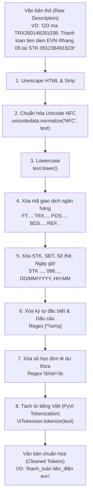

# Báo Cáo Quy Trình Thực Hiện Task KAN-14

> **Ticket:** KAN-14  
> **Tiêu đề:** `[NLP] Xây dựng module Tiền xử lý văn bản tiếng Việt (preprocessor.py)`  
> **Yêu cầu chức năng ánh xạ:** FR-09 (Chương 3 ĐATN)  
> **Người thực hiện:** Võ Hồng Đức  
> **Trạng thái:** Hoàn thành (Done)  
> **Thời gian cập nhật:** 16/11/2026  
> **Mã nguồn thực thi:** [`src/nlp/preprocessor.py`](../../../src/nlp/preprocessor.py), [`src/nlp/__init__.py`](../../../src/nlp/__init__.py)  
> **Bộ kiểm thử tự động:** [`tests/test_nlp_preprocessor.py`](../../../tests/test_nlp_preprocessor.py) (21 test cases passed)

---

## 1. Mục Tiêu & Yêu Cầu Của Task KAN-14

Trong các bài toán xử lý ngôn ngữ tự nhiên đối với dữ liệu tài chính Việt Nam (mô tả sao kê ngân hàng, giao dịch ví điện tử), văn bản đầu vào thường có đặc điểm:
- Rất ngắn (1 – 5 từ).
- Bị phân mảnh giữa nhiều chuẩn mã hóa Unicode khác nhau (NFD tổ hợp vs NFC dựng sẵn).
- Chứa nhiều ký tự rác hệ thống: mã giao dịch (`FT...`, `TRX...`, `POS...`, `BDS...`), số tài khoản (`STK 091...`), số điện thoại, ngày giờ.
- Tiếng Việt có hiện tượng từ ghép (Compound words: `thanh toán`, `tiền điện`, `nhà hàng`), nếu chỉ tách từ đơn theo dấu cách (whitespace splitting) thì mô hình TF-IDF sẽ mất ngữ nghĩa ngữ cảnh.

Task **KAN-14** giải quyết trọn vẹn 4 yêu cầu kỹ thuật nền tảng:
1. **Chuẩn hóa Unicode tiếng Việt dựng sẵn (NFC):** Chuyển đổi toàn bộ chuỗi ký tự dạng tổ hợp (NFD) do bộ gõ Unikey/TELEX sinh ra về dạng dựng sẵn chuẩn quốc tế.
2. **Chuyển chữ thường (lowercase):** Đưa toàn bộ văn bản về chữ thường nhằm đồng nhất không gian từ vựng.
3. **Loại bỏ ký tự đặc biệt, số tài khoản, mã giao dịch rác:** Dùng biểu thức chính quy (Regex) loại bỏ mã giao dịch nội bộ ngân hàng, số thẻ, số tài khoản, số điện thoại, dấu câu, emoji, URLs.
4. **Tách từ tiếng Việt (Word Tokenization):** Ứng dụng thư viện `pyvi` để nhận diện và nối từ ghép bằng ký tự gạch dưới `_` (ví dụ: `thanh toán tiền điện` -> `thanh_toán tiền_điện`).

---

## 2. Kiến Trúc Pipeline Tiền Xử Lý (`src/nlp/preprocessor.py`)

Quy trình tiền xử lý được thiết kế theo dạng đường ống tuần tự (Sequential Pipeline):



---

## 3. Các Hàm & Lớp Cốt Lõi

| Tên Hàm / Lớp | Vai Trò | Ví Dụ Input -> Output |
| :--- | :--- | :--- |
| `normalize_unicode(text)` | Chuẩn hóa NFD -> NFC | `"tie\u0302\u0300n \u0111ie\u0323\u0302n"` -> `"tiền điện"` |
| `remove_transaction_codes(text)` | Loại bỏ mã hệ thống ngân hàng | `"GD ma TRX123456 qua Napas"` -> `"GD ma qua Napas"` |
| `remove_account_numbers(text)` | Loại bỏ STK, SĐT, số thẻ, ngày giờ | `"Chuyen tien STK 091238491823"` -> `"Chuyen tien"` |
| `remove_special_characters(text)` | Xóa dấu câu, emoji, ký hiệu lạ | `"Highlands Coffee #123! ($500)"` -> `"Highlands Coffee 123 500"` |
| `tokenize_vietnamese(text)` | Nối từ ghép tiếng Việt bằng dấu gạch dưới | `"tiền điện tại nhà hàng"` -> `"tiền_điện tại nhà_hàng"` |
| `preprocess(text, ...)` | Pipeline đầy đủ tích hợp tất cả các bước trên | Chuỗi thô -> Chuỗi sạch sẵn sàng cho Vectorizer |
| `VietnamesePreprocessor` | Lớp Transformer tương thích chuẩn Scikit-learn Pipeline / `TfidfVectorizer` | Hỗ trợ `.fit()`, `.transform()`, `__call__()` |

---

## 4. Kết Quả Kiểm Thử (Unit Tests & Integration)

Đã xây dựng bộ kiểm thử chuyên sâu tại [`tests/test_nlp_preprocessor.py`](../../../tests/test_nlp_preprocessor.py) bao phủ **21 test cases**:
- **Unicode Normalization:** Kiểm tra chuỗi NFD, NFC, chuỗi rỗng và None.
- **Transaction Codes:** Kiểm thử loại bỏ `FT...`, `TRX...`, `POS...`, `BDS...`, `MBVCB...`.
- **Account Numbers:** Kiểm thử STK, số điện thoại 10 chữ số, ngày tháng, thời gian.
- **Special Characters:** Kiểm thử loại bỏ toàn bộ dấu câu mà vẫn bảo toàn dấu thanh tiếng Việt.
- **Tokenization:** Kiểm tra khả năng ghép từ (`thanh_toán`, `tiền_điện`, `nhà_hàng`).
- **Scikit-learn Integration:** Kiểm thử `VietnamesePreprocessor` hoạt động mượt mà khi gọi batch `.transform()` và nhúng vào `TfidfVectorizer`.

### Kết quả chạy kiểm thử toàn hệ thống:
```text
tests/test_nlp_preprocessor.py ..................... [ 44%] (21 passed)
tests/test_schema_and_auth.py ...                    [ 51%] ( 3 passed)
tests/test_smoke.py .....                            [ 61%] ( 5 passed)
tests/test_statement_preprocessing.py ..........     [ 82%] (10 passed)
tests/test_summary_analytics.py ....                 [ 91%] ( 4 passed)
tests/test_transactions_crud.py ....                 [100%] ( 4 passed)

======================= 47 passed in 7.04s =======================
```

---

## 5. Kết Luận & Sẵn Sàng Cho Task Tiếp Theo

Task **KAN-14** đã được nghiệm thu hoàn thành:
1. Module `src/nlp/preprocessor.py` sẵn sàng làm đầu vào trực tiếp cho **Task KAN-15 (Huấn luyện và so sánh mô hình TF-IDF + Linear SVC / Naive Bayes - FR-11)**.
2. Thư viện `pyvi>=0.1.1` và `scikit-learn>=1.4.0` đã được cập nhật vào `requirements.txt`.

