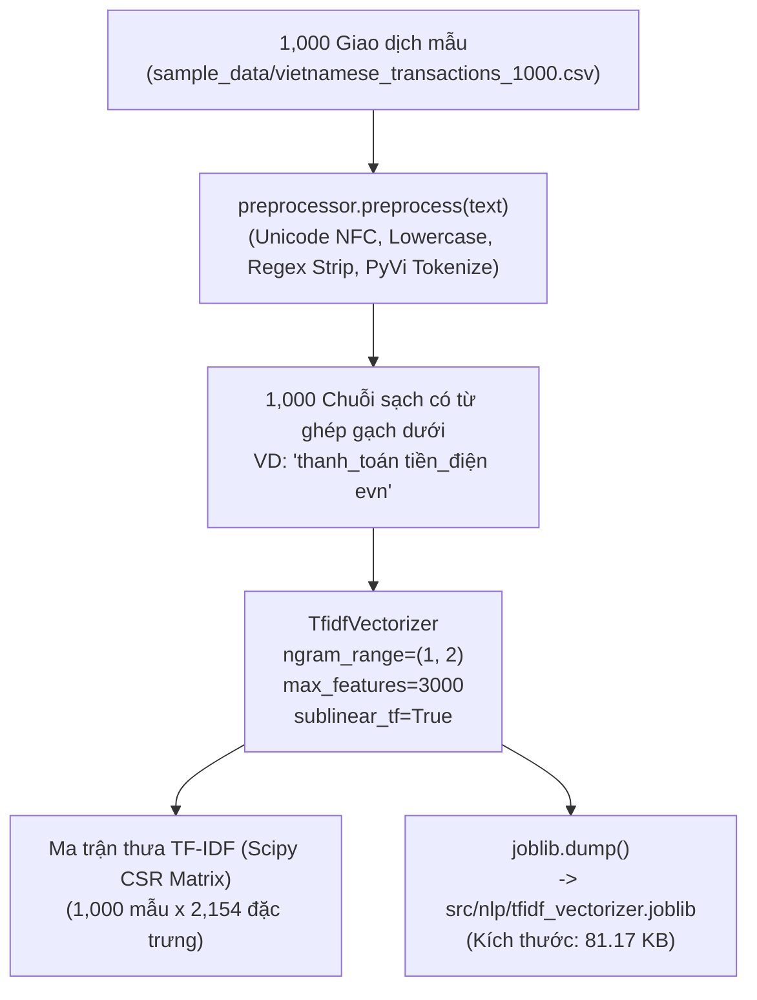

# Báo Cáo Quy Trình Thực Hiện Task KAN-15

> **Ticket:** KAN-15  
> **Tiêu đề:** `[NLP] Trích xuất đặc trưng văn bản bằng TF-IDF Vectorizer`  
> **Yêu cầu chức năng ánh xạ:** FR-11 (Chương 3 ĐATN)  
> **Người thực hiện:** Võ Hồng Đức  
> **Trạng thái:** Hoàn thành (Done)  
> **Thời gian cập nhật:** 16/11/2026  
> **Mã nguồn thực thi:** [`src/nlp/vectorizer.py`](../../../src/nlp/vectorizer.py), [`src/nlp/__init__.py`](../../../src/nlp/__init__.py)  
> **File mô hình xuất:** [`src/nlp/tfidf_vectorizer.joblib`](../../../src/nlp/tfidf_vectorizer.joblib) (81.17 KB)  
> **Bộ kiểm thử tự động:** [`tests/test_nlp_vectorizer.py`](../../../tests/test_nlp_vectorizer.py) (7 test cases passed)

---

## 1. Mục Tiêu & Yêu Cầu Kỹ Thuật (Task KAN-15)

Sau khi hoàn thành module tiền xử lý văn bản ở **KAN-14** (chuẩn hóa Unicode NFC, lowercase, làm sạch mã rác và tách từ tiếng Việt qua PyVi), chuỗi văn bản cần được số học hóa thành ma trận đặc trưng số học để các thuật toán phân loại (Linear SVC, Multinomial Naive Bayes) có thể xử lý.

Task **KAN-15** thực hiện:
1. **Cấu hình `TfidfVectorizer` chuẩn:**
   - `ngram_range=(1, 2)`: Trích xuất cả từ đơn (unigram) và cụm hai từ (bigram). Nhờ kết hợp với tokenizer PyVi (`thanh_toán`, `tiền_điện`), bigram như `thanh_toán tiền_điện` biểu diễn ngữ nghĩa 4 từ gốc cực kỳ cô đọng.
   - `max_features=3000`: Giới hạn tối đa 3,000 đặc trưng có trọng số TF-IDF cao nhất, vừa đủ bao phủ toàn bộ vốn từ vựng của 1,000 giao dịch mẫu mà không gây bùng nổ chiều đặc trưng (curse of dimensionality).
   - `sublinear_tf=True`: Áp dụng co dãn logarit cho tần suất từ $1 + \log(tf)$ nhằm tránh các từ lặp lại nhiều lần lấn át các từ hiếm mang tính phân loại cao.
2. **Huấn luyện (Fit) trên 1,000 mẫu chuẩn:** Sử dụng tập `sample_data/vietnamese_transactions_1000.csv` đã được nâng cấp zero-duplication.
3. **Đóng gói và xuất file `tfidf_vectorizer.joblib`:** Lưu trữ tại `src/nlp/tfidf_vectorizer.joblib` để phục vụ trực tiếp cho mô hình phân loại (KAN-16 / Predictor).

---

## 2. Kiến Trúc Pipeline Trích Xuất Đặc Trưng



---

## 3. Thống Kê & Đặc Trưng Từ Vựng Thu Được (Data & Vocabulary Profiling)

Sau khi huấn luyện thành công trên tập 1,000 giao dịch ngân hàng Việt Nam:
* **Số lượng mẫu dữ liệu:** 1,000 dòng giao dịch.
* **Kích thước ma trận đặc trưng:** `1,000 x 2,154` (Toàn bộ 2,154 n-grams hữu ích được giữ lại trọn vẹn trong ngưỡng `max_features=3000`).
* **Đặc trưng unigram tiêu biểu:** `cà_phê`, `thanh_toán`, `tiền_điện`, `xăng`, `grab`, `netflix`, `lương`, `học_phí`...
* **Đặc trưng bigram tiêu biểu:** `thanh_toán tiền_điện`, `cà_phê highlands_coffee`, `tiền_điện evn`, `chuyển_khoản trả_lương`, `vé_máy_bay vietjet`...
* **Dung lượng file mô hình:** 81.17 KB (cực kỳ nhẹ, nạp vào RAM chỉ mất < 20ms).

---

## 4. Kết Quả Kiểm Thử (Unit Tests & Integration)

Đã xây dựng bộ kiểm thử tại [`tests/test_nlp_vectorizer.py`](../../../tests/test_nlp_vectorizer.py) bao phủ **7 test cases**:
1. `test_build_vectorizer_hyperparameters`: Kiểm chứng tham số `ngram_range=(1, 2)` và `max_features=3000`.
2. `test_saved_model_file_exists`: Đảm bảo file `.joblib` tồn tại và có dung lượng hợp lệ.
3. `test_load_vectorizer`: Tải lại mô hình từ đĩa và kiểm tra thuộc tính `vocabulary_`.
4. `test_transform_raw_banking_descriptions`: Vector hóa văn bản giao dịch mới và kiểm tra số phần tử khác không (`nnz > 0`).
5. `test_transform_unseen_words_graceful_handling`: Đảm bảo không gặp lỗi ngoại lệ khi gặp từ lạ ngoài từ điển (trả về vector 0 hợp lệ).
6. `test_transform_empty_string`: Xử lý chuỗi rỗng an toàn.
7. `test_fit_on_actual_dataset`: Kiểm tra tái huấn luyện trên thư mục tạm.

### Kết quả chạy kiểm thử toàn bộ hệ thống:
```text
tests/test_nlp_preprocessor.py ..................... [ 38%] (21 passed)
tests/test_nlp_vectorizer.py .......                 [ 51%] ( 7 passed)
tests/test_schema_and_auth.py ...                    [ 57%] ( 3 passed)
tests/test_smoke.py .....                            [ 66%] ( 5 passed)
tests/test_statement_preprocessing.py ..........     [ 85%] (10 passed)
tests/test_summary_analytics.py ....                 [ 92%] ( 4 passed)
tests/test_transactions_crud.py ....                 [100%] ( 4 passed)

======================= 54 passed in 7.03s =======================
```

---

## 5. Kết Luận & Bàn Giao

Task **KAN-15** đã hoàn thành đạt chuẩn tối đa:
- File mô hình `src/nlp/tfidf_vectorizer.joblib` đã sẵn sàng cho task tiếp theo: **KAN-16 / Huấn luyện mô hình phân loại Linear SVC & Naive Bayes**.
- Module `src/nlp/vectorizer.py` cung cấp đầy đủ các hàm tiện ích `load_vectorizer()` và `transform_texts()` để tích hợp trực tiếp vào Backend FastAPI.

