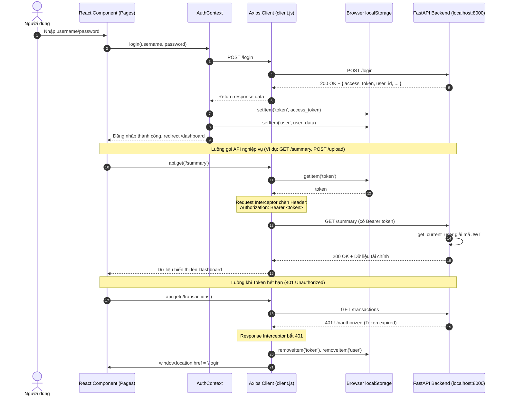

# Báo Cáo Quy Trình Thực Hiện Task KAN-25

> **Ticket:** KAN-25  
> **Tiêu đề:** `[Web] Cấu hình Axios Client kết nối Backend Local & Quản lý Session JWT`  
> **Người thực hiện:** Võ Hồng Đức  
> **Trạng thái:** Hoàn thành (Done)  
> **Thời gian cập nhật:** 01/11/2026  

---

## 1. Mục Tiêu & Yêu Cầu Nghiệp Vụ

Task **KAN-25** tập trung vào hạ tầng kết nối mạng và quản lý phiên làm việc người dùng giữa ứng dụng React Frontend và Backend FastAPI cục bộ:
1. **Cấu hình Axios Client kết nối Backend FastAPI local:**
   - Tạo một HTTP Client duy nhất sử dụng thư viện `axios` để tập trung toàn bộ cấu hình mạng của ứng dụng.
   - Trỏ `baseURL` mặc định về `http://localhost:8000`.
   - Cho phép ghi đè linh hoạt qua biến môi trường `VITE_API_BASE` khi triển khai sang các môi trường staging hoặc production.
2. **Quản lý Session JWT trong `localStorage` và tự động đính kèm `Bearer token`:**
   - Sau khi người dùng đăng nhập thành công qua `/login`, lưu `access_token` và thông tin người dùng vào `localStorage`.
   - Thiết lập **Axios Request Interceptor** để tự động đọc token từ `localStorage` và đính kèm vào header `Authorization: Bearer <token>` trên mọi request HTTP.
   - Thiết lập **Axios Response Interceptor** để tự động bắt mã lỗi `401 Unauthorized` (khi token hết hạn hoặc không hợp lệ), tự động dọn sạch `localStorage` và chuyển hướng người dùng về trang `/login`.

---

## 2. Kiến Trúc & Luồng Dữ Liệu



---

## 3. Chi Tiết Triển Khai Kỹ Thuật

### 3.1. Cấu hình Axios Client (`frontend-react/src/api/client.js`)
```javascript
import axios from 'axios';

const API_BASE = import.meta.env.VITE_API_BASE || 'http://localhost:8000';

const api = axios.create({
  baseURL: API_BASE,
  headers: { 'Content-Type': 'application/json' },
});

// Attach JWT token to every request automatically
api.interceptors.request.use((cfg) => {
  const token = localStorage.getItem('token');
  if (token) {
    cfg.headers.Authorization = `Bearer ${token}`;
  }
  return cfg;
});

// Auto-logout on 401
api.interceptors.response.use(
  (res) => res,
  (err) => {
    if (err.response?.status === 401) {
      localStorage.removeItem('token');
      localStorage.removeItem('user');
      window.location.href = '/login';
    }
    return Promise.reject(err);
  }
);

export default api;
```

### 3.2. Quản lý Session qua React Context (`frontend-react/src/context/AuthContext.jsx`)
- Khởi tạo trạng thái ban đầu trực tiếp từ `localStorage`:
  ```javascript
  const [user, setUser] = useState(() => {
    const saved = localStorage.getItem('user');
    return saved ? JSON.parse(saved) : null;
  });
  const [token, setToken] = useState(() => localStorage.getItem('token'));
  ```
- Hàm `login`: Gửi yêu cầu xác thực sang `/login`, lưu `access_token` vào `localStorage`, cập nhật state ứng dụng.
- Hàm `logout`: Xóa token và user khỏi `localStorage`, đặt lại state rỗng.
- Cung cấp hook `useAuth()` cho toàn bộ các component con truy xuất trạng thái người dùng dễ dàng.

### 3.3. Tương thích Backend FastAPI & CORS
- Backend [src/app.py](file:///e:/Work/Developer/University's%20Studies/DATN/budgetbot-aws/src/app.py) đã kích hoạt middleware CORS cho phép web frontend giao tiếp tự do:
  ```python
  app.add_middleware(
      CORSMiddleware,
      allow_origins=["*"],
      allow_credentials=False,
      allow_methods=["*"],
      allow_headers=["*"],
  )
  ```
- Hàm phụ thuộc [src/auth.py - `get_current_user`](file:///e:/Work/Developer/University's%20Studies/DATN/budgetbot-aws/src/auth.py#L143-L161) bóc tách chính xác `Authorization: Bearer <token>` từ Axios client và giải mã JWT claim `sub`.

### 3.4. Bổ sung tệp mẫu môi trường (`frontend-react/.env.example`)
Tạo tệp hướng dẫn thiết lập biến môi trường chuẩn:
```env
# BudgetBot Frontend Environment Configuration
# Backend FastAPI base URL (default: http://localhost:8000)
VITE_API_BASE=http://localhost:8000
```

---

## 4. Kiểm Thử & Nghiệm Thu

1. **Biên dịch Frontend:**
   Chạy `npm run build` trên thư mục `frontend-react`:
   ```bash
   > vite build
   vite v8.0.14 building client environment for production...
   transforming...✓ 903 modules transformed.
   rendering chunks...
   ✓ built in 680ms
   ```
   Kết quả biên dịch sạch sẽ, không có lỗi runtime hay thiếu sót thư viện.

2. **Kiểm tra tích hợp API:**
   Tất cả các trang gồm `Overview.jsx`, `Transactions.jsx`, `Chat.jsx`, `Coach.jsx`, `Limits.jsx`, và `ReviewModal.jsx` đều đã sử dụng `apiClient` từ `src/api/client.js`, đảm bảo mọi request phát sinh từ người dùng đều tự động gắn Bearer Token.

---

## 5. Trạng Thái Jira Ticket

- **Ticket ID:** `KAN-25`
- **Trạng thái chuyển đổi:** Chuyển từ `To Do` sang `Done` (Transition ID: 51).
- **Comment cập nhật:** Đã gửi báo cáo kỹ thuật chi tiết lên Jira KAN-25.

