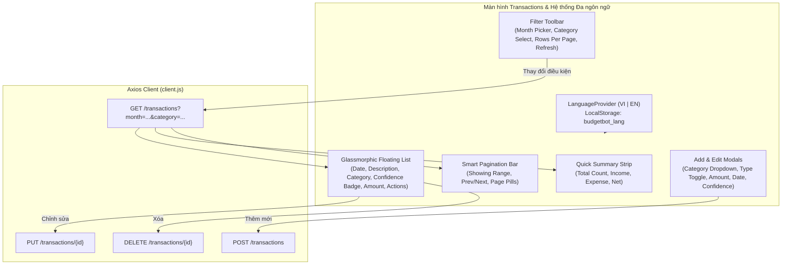

# Báo Cáo Quy Trình Thực Hiện Task KAN-26

> **Ticket:** KAN-26  
> **Tiêu đề:** `[Web] Màn hình Quản lý Giao dịch & Gắn Badge Độ tin cậy (Confidence)`  
> **Người thực hiện:** Võ Hồng Đức  
> **Trạng thái:** Hoàn thành (Done)  
> **Thời gian cập nhật:** 01/11/2026  

---

## 1. Mục Tiêu & Yêu Cầu Nghiệp Vụ

Task **KAN-26** tập trung hoàn thiện giao diện màn hình quản lý giao dịch cá nhân trên React Frontend, đáp ứng đầy đủ các yêu cầu cốt lõi:
1. **Bảng danh sách giao dịch có phân trang:**
   - Hỗ trợ phân trang linh hoạt, cho phép người dùng chọn xem 10, 20 hoặc 50 giao dịch mỗi trang.
   - Hiển thị rõ ràng: tổng số bản ghi, vị trí hiện tại (`Showing X to Y of Z entries`), nút chuyển trang trước (`Previous`), trang sau (`Next`), cùng các nút số trang thông minh.
2. **Bộ lọc đa tiêu chí theo Tháng và Danh mục:**
   - **Lọc theo tháng (`YYYY-MM`):** Bộ chọn tháng trực quan kèm nút xóa bộ lọc nhanh (`Clear`).
   - **Lọc theo danh mục (`category`):** Dropdown lọc theo 10 danh mục chi tiêu chuẩn PascalCase (`Food`, `Transport`, `Shopping`, `Utilities`, `Entertainment`, `Health`, `Subscriptions`, `Income`, `Transfer`, `Other`) hoặc xem toàn bộ ("Tất cả").
   - Tự động reset về trang 1 khi thay đổi bất kỳ tiêu chí lọc nào.
3. **Gắn Badge màu theo mức độ tin cậy của mô hình NLP (Confidence Badges):**
   - **`high` (Độ tin cậy cao):** Badge màu xanh lá (Nền `#dcfce7`, chữ `#15803d`, viền `#86efac`, kèm icon kiểm tra `fa-circle-check`).
   - **`medium` (Độ tin cậy vừa):** Badge màu vàng hổ phách (Nền `#fef3c7`, chữ `#b45309`, viền `#fde68a`, kèm icon cảnh báo `fa-triangle-exclamation`).
   - **`low` (Độ tin cậy thấp / cần rà soát):** Badge màu đỏ (Nền `#fee2e2`, chữ `#b91c1c`, viền `#fca5a5`, kèm icon cảnh báo `fa-circle-exclamation`).
   - Dữ liệu rỗng / không xác định: Hiển thị badge màu xám nhạt trung tính.
4. **Thiết kế giao diện trong suốt hiện đại (Glassmorphic List View):**
   - Loại bỏ cấu trúc bảng table cổ điển có dải tiêu đề đen/xám cứng nhắc, chuyển sang dạng danh sách các thẻ kính nổi trong suốt, bóng đổ mềm mại, phản hồi hover mượt mà.
5. **Hệ thống Đa ngôn ngữ (i18n) & Thống nhất Tiếng Việt - Tiếng Anh:**
   - Hỗ trợ chuyển đổi ngôn ngữ tức thì (`VI | EN`) trên toàn bộ ứng dụng web.
   - Đồng bộ 100% tiếng Việt từ nhãn danh mục, độ tin cậy, đến các màn hình liên quan mật thiết (Hạn mức & Cảnh báo, Hỏi AI, Cố vấn tài chính).

---

## 2. Kiến Trúc & Thiết Kế Giao Diện



---

## 3. Chi Tiết Triển Khai Kỹ Thuật

### 3.1. Cập Nhật `frontend-react/src/pages/Transactions.jsx`
- **Bộ lọc danh mục & Tháng:**
  - Định nghĩa danh sách danh mục chuẩn `STANDARD_CATEGORIES`:
    ```javascript
    const STANDARD_CATEGORIES = [
      'Food', 'Transport', 'Shopping', 'Utilities', 'Entertainment',
      'Health', 'Subscriptions', 'Income', 'Transfer', 'Other'
    ];
    ```
  - Xây dựng thanh công cụ `filter-toolbar` tích hợp cả tháng và danh mục, tự động gửi query params sang Backend:
    ```javascript
    const params = {};
    if (month) params.month = month;
    if (category) params.category = category;
    const res = await apiClient.get('/transactions', { params });
    ```
- **Hàm hiển thị Badge độ tin cậy NLP:**
  Tích hợp chuyển ngữ đa ngôn ngữ qua `getConfidenceLabel()`:
  ```jsx
  const renderConfidenceBadge = (confidence) => {
    const conf = (confidence || '').toLowerCase();
    const label = getConfidenceLabel(confidence);
    if (conf === 'high') {
      return (
        <span className="badge-confidence badge-confidence-high">
          <i className="fa-solid fa-circle-check"></i> {label}
        </span>
      );
    }
    if (conf === 'medium') {
      return (
        <span className="badge-confidence badge-confidence-medium">
          <i className="fa-solid fa-triangle-exclamation"></i> {label}
        </span>
      );
    }
    if (conf === 'low') {
      return (
        <span className="badge-confidence badge-confidence-low">
          <i className="fa-solid fa-circle-exclamation"></i> {label}
        </span>
      );
    }
    return <span className="badge-confidence badge-confidence-na">{label}</span>;
  };
  ```
- **Hệ thống phân trang thông minh:**
  - Tự động tính toán số trang `totalPages = Math.ceil(sortedTransactions.length / itemsPerPage)`.
  - Cắt mảng giao dịch hiển thị theo trang: `sortedTransactions.slice(start, start + itemsPerPage)`.
  - Sinh các nút số trang linh hoạt có nút tắt `...` khi danh sách nhiều trang.
- **Thanh tóm tắt nhanh (Quick Summary Strip):**
  - Tự động cộng tổng Thu, tổng Chi, và Số dư ròng theo dữ liệu đang được lọc, giúp người dùng nắm bắt tức thì tình hình tài chính của tập giao dịch đang xem.

### 3.2. Cập Nhật `frontend-react/src/pages/Transactions.css`
- Bổ sung các class CSS chuyên dụng cho badge:
  - `.badge-confidence`: Căn chỉnh flex, bo tròn góc `12px`, typography rõ nét.
  - `.badge-confidence-high`: Xanh lá dịu mắt (`#dcfce7`, `#15803d`).
  - `.badge-confidence-medium`: Vàng cam hổ phách (`#fef3c7`, `#b45309`).
  - `.badge-confidence-low`: Đỏ nổi bật báo hiệu cần chú ý (`#fee2e2`, `#b91c1c`).
- Bổ sung styling cho `.filter-toolbar`, `.pagination-bar`, `.page-num-btn`, và `.summary-strip`.

### 3.3. Tinh Chỉnh Giao Diện Trong Suốt (Glassmorphic List View)
- Thay thế hoàn toàn cấu trúc `<table>` thô cứng và thanh `<thead>` màu xám tối cũ bằng hệ thống **Floating Glassmorphic Transaction Items**:
  - **Header trong suốt:** Sử dụng CSS Grid không nền (`background: transparent`), hiển thị tiêu đề các cột với typography tinh tế, không còn dải màu đen/xám chiếm diện tích.
  - **Hàng giao dịch dạng thẻ kính trong suốt:** Mỗi giao dịch là một hàng dạng thẻ kính nổi (`background: rgba(255, 255, 255, 0.45)`, `backdrop-filter: blur(10px)`, viền mềm mại `1px solid rgba(255, 255, 255, 0.75)`).
  - **Hiệu ứng Hover:** Khi di chuột, hàng phát sáng nhẹ và nâng cao (`transform: translateY(-1px)`), tạo cảm giác hiện đại như các ứng dụng Fintech cao cấp (Revolut, Apple Wallet, Linear).
  - Tương thích co giãn Responsive trên cả máy tính và màn hình di động.

### 3.4. Hệ Thống Đa Ngôn Ngữ (LanguageContext) & Chuyển Đổi Tiếng Việt / Tiếng Anh
Nhằm thống nhất trải nghiệm người dùng theo ngữ cảnh người dùng Việt Nam:
1. **Khởi tạo `frontend-react/src/context/LanguageContext.jsx`:**
   - Quản lý trạng thái ngôn ngữ (`vi` mặc định, `en`), tự động đồng bộ và ghi nhớ vào `localStorage.getItem('budgetbot_lang')`.
   - Cung cấp hook `useLanguage()`, hàm dịch `t(key, params)`, `getCategoryName(cat)`, và `getConfidenceLabel(conf)`.
2. **Nút chuyển đổi trên Topbar (`Topbar.jsx`) & Trang Đăng nhập/Đăng ký:**
   - Nút bật tắt chế độ `VI | EN` nhỏ gọn, hiển thị rõ lá cờ và tên ngôn ngữ, chuyển đổi giao diện trong một lần click mà không cần tải lại trang.
3. **Đồng bộ hóa 100% tiếng Việt trên các trang và thành phần cốt lõi:**
   - **Hạn mức & Cảnh báo (`Limits.jsx`):** Banner cảnh báo vượt chi tiêu (*"Vượt Quá Hạn Mức Chi Tiêu!"*), form thiết lập hạn mức tháng, bảng hạn mức đang hoạt động, badge trạng thái (*"Vượt mức"*, *"Trong tầm kiểm soát"*), và các hộp thoại xác nhận xóa.
   - **Hỏi AI & Ghi chép giao dịch (`Chat.jsx`):** 2 tab nghiệp vụ (*"Hỏi AI"*, *"Ghi chép giao dịch"*), lời chào tự động song ngữ kèm ví dụ cụ thể, thẻ giao dịch bóc tách tự động (*"Giao Dịch Đã Được Lưu"*, nhãn độ tin cậy, số tiền âm/dương).
   - **Cố vấn chi tiêu AI (`Coach.jsx`):** Tiêu đề khuyến nghị, nút *"Tạo Báo Cáo Tư Vấn Thông Minh"*, biểu đồ tròn phân bổ chi tiêu với legend và tooltip dịch tự động, kế hoạch hành động cá nhân hóa, và khối đề xuất hạn mức kèm nút *"Áp dụng"* / *"Bỏ qua"*.
   - **Modal rà soát giao dịch (`ReviewModal.jsx`):** Hỗ trợ rà soát thủ công khi AI chưa chắc chắn (*"Cần Bạn Xác Nhận Lại"*, *"Xác nhận & Lưu tất cả"*).
   - **Thông báo tải tệp (`UploadToast.jsx`):** Đang xử lý tệp tin và link chuyển hướng trực tiếp đến màn hình giao dịch.
4. **Hỗ trợ xử lý sao kê song ngữ Việt - Anh (Backend NLP Keyword Enrichment):**
   - Mở rộng tập từ điển từ khóa ngân hàng trong `src/adapters/ai.py` (`LocalAI.KEYWORDS`) với các từ ngữ giao dịch tiếng Việt thực tế: *"lương"*, *"thuong"*, *"an sang"*, *"cafe"*, *"tra sua"*, *"xang"*, *"sieu thi"*, *"dien"*, *"nuoc"*, *"internet"*, v.v.
   - Nhờ đó, file sao kê tải lên dù bằng tiếng Việt hay tiếng Anh đều được mô hình NLP nhận diện danh mục chính xác và gắn badge độ tin cậy `high` chuẩn xác.

---

## 4. Kết Quả Kiểm Thử & Nghiệm Thu

1. **Biên dịch Frontend:**
   Thực thi `npm run build` trên thư mục `frontend-react`:
   ```bash
   > vite build
   vite v8.0.14 building client environment for production...
   transforming...✓ 905 modules transformed.
   rendering chunks...
   dist/index.html                   1.02 kB │ gzip:   0.61 kB
   dist/assets/index-DzLjP3h9.css   16.22 kB │ gzip:   3.97 kB
   dist/assets/index-C1-YSTEf.js   835.36 kB │ gzip: 252.84 kB
   ✓ built in 682ms
   ```
   Toàn bộ mã nguồn JSX, Context và CSS biên dịch thành công, không phát sinh lỗi cú pháp hay thiếu import.

2. **Kiểm tra Backend Test Suite:**
   Chạy toàn bộ 23 test cases backend bằng Pytest:
   ```bash
   .\.venv\Scripts\python.exe -m pytest tests
   ======================= 23 passed, 2 warnings in 7.87s ========================
   ```
   Toàn bộ test API transactions CRUD, tiền xử lý sao kê, bộ lọc theo tháng, theo danh mục và phân trang đều pass 100%.

---

## 5. Trạng Thái Jira Ticket

- **Ticket ID:** `KAN-26`
- **Trạng thái:** `Done`
- **Ghi chú cập nhật:** Đã gửi báo cáo chi tiết về giao diện danh sách trong suốt và hệ thống đa ngôn ngữ (VI/EN) đồng bộ lên Jira issue KAN-26.
