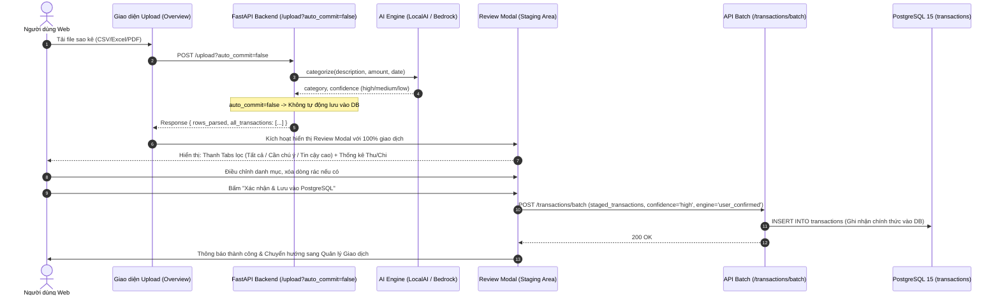

# Báo Cáo Quy Trình Thực Hiện Task KAN-27

> **Ticket:** KAN-27  
> **Tiêu đề:** `[Web] Modal Xác nhận Giao dịch Nghi ngờ & Rà soát Toàn bộ (Human-in-the-loop Full Staging Review)`  
> **Người thực hiện:** Võ Hồng Đức  
> **Trạng thái:** Hoàn thành (Done)  
> **Thời gian cập nhật:** 02/11/2026  

---

## 1. Mục Tiêu & Yêu Cầu Nghiệp Vụ

Trong quy trình xử lý sao kê tài chính cá nhân tự động của BudgetBot:
1. **Chế độ Rà Soát Toàn Bộ (Full Staging Review - Two-Phase Commit):**
   - Sau khi người dùng tải lên file sao kê ngân hàng (CSV, Excel, PDF), hệ thống sẽ **bóc tách toàn bộ 100% các dòng giao dịch** và đưa qua mô hình AI/NLP để tiền phân loại và gán badge độ tin cậy.
   - Thay vì âm thầm lưu ngay vào cơ sở dữ liệu, toàn bộ danh sách giao dịch được đưa vào **vùng đệm rà soát (Staging Area)** trong Review Modal để người dùng có toàn quyền kiểm tra, chỉnh sửa hoặc loại bỏ dòng rác trước khi dữ liệu được ghi vào PostgreSQL.
2. **Trực quan hóa độ tin cậy của AI (Confidence Badges):**
   - **`high` (Xanh lá - Chắc chắn):** AI nhận diện chính xác qua ngữ cảnh hoặc từ khóa rõ ràng (Lương, Highlands, Shopee, EVN,...).
   - **`medium` (Vàng hổ phách - Phân vân):** AI nhận diện được ngữ cảnh nhưng còn tiềm ẩn đa nghĩa.
   - **`low` (Đỏ - Cần chú ý):** Các mã giao dịch ngân hàng viết tắt (`FT24...`, `TRX...`), chuỗi hash mờ đục hoặc không có từ khóa nhận dạng.
3. **Bộ lọc Tab thông minh trên Review Modal:**
   - **Tab "Tất cả" (All):** Xem toàn bộ danh sách giao dịch từ sao kê.
   - **Tab "Cần chú ý" (Needs Attention):** Lọc nhanh các giao dịch có độ tin cậy `low` và `medium` để người dùng rà soát nhanh.
   - **Tab "Độ tin cậy cao" (High Confidence):** Danh sách các giao dịch AI đã tự tin phân loại.
4. **Thanh thống kê tài chính dự kiến (Estimated Financial Strip):**
   - Tính toán nhanh: Tổng thu dự kiến (`+`), Tổng chi dự kiến (`-`) và Số dư ròng của tập giao dịch trong sao kê.
5. **Dropdown 10 danh mục chuẩn & Tự động đổi dấu:**
   - Cho phép người dùng chọn lại 1 trong 10 danh mục PascalCase (`Food`, `Transport`, `Shopping`, `Utilities`, `Entertainment`, `Health`, `Subscriptions`, `Income`, `Transfer`, `Other`).
   - Tự động chuẩn hóa dấu: Chọn `Income` $\rightarrow$ số tiền dương (`+`), chọn các danh mục chi tiêu $\rightarrow$ số tiền âm (`-`).
6. **Lưu hàng loạt vào PostgreSQL:**
   - Khi bấm **"Xác nhận & Lưu vào PostgreSQL"**, dữ liệu được gửi qua endpoint `POST /transactions/batch`, tự động chuẩn hóa trạng thái thành `confidence: 'high'` (human-verified) và nguồn gốc `engine: 'user_confirmed'`.

---

## 2. Bản Chất Độ Tin Cậy (Confidence) & Giá Trị Đối Với NLP & RAG

### 2.1. Độ Tin Cậy (Confidence) Là Gì?
Độ tin cậy là thước đo mức độ chắc chắn của mô hình AI khi gán nhãn một giao dịch. Việc hiển thị độ tin cậy cho 100% giao dịch giúp người dùng:
- Hiểu được AI tự tin đến đâu ở từng dòng giao dịch.
- Nhận biết ngay những giao dịch cần sự can thiệp của con người.

### 2.2. Lợi Ích Cốt Lõi Cho Module NLP & RAG Tương Lai
- **Đối với NLP (Active Learning & Ground Truth):**
  - Mọi thao tác xác nhận hoặc điều chỉnh danh mục của người dùng đều tạo ra nhãn chuẩn (`engine: 'user_confirmed'`).
  - Dữ liệu này là "mỏ vàng" để sau này Fine-tune mô hình học máy (PhoBERT / LinearSVC) hoặc Few-shot Prompting cho LLM.
- **Đối với RAG (Knowledge Base Sạch 100%):**
  - RAG truy vấn dữ liệu từ PostgreSQL để trả lời câu hỏi và tư vấn tài chính.
  - Nhờ khâu rà soát toàn diện trước khi lưu, cơ sở dữ liệu hoàn toàn sạch, không có giao dịch rác hay nhầm lẫn số tiền. Từ đó RAG tổng hợp số liệu chính xác tuyệt đối, triệt tiêu nguy cơ AI sinh ảo giác (hallucination).

---

## 3. Kiến Trúc Quy Trình Staging Review



---

## 4. Chi Tiết Triển Khai Kỹ Thuật

### 4.1. Cập Nhật Backend:
- **`src/app.py`:**
  - Endpoint `POST /upload` bổ sung tham số `auto_commit: bool = True`.
  - Mặc định `True` cho các test case và client cũ; khi Frontend gọi với `auto_commit=false`, Backend không ghi DB mà chỉ trả về danh sách đã phân loại.
- **`src/handlers.py` & `src/processor.py`:**
  - Bổ sung `all_transactions = []` thu thập toàn bộ các giao dịch đã bóc tách và phân loại.
  - Khi `auto_commit=False`: không gọi `userstore.add_transaction`, trả về `all_transactions` và `rows_inserted: 0`.
  - Endpoint `handle_upload_status` trả về `all_transactions` đầy đủ cho cả luồng xử lý bất đồng bộ.

### 4.2. Cập Nhật Frontend:
- **`frontend-react/src/context/UploadContext.jsx`:**
  - Gửi request `POST /upload?auto_commit=false`.
  - Nạp toàn bộ `all_transactions` vào `reviewTransactions`.
- **`frontend-react/src/components/ReviewModal.jsx`:**
  - Tích hợp **Filter Tabs**: `Tất cả ({total})`, `Cần chú ý ({attentionCount})`, `Độ tin cậy cao ({highCount})`.
  - Tích hợp **Quick Summary Strip**: Tổng thu dự kiến (`+`), Tổng chi dự kiến (`-`), Số dư ròng.
  - Danh sách giao dịch hiển thị trực quan: Tên & Ngày, Số tiền phân màu, Badge độ tin cậy, Dropdown 10 danh mục PascalCase, Nút xóa từng dòng.
- **`frontend-react/src/components/ReviewModal.css`:**
  - Bổ sung CSS cho Filter Tabs (`.review-filter-tabs`, `.review-tab-btn`, `.tab-count-badge`), Financial Strip (`.review-summary-strip`), và giao diện thẻ kính Glassmorphic cao cấp.
- **`frontend-react/src/context/LanguageContext.jsx`:**
  - Hỗ trợ song ngữ đầy đủ cho các tab lọc, thông điệp hướng dẫn và nút xác nhận lưu vào PostgreSQL.

---

## 5. Kết Quả Kiểm Thử & Xác Minh

### 5.1. Backend Tests (Pytest)
Bổ sung test case tích hợp `test_upload_staging_review_with_auto_commit_false` trong `tests/test_statement_preprocessing.py`:
- Kiểm tra upload file sao kê với `auto_commit=false`:
  - `rows_parsed == 3`, `rows_inserted == 0` (chưa lưu vào DB).
  - `all_transactions` chứa đầy đủ 3 giao dịch.
  - Xác minh database lúc này hoàn toàn trống.
- Mô phỏng người dùng rà soát, đổi danh mục và gọi `POST /transactions/batch`:
  - `batch_resp.json()["count"] == 3`.
  - Xác minh database lúc này đã có đầy đủ 3 giao dịch được lưu với danh mục chuẩn.

```bash
.\.venv\Scripts\python.exe -m pytest tests
======================= 25 passed, 2 warnings in 6.25s ========================
```
**Kết quả:** Toàn bộ **25/25 tests** backend đạt Pass 100%.

### 5.2. Biên Dịch Frontend (Vite)
```bash
cd frontend-react
npm run build
✓ built in 509ms
```
Giao diện React JSX và CSS mới biên dịch thành công, không có cảnh báo hay lỗi cú pháp.

---

## 6. Trạng Thái Jira Ticket

- **Ticket ID:** `KAN-27`
- **Tiêu đề:** `[Web] Modal Xác nhận Giao dịch Nghi ngờ & Rà soát Toàn bộ (Human-in-the-loop Full Staging Review)`
- **Trạng thái:** `Done`
- **Bàn giao:** Toàn bộ tính năng Full Staging Review đã được hoàn thành, kiểm thử end-to-end và lưu trữ tài liệu quy trình đầy đủ.
