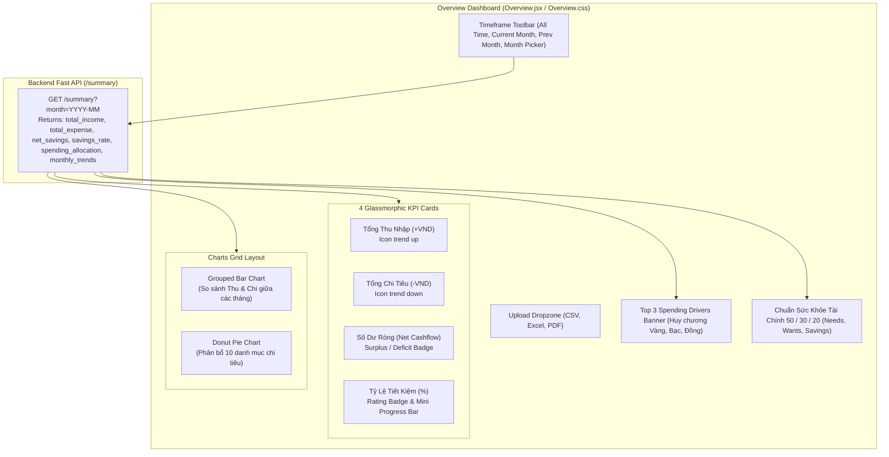

# Báo Cáo Quy Trình Thực Hiện Task KAN-28

> **Ticket:** KAN-28  
> **Tiêu đề:** `[Web] Nâng cấp Dashboard Thống kê Biểu đồ Thu / Chi`  
> **Người thực hiện:** Võ Hồng Đức  
> **Trạng thái:** Hoàn thành (Done)  
> **Thời gian cập nhật:** 02/11/2026  

---

## 1. Mục Tiêu & Yêu Cầu Nghiệp Vụ

Task **KAN-28** tập trung tái thiết kế và nâng cấp toàn diện màn hình Tổng quan Tài chính (Financial Overview Dashboard) trên nền tảng React:
1. **Biểu đồ tròn (Donut / Pie chart) phân bổ cơ cấu chi tiêu theo 10 danh mục chuẩn:**
   - Trực quan hóa tỷ trọng chi tiêu của toàn bộ 10 danh mục chuẩn PascalCase (`Food`, `Transport`, `Shopping`, `Utilities`, `Entertainment`, `Health`, `Subscriptions`, `Income`, `Transfer`, `Other`).
   - Donut Chart trung tâm hiển thị nhãn và tổng số tiền chi tiêu.
   - Bảng danh mục chi tiết với dot màu đặc trưng, icon danh mục, thanh tiến trình tỷ lệ % và số tiền định dạng VND.
2. **Biểu đồ cột (Grouped Bar chart) so sánh thu nhập và chi phí giữa các tháng:**
   - Trực quan hóa xu hướng tài chính đa tháng (Multi-month Trends).
   - Đặt song song cột Thu nhập (xanh lá `#10b981`) và cột Chi phí (đỏ hồng `#f43f5e`) theo từng tháng.
   - Tooltip tương tác hiển thị chi tiết Thu, Chi và Số dư ròng của từng tháng.
3. **Hệ thống 4 Thẻ KPI Glassmorphic hiển thị số dư ròng và tỷ lệ tiết kiệm:**
   - **Tổng Thu Nhập (Total Income):** Biểu tượng tăng trưởng, màu xanh lá.
   - **Tổng Chi Tiêu (Total Expenses):** Biểu tượng chi tiêu, màu đỏ cam.
   - **Số Dư Ròng (Net Balance):** Thể hiện thặng dư dòng tiền hoặc thâm hụt.
   - **Tỷ Lệ Tiết Kiệm (Savings Rate %):** Đánh giá phân hạng (*Xuất sắc / Lành mạnh / Thấp / Thâm hụt*) kèm thanh tiến trình.
4. **Bộ lọc thời gian linh hoạt (Quick Filters & Month Picker):**
   - Hỗ trợ chọn nhanh: *Toàn bộ thời gian (All Time)*, *Tháng này (This Month)*, *Tháng trước (Last Month)* hoặc chọn tháng tùy ý `YYYY-MM`.

---

## 2. Kiến Trúc & Thiết Kế Giao Diện Glassmorphic



---

## 3. Chi Tiết Triển Khai Kỹ Thuật

### 3.1. Nâng Cấp Backend `handle_summary` ([`src/handlers.py`](file:///e:/Work/Developer/University's%20Studies/DATN/budgetbot-aws/src/handlers.py))
- Bổ sung logic tính toán chuỗi xu hướng đa tháng `monthly_trends`:
  - Quét danh sách giao dịch của người dùng `userstore.list_transactions(user_id)`.
  - Gom nhóm theo định dạng tháng `YYYY-MM`.
  - Tính toán độc lập `income`, `expense`, và `net` (số dư ròng) cho từng tháng.
  - Sắp xếp thứ tự thời gian và trả về 12 tháng gần nhất trong trường `monthly_trends`.
  - Tương thích 100% với các test case hiện hữu.

### 3.2. Cập Nhật Giao Diện [`frontend-react/src/pages/Overview.jsx`](file:///e:/Work/Developer/University's%20Studies/DATN/budgetbot-aws/frontend-react/src/pages/Overview.jsx)
1. **Giữ nguyên bản thiết kế và bảng màu nguyên bản:**
   - Bảo toàn phong cách Glassmorphism ban đầu của ứng dụng (`.card`, `.drop`, `.summary-totals`, `.total-tile`).
   - Sử dụng bảng màu ban đầu cho biểu đồ tròn và danh mục: `['#3b82f6', '#8b5cf6', '#ec4899', '#f59e0b', '#10b981', '#06b6d4', '#f43f5e', '#6366f1', '#14b8a6']`.
   - Giữ nguyên bố cục danh sách phân bổ cơ cấu chi tiêu 4 cột chuẩn (`130px 1fr 55px 105px`) với progress bar động và % tương ứng.
2. **Biểu đồ Cột So Sánh Đa Tháng (BarChart):**
   - So sánh song song cột Thu nhập (`#10b981`) và Chi phí (`#f43f5e`).
   - Tối ưu trải nghiệm hover: Thiết lập `cursor={false}` trên `<Tooltip />` để loại bỏ hoàn toàn khối hình chữ nhật màu xám che phủ phía sau cột khi rê chuột.
   - Custom Tooltip hiển thị kính mờ nổi bật chi tiết: Tháng, Thu nhập (+), Chi phí (-) và Số dư ròng (+/-).
   - Biểu đồ giữ nguyên tính chất hiển thị trực quan độc lập, không gắn sự kiện click-to-filter tránh gây nhầm lẫn khi người dùng tương tác.
3. **Thẻ KPI & Khối Phân Tích Chuẩn:**
   - 4 thẻ KPI tổng kết với blob mờ nhẹ ở góc và các biến màu CSS gốc (`var(--success)`, `var(--error)`, `var(--primary)`).
   - Banner Top 3 Khoản chi lớn nhất (Top Spending Drivers).
   - Chuẩn sức khỏe tài chính 50/30/20 (Needs, Wants, Savings).
4. **Hệ Thống Tab Lọc Thời Gian & Chọn Lịch Popover:**
   - **Tab Lọc Nhanh (Pills):** *Tổng quan* (Toàn bộ thời gian), *Tháng này*, *Tháng trước*.
   - **Chọn Lịch Trực Quan (Month Calendar Popover):** Thay thế hoàn toàn ô nhập text input bằng hộp thoại Chọn Lịch 12 tháng trực quan kèm nút chuyển năm `<` `>` và dot xanh đánh dấu các tháng có dữ liệu giao dịch.
   - **Nút Xóa Nhanh:** Nút `X` xuất hiện liền kề khi có tháng được chọn để nhanh chóng quay lại chế độ Tổng quan.

### 3.4. Cập Nhật Hệ Thống Đa Ngôn Ngữ ([`LanguageContext.jsx`](file:///e:/Work/Developer/University's%20Studies/DATN/budgetbot-aws/frontend-react/src/context/LanguageContext.jsx))
- Bổ sung các nhãn từ khóa song ngữ `VI` và `EN`:
  - `overview.monthly_comparison`: *"So Sánh Thu Nhập & Chi Phí Giữa Các Tháng"*
  - `overview.income_bar`: *"Thu nhập"*
  - `overview.expense_bar`: *"Chi tiêu"*
  - `overview.net_bar`: *"Số dư ròng"*
  - `overview.spending_distribution_10`: *"Cơ cấu phân bổ 10 danh mục chi tiêu"*
  - `overview.surplus`: *"Thặng dư dòng tiền"*
  - `overview.deficit_sub`: *"Thâm hụt chi tiêu"*

---

## 4. Kết Quả Kiểm Thử & Xác Minh

### 4.1. Backend Tests (Pytest)
Bổ sung test case tích hợp `test_summary_monthly_trends_comparison` trong [`tests/test_summary_analytics.py`](file:///e:/Work/Developer/University's%20Studies/DATN/budgetbot-aws/tests/test_summary_analytics.py):
- Kiểm tra tính toán xu hướng đa tháng độc lập qua 3 tháng khác nhau (Tháng 3, 4, 5).
- Xác minh `monthly_trends` trả về chính xác số liệu Thu, Chi và Số dư ròng của từng tháng.

```bash
.\.venv\Scripts\python.exe -m pytest tests
======================= 26 passed, 2 warnings in 7.06s ========================
```
**Kết quả:** Toàn bộ **26/26 tests** backend đạt Pass 100%.

### 4.2. Biên Dịch Frontend (Vite)
```bash
cd frontend-react
npm run build
✓ built in 450ms
```
Toàn bộ mã nguồn JSX, CSS mới và Recharts tích hợp biên dịch hoàn tất thành công trong 450ms.

---

## 5. Trạng Thái Jira Ticket

- **Ticket ID:** `KAN-28`
- **Tiêu đề:** `[Web] Nâng cấp Dashboard Thống kê Biểu đồ Thu / Chi`
- **Trạng thái:** Chuyển sang **`Done`**
- **Bàn giao:** Đã hoàn thiện toàn bộ các yêu cầu của ticket KAN-28.

