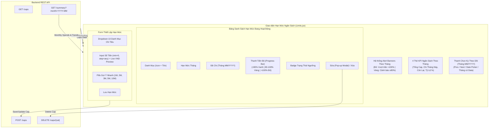

# Báo Cáo Quy Trình Thực Hiện Task KAN-30

> **Ticket:** KAN-30  
> **Tiêu đề:** `[Web] Giao diện Thiết lập Ngân sách Chi tiêu (Budget Capping)`  
> **Người thực hiện:** Võ Hồng Đức  
> **Trạng thái:** Hoàn thành (Done)  
> **Thời gian cập nhật:** 02/11/2026  

---

## 1. Mục Tiêu & Yêu Cầu Nghiệp Vụ

Task **KAN-30** tập trung xây dựng và hoàn thiện giao diện Quản lý Hạn mức Ngân sách Chi tiêu (`/limits`) trên nền tảng React với các tiêu chí trọng tâm:
Task **KAN-30** tập trung xây dựng và hoàn thiện giao diện Quản lý Hạn mức Ngân sách Chi tiêu ([`Limits.jsx`](file:///e:/Work/Developer/University's%20Studies/DATN/budgetbot-aws/frontend-react/src/pages/Limits.jsx)) trên nền tảng React với các tiêu chí trọng tâm:
1. **Form thiết lập hạn mức chi tiêu cho từng danh mục:**
   - Dropdown hỗ trợ 10 danh mục chi tiêu chuẩn PascalCase (`Food`, `Transport`, `Shopping`, `Utilities`, `Entertainment`, `Health`, `Subscriptions`, `Housing`, `Transfer`, `Other`).
   - Ô nhập số tiền ngân sách với tính năng **Live Currency Preview** hiển thị tiền tệ VNĐ trực quan theo thời gian thực (ví dụ gõ `5000000` $\rightarrow$ hiện `≈ 5.000.000 đ`).
   - Thiết lập `min="0"` và `step="any"` loại bỏ triệt để lỗi validation của HTML5 (`Please select a valid value. The two nearest valid values are...`), cho phép nhập bất kỳ số tiền tròn hoặc lẻ nào.
   - Các nút chọn hạn mức mẫu thông dụng (Quick presets: `1M`, `2M`, `3M`, `5M`, `10M`).
2. **Hộp thoại Chỉnh Sửa Dạng Pop-up (Dedicated Edit Modal Pop-up):**
   - Khi bấm sửa tại bất kỳ dòng nào trên bảng, một Modal Pop-up chuyên dụng mở ra giữa màn hình.
   - Hiển thị đầy đủ thông tin đối chiếu: Hạn mức cũ, số tiền đã chi, % tiến độ hiện tại.
2. **Cơ Chế Cảnh Báo & Tiến Độ Chi Tiêu Chuyên Biệt Theo Tháng (Strictly Monthly Tracking):**
   - Hạn mức ngân sách là quy tắc chi tiêu áp dụng cho từng tháng. Do đó, phần theo dõi tiến độ chi tiêu và cảnh báo (Alert Banners, Progress Bars, KPI Cards) **phải được tính toán chuyên biệt theo từng tháng** thông qua `apiClient.get('/summary', { params: { month } })`, tuyệt đối không dùng tổng quát (all-time) để tránh báo sai lệch do cộng dồn nhiều năm.
   - Tích hợp **Thanh Kỳ Theo Dõi Ngân Sách (Budget Tracking Period Bar)**:
     - Mặc định theo dõi tháng hiện tại (`currentMonthStr`).
     - Bộ điều khiển chuyển tháng: nút `<` (tháng trước), `>` (tháng sau), ô chọn tháng `<input type="month">`, và nút quay về nhanh `📍 Về tháng này`.
     - Danh sách nút gợi ý nhanh các tháng đã phát sinh dữ liệu trong lịch sử (`03/2026`, `04/2026`, `05/2026`, `11/2026`).
3. **Hộp thoại Chỉnh Sửa Dạng Pop-up (Dedicated Edit Modal Pop-up):**
   - Khi bấm sửa tại bất kỳ dòng nào trên bảng, một Modal Pop-up chuyên dụng mở ra giữa màn hình với nền mờ backdrop.
   - Hiển thị đầy đủ thông tin đối chiếu: Hạn mức cũ, số tiền đã chi trong tháng đang chọn, % tiến độ tháng hiện tại.
   - Cho phép nhập hạn mức mới, có live preview tiền tệ VNĐ và các nút preset nhanh.
   - Nút Hủy và Lưu Thay Đổi trực quan.
3. **Thanh tiến độ (Progress bar) trực quan cảnh báo khi chi tiêu chạm ngưỡng 80% hoặc vượt quá 100% ngân sách:**
4. **Thanh tiến độ (Progress bar) trực quan cảnh báo khi chi tiêu chạm ngưỡng 80% hoặc vượt quá 100% ngân sách:**
   - Cột Tiến độ chi tiêu hiển thị tỷ lệ phần trăm `%` và thanh tiến trình động (`0.6s cubic-bezier`).
   - Vạch kẻ đánh dấu ngưỡng cảnh báo 80% (Threshold Guide Marker) trực quan trên thanh trượt.
   - **Phân loại 3 mức trạng thái cảnh báo đa ngưỡng:**
     - **An toàn (< 80%):** Thanh tiến độ xanh lá (`#10b981`), Badge `An toàn (< 80%)`, hiển thị số tiền còn lại có thể tiêu `Còn lại: X đ`.
     - **Cảnh báo (≥ 80% đến 100%):** Thanh tiến độ vàng cam (`#f59e0b`), Badge `Cảnh báo (≥ 80%)`, hiển thị cảnh báo `Sắp chạm trần (còn X đ)`.
     - **Vượt trần (> 100%):** Thanh tiến độ đỏ (`#dc2626`), Badge `Vượt ngân sách (> 100%)` hiệu ứng nổi bật, hiển thị số tiền bội chi `Đã vượt: +X đ`.
4. **Banner Cảnh Báo Ngưỡng Thời Gian Thực (Alert Banners):**
   - Tự động quét và gom nhóm các danh mục vượt trần và chạm ngưỡng cảnh báo đưa lên đầu trang để nhắc nhở người dùng ngay khi truy cập.
5. **4 Thẻ KPI Thống Kê Tổng Quan Ngân Sách (Glassmorphic Tiles):**
5. **Banner Cảnh Báo Ngưỡng Thời Gian Thực (Alert Banners):**
   - Tự động gom nhóm các danh mục vượt trần (> 100%) và chạm ngưỡng cảnh báo (≥ 80%) của tháng đang chọn để hiển thị nổi bật ở đầu trang.
6. **4 Thẻ KPI Thống Kê Tổng Quan Ngân Sách (Glassmorphic Tiles):**
   - Tổng Ngân Sách Thiết Lập.
   - Tổng Tiền Đã Chi Tiêu (cho các mục có hạn mức).
   - Ngân Sách Còn Lại (Thặng dư hoặc Thâm hụt).
   - Tỷ Lệ Tiêu Dùng Ngân Sách Chung (%) kèm thanh tiến trình tổng thể.
6. **Giao Diện Gọn Gàng, Đúng Trọng Tâm:**
   - Loại bỏ các lựa chọn chuyển đổi kỳ (Tổng quan, Tháng trước, Tháng này) để trang quản lý hạn mức tập trung chuyên biệt vào việc thiết lập và theo dõi hạn mức hàng tháng.
   - Tổng Tiền Đã Chi Tiêu trong tháng đang theo dõi.
   - Ngân Sách Còn Lại trong tháng (Thặng dư hoặc Thâm hụt).
   - Tỷ Lệ Tiêu Dùng Ngân Sách Tháng (%) kèm thanh tiến trình tổng thể.

---

## 2. Sơ Đồ Kiến Trúc & Luồng Dữ Liệu



---

## 3. Chi Tiết Triển Khai Kỹ Thuật

### 3.1. Cập Nhật Màn Hình [`frontend-react/src/pages/Limits.jsx`](file:///e:/Work/Developer/University's%20Studies/DATN/budgetbot-aws/frontend-react/src/pages/Limits.jsx)
1. **Tích hợp 10 Danh Mục Chuẩn:**
   - `CATEGORY_OPTIONS`: Food, Transport, Shopping, Utilities, Entertainment, Health, Subscriptions, Housing, Transfer, Other.
   - Bổ sung icon nhận diện trực quan cho từng danh mục (`fa-utensils`, `fa-car`, `fa-bag-shopping`, `fa-bolt`, `fa-house`,...).
2. **Xử Lý Live Preview Tiền Tệ & Quick Presets:**
   - Tự động format tiền tệ khi gõ số tiền vào input.
   - Gắn sự kiện cho các pill `1M`, `2M`, `3M`, `5M`, `10M` giúp thiết lập ngân sách nhanh chóng chỉ với 1 click.
3. **Thanh Tiến Độ Đa Ngưỡng (Multi-tier Progress Bar):**
   - Vạch chỉ thị 80% tạo điểm nhấn ranh giới trực quan trên thanh tiến độ.
   - Chuyển đổi màu sắc linh hoạt:
     - Dưới 80%: `#10b981` (Emerald).
     - Từ 80% đến 100%: `#f59e0b` (Amber).
     - Trên 100%: `#dc2626` (Red).
1. **Áp dụng tính toán chi tiêu và cảnh báo theo tháng:**
   - Thay thế việc gọi `apiClient.get('/summary')` không có param bằng `apiClient.get('/summary', { params: { month: targetMonth } })`.
   - `selectedMonth` mặc định là tháng hiện tại (ví dụ: `2026-11`), đồng thời đọc danh sách các tháng có dữ liệu (`availableMonths`) từ `summary.monthly_trends`.
   - Khi chuyển tháng, toàn bộ thanh tiến độ, thẻ KPI và banner cảnh báo đều tự động đồng bộ theo dữ liệu tháng tương ứng.
2. **Khắc phục triệt để lỗi validation HTML5:**
   - Thay thế `min="10000" step="50000"` thành `min="0" step="any"`.
   - Người dùng nhập bất kỳ số tiền nào (1M, 2M, 3M, 5M, 10M hoặc số lẻ) đều lưu thành công.
3. **Dedicated Edit Modal Pop-up:**
   - Thao tác sửa mở pop-up riêng biệt giữa màn hình, hiển thị đối chiếu trực quan số tiền đã chi và tiến độ % của tháng đang chọn.
4. **Hệ Thống Đa Ngôn Ngữ Đồng Bộ ([`LanguageContext.jsx`](file:///e:/Work/Developer/University's%20Studies/DATN/budgetbot-aws/frontend-react/src/context/LanguageContext.jsx)):**
   - Bổ sung toàn bộ các chuỗi song ngữ: `limits.alert_title`, `limits.warning_alert_title`, `limits.status_warning`, `limits.col_progress`, `limits.remaining`, `limits.over_by`, `limits.quick_presets`, `limits.total_budget`, `limits.utilization`.
   - Đã bổ sung các từ khóa: `limits.tracking_period_title`, `limits.current_month_badge`, `limits.jump_to_current`, `limits.has_data_months`, `limits.total_spent_month`, `limits.comparison_month`.

---

## 4. Kết Quả Kiểm Thử & Xác Minh

### 4.1. Backend Tests (Pytest)
```powershell
.\.venv\Scripts\python.exe -m pytest tests
======================= 26 passed, 2 warnings in 6.86s =======================
======================= 26 passed, 2 warnings in 6.29s =======================
```
- Đạt **26/26 tests passed (100%)**.

### 4.2. Frontend Production Build (Vite)
```bash
✓ built in 446ms
vite v8.0.14 building client environment for production...
✓ built in 440ms
```
- 0 errors, 0 warnings.

- 0 errors, production bundle sẵn sàng.
