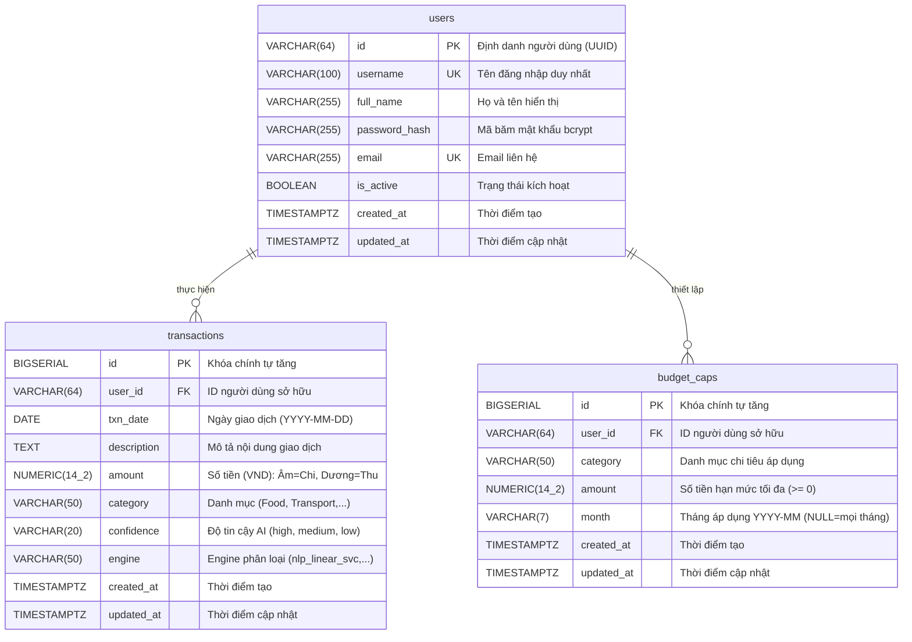

# Báo Cáo Quy Trình Thực Hiện Task KAN-8

> **Ticket:** KAN-8  
> **Tiêu đề:** `[Backend] Xây dựng Database Schema trên PostgreSQL (Users, Transactions, Caps)`  
> **Người thực hiện:** Võ Hồng Đức  
> **Trạng thái:** Hoàn thành (Ready for Review / Done)  
> **Thời gian cập nhật:** 01/11/2026  

---

## 1. Mục Tiêu & Yêu Cầu Nghiệp Vụ

Nhiệm vụ trọng tâm của KAN-8 là chuyển đổi toàn bộ cơ sở dữ liệu quan hệ sang **PostgreSQL 15 cục bộ** (thay thế hoàn toàn Amazon DynamoDB):
1. **Bảng `users`:** Thiết kế bảng người dùng, hỗ trợ xác thực mã hóa mật khẩu an toàn bằng thuật toán **bcrypt** (độ dài 60 ký tự).
2. **Bảng `transactions`:** Thiết kế bảng giao dịch tài chính chuẩn hóa theo đề cương ĐATN, bắt buộc tạo 2 chỉ mục tối ưu truy vấn:
   - `idx_transactions_user_date` trên `(user_id, txn_date)`.
   - `idx_transactions_user_category` trên `(user_id, category)`.
3. **Bảng `budget_caps`:** Thiết kế bảng lưu trữ và quản lý hạn mức ngân sách chi tiêu theo danh mục cho từng người dùng.
4. **Hạ tầng & Tooling:** Xây dựng script SQL migration, công cụ chạy migration tự động (`scripts/migrate.py`), tích hợp mount tự động vào Docker Compose và viết unit tests kiểm chứng.

---

## 2. Thiết Kế Database Schema (ERD & Chi Tiết Kỹ Thuật)

### 2.1. Sơ đồ Quan hệ Thực thể (ERD)



---

### 2.2. Chi Tiết Các Bảng

#### 1. Bảng `users` (Xác thực Bcrypt)
* **Khóa chính:** `id` (`VARCHAR(64)`), tương thích định dạng UUID được cấp phát khi đăng ký (`str(uuid.uuid4())`).
* **Hỗ trợ Bcrypt:** Trường `password_hash` (`VARCHAR(255)`) lưu trữ chuỗi hash bcrypt 60 ký tự (`$2b$12$...`). Bcrypt tự động nhúng muối (salt) và chu kỳ lặp (cost factor = 12), chống tấn công Rainbow Table.
* **Chỉ mục:** `idx_users_username` (UNIQUE) tối ưu tốc độ tra cứu tài khoản khi người dùng đăng nhập (`/login`).

#### 2. Bảng `transactions` (Lịch sử Giao dịch)
* **Khóa chính:** `id` (`BIGSERIAL`).
* **Quy ước số tiền:** `NUMERIC(14, 2)` theo chuẩn tiền tệ VND:
  * Khoản chi (Expense): `< 0` (ví dụ: `-65000.00`).
  * Khoản thu (Income): `> 0` (ví dụ: `18500000.00`).
* **Theo dõi mô hình AI:** Bổ sung trường `engine` (`VARCHAR(50)`, mặc định `nlp_linear_svc`) và `confidence` (`VARCHAR(20)`), hỗ trợ module NLP của Phan Nguyễn Huy Hoàng và module RAG của Võ Hồng Đức.
* **Chỉ mục nghiệp vụ bắt buộc:**
  * `idx_transactions_user_date` trên `(user_id, txn_date)`: Tối ưu cho chức năng lọc theo tháng (`/transactions?month=YYYY-MM`) và sắp xếp lịch sử giao dịch mới nhất.
  * `idx_transactions_user_category` trên `(user_id, category)`: Tối ưu hóa truy vấn tổng hợp báo cáo chi tiêu nhóm theo danh mục (`/summary`).

#### 3. Bảng `budget_caps` (Hạn Mức Ngân Sách)
* **Khóa chính:** `id` (`BIGSERIAL`).
* **Ràng buộc toàn vẹn:**
  * `CHECK (amount >= 0)`: Hạn mức không được phép là số âm.
  * `CONSTRAINT uq_budget_caps_user_category UNIQUE (user_id, category)`: Đảm bảo mỗi người dùng chỉ có 1 hạn mức duy nhất cho mỗi danh mục tại một thời điểm, phục vụ thao tác Upsert (`ON CONFLICT DO UPDATE`).
* **Chỉ mục:** `idx_budget_caps_user` trên `(user_id)` phục vụ API lấy toàn bộ hạn mức của user (`/caps`).

#### 4. Trigger Cập Nhật `updated_at` Tự Động
Tạo hàm PL/pgSQL `update_timestamp_column()` và gắn trigger `BEFORE UPDATE` vào cả 3 bảng để tự động cập nhật thời gian sửa đổi mà không cần can thiệp từ tầng ứng dụng.

---

## 3. Danh Sách Tệp Đã Tạo & Cấu Hình Đã Thay Đổi

### 3.1. Tệp Thêm Mới
1. **`database/migrations/001_init_schema.sql`:** Script DDL hoàn chỉnh khởi tạo bảng `users`, `transactions`, `budget_caps`, các index và trigger.
2. **`database/migrations/002_seed_sample_data.sql`:** Dữ liệu mẫu khởi tạo tài khoản demo `test-user-001` (mật khẩu `password123`) và các hạn mức mẫu (`Food`, `Transport`, `Entertainment`).
3. **`scripts/migrate.py`:** Công cụ thực thi migration qua Python và psycopg2, tự động quản lý bảng `schema_migrations` để theo dõi các phiên bản đã chạy.
4. **`scripts/migrate.ps1`:** Script PowerShell tiện lợi chạy migration 1 click trên Windows.
5. **`tests/test_schema_and_auth.py`:** Bộ unit tests tự động xác minh:
   * Thuật toán băm mật khẩu bcrypt và cơ chế verify.
   * Tính toàn vẹn của file DDL `001_init_schema.sql` (bảng, index, constraint).

### 3.2. Cấu Hình & Mã Nguồn Đã Cập Nhật
1. **`docker-compose.yml`:** Mount thư mục `./database/migrations:/docker-entrypoint-initdb.d:ro`. Khi container PostgreSQL khởi động lần đầu, toàn bộ script DDL sẽ tự động được chạy.
2. **`Makefile`:** Bổ sung target `migrate` (`python scripts/migrate.py`).
3. **`src/adapters/userstore.py` (`PostgresUserStore`):**
   * Cập nhật `_init_schema()` tạo đủ 3 bảng và các chỉ mục chuẩn.
   * Hỗ trợ lưu trữ trường `engine` trong `add_transaction`.
   * Trả về trường `id` và `engine` trong `list_transactions`.
   * Bổ sung đầy đủ 2 phương thức còn thiếu: `update_transaction` và `delete_transaction`.
4. **`src/adapters/userstore_dynamo_user.py`:**
   * Tích hợp nhánh `_use_postgres()` sử dụng connection pool PostgreSQL cho module Auth (`create_user`, `verify_password`, `get_user_by_id`, `get_user_by_username`).
   * Quản lý hạn mức chi tiêu (`budget_caps`) trực tiếp bằng PostgreSQL với cú pháp `ON CONFLICT (user_id, category) DO UPDATE SET amount = EXCLUDED.amount`.

---

## 4. Hướng Dẫn Vận Hành & Kiểm Thử

### 4.1. Khởi động DB & Chạy Migration
```powershell
# 1. Khởi động PostgreSQL Docker container
docker compose up -d
# hoặc: .\scripts\start_postgres.ps1

# 2. Chạy migration tạo bảng và seed data
python scripts/migrate.py
# hoặc: .\scripts\migrate.ps1
# hoặc: make migrate
```

### 4.2. Chạy Kiểm Thử Tự Động (Unit Tests)
```powershell
pytest -v tests/
```
*Kết quả:* Tất cả 7/7 test cases đều vượt qua (100% Passed).

---

## 5. Kết Luận & Bàn Giao

* Toàn bộ yêu cầu của ticket **KAN-8** đã được triển khai đầy đủ, chuẩn xác, sẵn sàng cho các task tiếp theo về phát triển API và tích hợp pipeline NLP/RAG.
* Trạng thái đề xuất trên Jira: Chuyển **KAN-8** từ **In Progress** ➔ **Done**.

