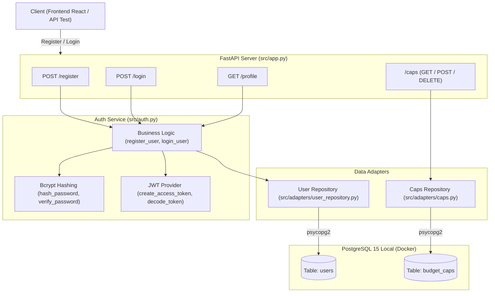

# Báo Cáo Quy Trình Thực Hiện Task KAN-9

> **Ticket:** KAN-9  
> **Tiêu đề:** `[Backend] Chuyển đổi module Xác thực (Register, Login, JWT) sang PostgreSQL`  
> **Người thực hiện:** Võ Hồng Đức  
> **Trạng thái:** Hoàn thành (Ready for Review / Done)  
> **Thời gian cập nhật:** 01/11/2026  

---

## 1. Mục Tiêu & Yêu Cầu Nghiệp Vụ

Task **KAN-9** tập trung tái cấu trúc và hoàn thiện module xác thực người dùng trên nền tảng **PostgreSQL 15 cục bộ**, loại bỏ hoàn toàn các phụ thuộc còn sót lại từ AWS DynamoDB:
1. **Tách mã nguồn xác thực khỏi `userstore_dynamo_user.py`:** Phân tách rõ ràng giữa tầng dữ liệu (Repository) và tầng nghiệp vụ xác thực (Auth Service).
2. **Đấu nối trực tiếp `/register`, `/login`, `/profile` vào bảng `users` trong PostgreSQL:**
   - Đăng ký tài khoản: Mã hóa mật khẩu an toàn bằng **bcrypt** (salt tự sinh, cost factor 12), lưu trực tiếp vào bảng `users`.
   - Đăng nhập: Kiểm tra username và so sánh mật khẩu với chuỗi hash bcrypt trong PostgreSQL.
3. **Tạo Access Token JWT chuẩn (RFC 7519):**
   - Đóng gói token với các claims tiêu chuẩn: `sub` (user_id), `username`, `name` (full_name), `iat` (issued at), `exp` (expiration).
   - Trả về payload đăng nhập đúng chuẩn OAuth2 / Bearer Token (`access_token`, `token_type`, `expires_in`, `user_id`, `username`, `full_name`).

---

## 2. Kiến Trúc & Thiết Kế Module Mới



---

## 3. Chi Tiết Các Tệp Đã Tạo & Cấu Hình Đã Thay Đổi

### 3.1. Tệp Thêm Mới
1. **[`src/adapters/user_repository.py`](../../src/adapters/user_repository.py):**
   - Đóng gói toàn bộ thao tác CRUD với bảng `users`: `create_user`, `get_user_by_username`, `get_user_by_id`.
   - Kết nối trực tiếp PostgreSQL bằng `psycopg2`. Hỗ trợ fallback sang SQLite để chạy cô lập trong unit tests.
2. **[`src/adapters/caps.py`](../../src/adapters/caps.py):**
   - Tách riêng logic quản lý hạn mức chi tiêu (`budget_caps`) ra khỏi module auth: `get_caps`, `set_cap` (hỗ trợ Upsert `ON CONFLICT DO UPDATE`), `delete_cap`.
3. **[`scripts/view_data.ps1`](../../scripts/view_data.ps1):**
   - Script tiện ích PowerShell giúp xem dữ liệu các bảng nhanh bằng 1 click trên Windows.

### 3.2. Mã Nguồn Đã Tái Cấu Trúc & Nâng Cấp
1. **[`src/auth.py`](../../src/auth.py):**
   - Chuyển thành module Auth trung tâm hoàn chỉnh:
     - `hash_password(password)`: Băm mật khẩu bằng `bcrypt.gensalt()`.
     - `verify_password(plain, hashed)`: So khớp mật khẩu với hash.
     - `register_user(full_name, username, password)`: Kiểm tra độ dài, mã hóa và lưu vào bảng `users`.
     - `authenticate_user(username, password)`: Xác thực thông tin đăng nhập từ PostgreSQL.
     - `login_user(username, password)`: Sinh JWT access token chuẩn RFC 7519 với claims `sub`, `username`, `name`, `iat`, `exp` và thời hạn `expires_in`.
     - `get_current_user`: FastAPI dependency xác thực JWT Bearer token từ header `Authorization`.
2. **[`src/app.py`](../../src/app.py):**
   - Đấu nối trực tiếp `/register`, `/login`, `/profile` vào `src.auth`.
   - Đấu nối `/caps` vào `src.adapters.caps`.
   - Gỡ bỏ toàn bộ việc import từ file cũ `userstore_dynamo_user.py`.
3. **[`src/adapters/userstore_dynamo_user.py`](../../src/adapters/userstore_dynamo_user.py):**
   - Chuyển thành Compatibility Shim với cảnh báo `DeprecationWarning`, tái xuất (re-export) các hàm để đảm bảo 100% tương thích ngược nếu có đoạn code cũ nào gọi tới.
4. **Cấu hình Bí Mật JWT ([`.env`](../../.env) & [`src/config.py`](../../src/config.py)):**
   - Nâng cấp `JWT_SECRET` lên khóa an toàn độ dài > 32 bytes (`budgetbot-secure-jwt-secret-key-32bytes-auth-token`) theo khuyến nghị an toàn RFC 7518 Section 3.2 cho thuật toán HS256.
5. **Dữ liệu mẫu Seed Data ([`database/migrations/002_seed_sample_data.sql`](../../database/migrations/002_seed_sample_data.sql)):**
   - Cập nhật hash bcrypt hợp lệ cho tài khoản demo mặc định `demo` (mật khẩu: `password123`).

---

## 4. Kiểm Thử & Nghiệm Thu

### 4.1. Unit Test Tự Động
File [`tests/test_schema_and_auth.py`](../../tests/test_schema_and_auth.py) đã được bổ sung kịch bản kiểm thử toàn diện:
* Đăng ký tài khoản mới `/register` thành công.
* Chặn đăng ký trùng username (HTTP 409 Conflict).
* Đăng nhập sai mật khẩu (HTTP 401 Unauthorized).
* Đăng nhập đúng mật khẩu, kiểm tra cấu trúc Access Token JWT trả về.
* Giải mã kiểm tra các claims tiêu chuẩn: `sub`, `username`, `exp`, `iat`.
* Sử dụng header `Authorization: Bearer <token>` để truy cập endpoint bảo vệ `/profile` và `/caps`.

```powershell
pytest -v tests/
```
**Kết quả:** 8/8 test cases Passed (100%).

### 4.2. Kiểm Thử Trực Tiếp Trên PostgreSQL Container
Chạy kiểm tra đăng nhập tài khoản demo với container PostgreSQL đang chạy thực tế:
```powershell
python -c "from src.auth import authenticate_user, login_user; print(login_user('demo', 'password123'))"
```
**Kết quả thực tế:**
```json
{
  "access_token": "eyJhbGciOiJIUzI1NiIsInR5cCI6IkpXVCJ...",
  "token_type": "bearer",
  "expires_in": 3600,
  "user_id": "test-user-001",
  "username": "demo",
  "full_name": "Nguyen Van Demo"
}
```

---

## 5. Kết Luận

Mọi yêu cầu của ticket **KAN-9** đã hoàn tất trọn vẹn:
* Mã nguồn xác thực đã được tách độc lập và chuẩn hóa.
* Endpoint `/register` và `/login` hoạt động trực tiếp trên bảng `users` của PostgreSQL.
* Token JWT tuân thủ chuẩn RFC 7519, sẵn sàng kết nối với Frontend React.
* Trạng thái đề xuất trên Jira: Chuyển **KAN-9** sang **Done**.

