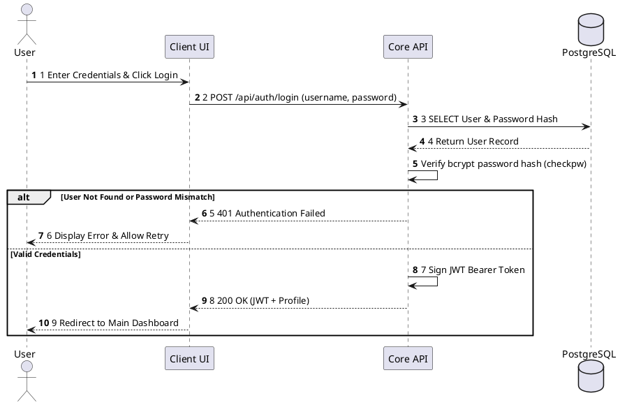
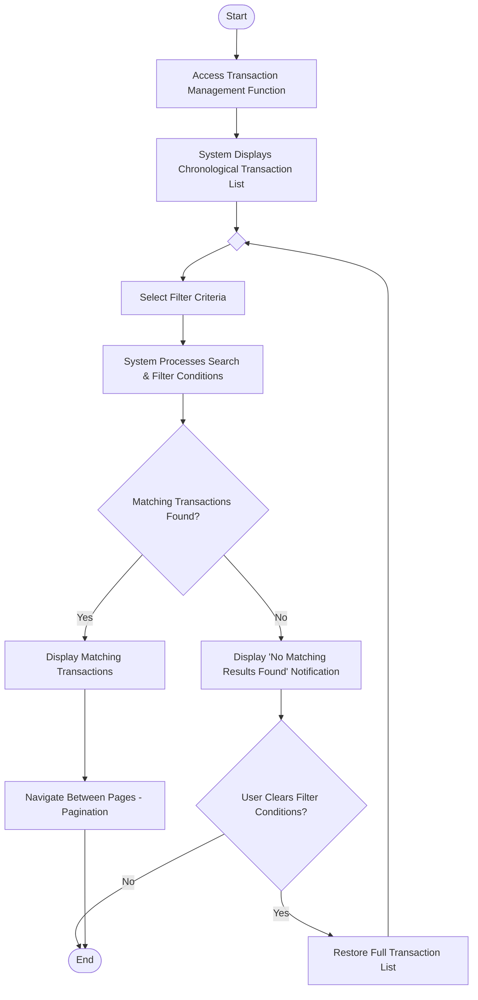
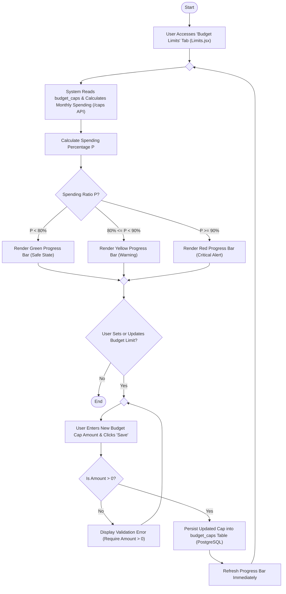
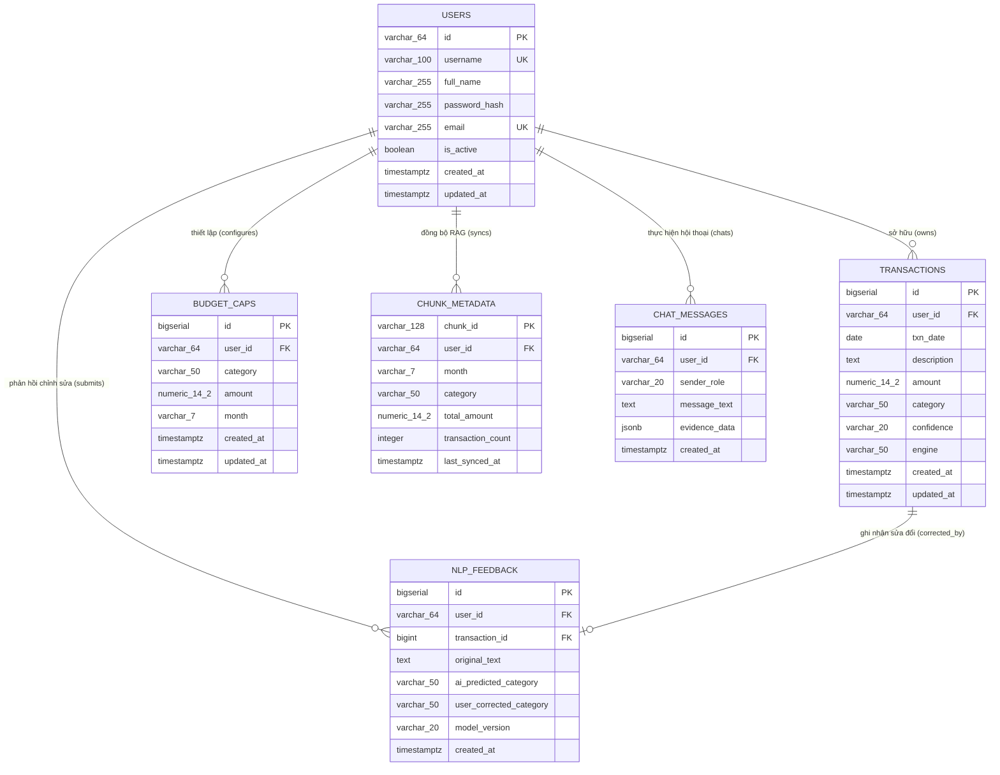

# BÁO CÁO HƯỚNG DẪN KIỂM TRA VÀ ĐỒNG BỘ BÁO CÁO VỚI PROJECT THỰC TẾ
*(Tài liệu đối chiếu: `CS-Graduation-thesis-student-full-name.docx-3.pdf` & Mã nguồn hệ thống BUDGETBOT)*

---

## MỤC LỤC
1. [Tổng Quan & Phân Loại Lỗi Theo Mức Độ Ưu Tiên](#1-tổng-quan--phân-loại-lỗi-theo-mức-độ-ưu-tiên)
2. [Kiểm Tra Mục 3.3: Activity Diagrams (12 Biểu Đồ)](#2-kiểm-tra-mục-33-activity-diagrams-12-biểu-đồ)
3. [Kiểm Tra Mục 3.4: Sequence Diagrams (12 Biểu Đồ)](#3-kiểm-tra-mục-34-sequence-diagrams-12-biểu-đồ)
4. [Kiểm Tra Mục 3.5: Class Diagram](#4-kiểm-tra-mục-35-class-diagram)
5. [Kiểm Tra Mục 3.6: Database Design & ERD (3.6.1)](#5-kiểm-tra-mục-36-database-design--erd-361)
6. [Mã Nguồn Mẫu (PlantUML & Mermaid) Cho Các Biểu Đồ Bị Lỗi](#6-mã-nguồn-mẫu-plantuml--mermaid-cho-các-biểu-đồ-bị-lỗi)
7. [Đối Chiếu & Đồng Bộ Báo Cáo Với Project Thực Tế (Chương 1, 2 & 3)](#7-đối-chiếu--đồng-bộ-báo-cáo-với-project-thực-tế-chương-1-2--3)
8. [Checklist Hành Động Dành Cho Sinh Viên (Action Checklist)](#8-checklist-hành-động-dành-cho-sinh-viên-action-checklist)

---

## 1. TỔNG QUAN & PHÂN LOẠI LỖI THEO MỨC ĐỘ ƯU TIÊN

Hệ thống biểu đồ trong Chương 3 của khóa luận được thiết kế rất công phu, bám sát các yêu cầu chức năng (FR-01 đến FR-24), thể hiện rõ các thành phần phức tạp như **NLP tiếng Việt (underthesea + TF-IDF + SVC)**, **Human-in-the-Loop (HITL)** và **RAG đa tầng (ChromaDB + PostgreSQL hybrid + GPT-4o-mini)**.

Tuy nhiên, có một số lỗi kỹ thuật, lỗi sao chép (copy-paste) và chuẩn ký hiệu UML có thể bị Hội đồng phản biện trừ điểm nếu không được khắc phục:

### 🔴 Mức độ 1: Lỗi Nghiêm Trọng (Critical - Bắt buộc sửa ngay)
1. **Sequence Diagram 3.4.2 (User Login - trang 83)**:
   - Thông điệp số 2 ghi nhầm endpoint thành: `2 POST /api/auth/register (username, password)`. Đây là biểu đồ Đăng nhập, endpoint bắt buộc phải là `POST /api/auth/login`.
   - Thiếu bước tự xác thực mã băm mật khẩu `bcrypt.checkpw` trước khi rẽ nhánh xác thực.
2. **ERD 3.6.1 (Database Design - trang 94)**:
   - Trong bảng `NLP_FEEDBACK`, cột `transaction_id` là Khóa ngoại `[FK]` trỏ đến giao dịch, nhưng trên hình vẽ ERD **hoàn toàn thiếu đường nối ngoại khóa** giữa bảng `TRANSACTIONS` và `NLP_FEEDBACK`.
   - Hàng `month` trong bảng `CHUNK_METADATA` bị lỗi typo thành `varchar(?)`.
3. **Đánh số bảng trùng lặp (Mục 3.6 - trang 96)**:
   - Cả hai bảng `Budget_caps` và `Nlp_feedback` đều bị đánh số là **Table 21**.

### 🟡 Mức độ 2: Lỗi Chuẩn UML & Logic Hệ Thống (Cần hoàn thiện)
1. **Activity Diagram 3.3.5 (Filtering Transactions - trang 67)**:
   - Thiếu nhãn `[No]` trên nhánh rẽ phải của hình thoi `User Clears Filter Conditions?`. Chữ `Yes` bị đè vào đỉnh hình thoi.
   - Nhánh khôi phục danh sách `Restore Full Transaction List` lại nối thẳng vào nút `End` thay vì quay về bước hiển thị danh sách.
2. **Activity Diagram 3.3.9 (NLP Classification - trang 74)**:
   - Nhánh `Keyword Rule Matched? = No` dẫn vào hành động người dùng `Allow User to Manually Select Category` rồi lại nhập chung vào nút trả kết quả AI `Return & Display Suggested Category on UI (< 300ms)`.
3. **Activity Diagram 3.3.12 (Budget Limits - trang 81)**:
   - Dùng 2 hình thoi lồng nhau để rẽ 3 nhánh tỷ lệ chi tiêu $P$; thiếu Merge Node trước khi đi vào hình thoi `User Sets or Updates Budget Limit?`.
4. **Sequence Diagram 3.4.9 (NLP Internal Flow - trang 89)**:
   - Lifeline điều phối bị đặt tên là `Core API` thay vì `FastAPI NLP Engine`.

### 🟢 Mức độ 3: Trình Bày & Dàn Trang (Thẩm mỹ học thuật)
1. **Dàn trang 3.3.1 (trang 58–60)**: Hình vẽ 3.3.1 bị trôi xuống đầu trang 60 ngay trên tiêu đề 3.3.2.
2. **Thiếu Caption**: Cả Class Diagram (3.5) và ERD (3.6.1) đều chưa có nhãn `Figure 3.XX: ...` chuẩn dưới chân hình.

---

## 2. KIỂM TRA MỤC 3.3: ACTIVITY DIAGRAMS (12 BIỂU ĐỒ)

### Bảng Đánh Giá Chi Tiết 12 Biểu Đồ Hoạt Động

| Mục | Tên Biểu Đồ | Trang | Đánh Giá | Chi Tiết Lỗi & Khuyến Nghị Sửa |
| :---: | :--- | :---: | :---: | :--- |
| **3.3.1** | User Registration | 60 | Khá | • **Dàn trang**: Hình vẽ bị đẩy sang đầu trang 60, nằm ngay sát phía trên tiêu đề `3.3.2`. Cần kéo hình về đúng trang 59. • Nút `Re-enter Information` ở cuối bị thừa, chỉ cần mũi tên quay lại Merge Node trước `Enter Registration Information`. |
| **3.3.2** | User Login | 61 | Tốt | • Luồng logic chuẩn xác (kiểm tra tài khoản, so khớp bcrypt, cấp JWT). • Nút `Retry Login` có thể lược bỏ để nối thẳng về Merge Node phía trên. |
| **3.3.3** | File Import (CSV) | 63 | Tốt | • Rất chặt chẽ: Kiểm tra định dạng CSV $\rightarrow$ Validate fields $\rightarrow$ Batch Insert PostgreSQL $\rightarrow$ Đồng bộ ChromaDB chunks. • Phân nhánh lỗi kết thúc sớm rất rõ ràng. |
| **3.3.4** | Adding Transaction | 65 | Tốt | • Mô tả chuẩn quá trình gợi ý NLP thời gian thực và cho phép người dùng can thiệp (override). • Nút `Keep Suggested Category` có thể đi thẳng xuống Merge Node. |
| **3.3.5** | Viewing, Searching & Filtering | 67 | ❌ **LỖI** | 1. **Thiếu Guard**: Nhánh bên phải của hình thoi `User Clears Filter Conditions?` không có chữ `No`. 2. **Đè chữ**: Chữ `Yes` bị đè lên cạnh dưới của hình thoi. 3. **Lỗi luồng**: Nút `Restore Full Transaction List` nối thẳng ra `End`. Luồng đúng phải quay lại bước `System Displays Chronological Transaction List`. |
| **3.3.6** | Editing Transaction | 69 | Tốt | • Xử lý đầy đủ: Hủy thay đổi, Dữ liệu lỗi (vòng lặp sửa), Thành công (cập nhật DB & refresh ChromaDB chunk). |
| **3.3.7** | Deleting Transaction | 70 | Tốt | • Có bước xác nhận của người dùng, kiểm tra phân quyền (ownership), cập nhật thống kê và xóa vector chunk. |
| **3.3.8** | Statistics & Charts | 72 | Tốt | • Xử lý tốt cả 2 trường hợp: Có dữ liệu (vẽ biểu đồ Chart.js) và Không có dữ liệu (Empty State). |
| **3.3.9** | NLP Classification | 74 | ⚠️ **LỖI LOGIC** | • Nhánh `Keyword Rule Matched? = No` dẫn vào `Allow User to Manually Select Category` (User action) rồi lại nhập chung vào nút `Return & Display Suggested Category on UI (< 300ms)`. Khi không khớp từ khóa thì AI không có gợi ý nào để trả về, luồng phải trả về `None/Null` để Client tự mở dropdown. |
| **3.3.10**| HITL Feedback | 76 | Rất Tốt | • Đúng chuẩn Human-in-the-Loop: Trích xuất bộ ba `(original_text, ai_predicted, user_corrected)` lưu vào PostgreSQL để phục vụ re-train. |
| **3.3.11**| RAG Q&A Pipeline | 78 | Xuất Sắc | • Rất chuyên nghiệp: Domain Guardrail (FR-20) $\rightarrow$ Embedding `text-embedding-3-small` $\rightarrow$ Top-K ChromaDB $\rightarrow$ Kiểm tra Insufficient Data $\rightarrow$ Hybrid SQL PostgreSQL $\rightarrow$ GPT-4o-mini $\rightarrow$ Hiển thị bảng bằng chứng giao dịch. |
| **3.3.12**| Budget Limits & Alerts | 81 | ⚠️ **LỖI UML** | 1. **Sai chuẩn UML**: Dùng 2 hình thoi lồng nhau để rẽ nhánh tỷ lệ $P$. Chuẩn UML chỉ cần 1 Decision Node có 3 nhánh ra: `[P < 80%]`, `[80% <= P < 90%]`, `[P >= 90%]`. 2. **Thiếu Merge Node**: Cả 3 hành động vẽ Progress Bar cùng trỏ thẳng vào hình thoi `User Sets or Updates Budget Limit?` mà không qua hình thoi gộp (Merge Node). |

---

## 3. KIỂM TRA MỤC 3.4: SEQUENCE DIAGRAMS (12 BIỂU ĐỒ)

### Bảng Đánh Giá Chi Tiết 12 Biểu Đồ Tuần Tự

| Mục | Tên Biểu Đồ | Trang | Đánh Giá | Chi Tiết Lỗi & Khuyến Nghị Sửa |
| :---: | :--- | :---: | :---: | :--- |
| **3.4.1** | User Registration | 82 | Rất Tốt | • Trình tự chuẩn: Validate format $\rightarrow$ Check exist username $\rightarrow$ Bcrypt hash $\rightarrow$ Insert DB $\rightarrow$ HTTP 201 Created. |
| **3.4.2** | User Login | 83 | 🚨 **CRITICAL** | 1. **Lỗi copy-paste endpoint**: Thông điệp 2 ghi `POST /api/auth/register`. Phải sửa ngay thành `POST /api/auth/login`. 2. **Thiếu self-call**: Sau khi lấy thông tin từ DB, thiếu một mũi tên tự gọi tại `Core API`: `Verify bcrypt password hash` trước khi vào khối `alt`. |
| **3.4.3** | File Import (CSV) | 84 | Xuất Sắc | • Phối hợp nhịp nhàng 6 lifeline: `User`, `Client UI`, `Core API`, `FastAPI NLP`, `PostgreSQL`, `ChromaDB`. |
| **3.4.4** | Adding Transaction | 85 | Rất Tốt | • Tách biệt rõ 2 giai đoạn: Gợi ý tức thời (< 300ms) và Lưu giao dịch. • *Góp ý*: Thông điệp 7 ghi `POST /api/transactions (description)` — nên bổ sung đủ payload `(date, amount, description, category)`. |
| **3.4.5** | Search & Filter | 86 | Chuẩn Xác | • Có parameterized query, phân trang (limit/offset), metadata tổng số dòng và xử lý danh sách rỗng. |
| **3.4.6** | Editing Transaction | 87 | Rất Tốt | • Có kiểm tra quyền sở hữu (`Verify Ownership`), cập nhật PostgreSQL và re-embed chunk tháng bị ảnh hưởng trong ChromaDB. |
| **3.4.7** | Deleting Transaction | 88 | Tốt | • Có hộp thoại xác nhận hủy/đồng ý, kiểm tra phân quyền và đồng bộ xóa vector chunk. |
| **3.4.8** | Statistics & Charts | 89 | Chuẩn Xác | • Thể hiện truy vấn `GROUP BY` trong PostgreSQL, tính toán KPI tại Core API và gọi Chart.js vẽ biểu đồ. |
| **3.4.9** | NLP Classification | 89 | ⚠️ **LỖI TÊN** | • Lifeline điều phối bị đặt tên là `Core API`. Vì đây là biểu đồ mô tả luồng nội bộ microservice NLP, lifeline này phải đổi tên thành `FastAPI NLP Engine` (hoặc `NLP Service`) để đồng nhất với các hình 3.4.3 và 3.4.4. |
| **3.4.10**| HITL Feedback | 90 | Rất Tốt | • Lưu đồng thời giao dịch và bản ghi feedback `(desc, ai_label, user_label)` vào PostgreSQL. |
| **3.4.11**| RAG Q&A Pipeline | 91 | Xuất Sắc | • Đúng chuẩn hệ thống RAG thực tế: Guardrail $\rightarrow$ Cosine Search $\rightarrow$ Anti-hallucination check $\rightarrow$ Hybrid SQL $\rightarrow$ GPT-4o-mini grounded prompt $\rightarrow$ Evidence table. |
| **3.4.12**| Budget Limits & Alerts | 92 | Khá | 1. **Khác biệt HTTP Method**: Thông điệp 10 ghi `PUT /caps`, trong khi code thực tế `src/app.py` định nghĩa `@app.post("/caps")`. 2. **Tên Lifeline không đồng nhất**: Đang dùng tên file code `Limits.jsx` và `/caps API (caps.py)`. Nên quy về `Client UI` và `Core API` cho đồng bộ với toàn bộ khóa luận. |

---

## 4. KIỂM TRA MỤC 3.5: CLASS DIAGRAM

### 1. Phân Tích Kiến Trúc
Biểu đồ lớp (trang 93) mô hình hóa cấu trúc tĩnh theo phong cách hướng đối tượng chuẩn gồm:
* **5 Lớp Dịch Vụ**: `AuthService`, `TransactionService`, `BudgetCapService`, `RAGEngineService`, `NLPClassifierService`.
* **6 Lớp Thực Thể (Domain Entities)**: `User`, `BudgetCap`, `Transaction`, `ChunkMetadata`, `ChatMessage`, `NlpFeedback`.

### 2. Các Lỗi & Điểm Cần Khắc Phục
1. **Xung đột trách nhiệm giữa Service và Entity**:
   * Thực thể `User` có phương thức `+register(): Boolean`, trong khi `AuthService` lại có `+registerUser(payload): User`. Bản thân Entity User không thể tự ghi nó vào cơ sở dữ liệu. Cần **bỏ phương thức `register()` khỏi lớp `User`**, chỉ giữ lại trong `AuthService`.
2. **Kiểu dữ liệu đặc thù Database trong Class Diagram**:
   * Lớp `ChatMessage` có thuộc tính `-JSONB evidence_data`. Trong UML OOP, nên chuẩn hóa thành kiểu `Object`, `Map<String, Object>` hoặc `JSON`.
3. **Bổ sung nhãn Stereotype**:
   * Nên thêm stereotype `<<service>>` cho các lớp nghiệp vụ và `<<entity>>` cho các lớp dữ liệu để người đọc dễ phân biệt kiến trúc.
4. **Bổ sung Caption hình**:
   * Thêm nhãn bên dưới hình vẽ tại trang 93: `Figure 3.13: BUDGETBOT System Class Diagram`.

---

## 5. KIỂM TRA MỤC 3.6: DATABASE DESIGN & ERD (3.6.1)

### 1. 🚨 Lỗi Nghiêm Trọng Trong Hình Vẽ ERD (Trang 94)
* **Thiếu đường quan hệ ngoại khóa `TRANSACTIONS` $\rightarrow$ `NLP_FEEDBACK`**:
  * Trong bảng `NLP_FEEDBACK`, cột `transaction_id` là `[FK]` trỏ đến `TRANSACTIONS.id`.
  * Trong Class Diagram (3.5), có liên kết `1` đến `0..1` giữa hai thực thể này.
  * **Trên hình vẽ ERD (trang 94)**: Hoàn toàn không có đường vẽ nối giữa `TRANSACTIONS` và `NLP_FEEDBACK`. Năm bảng con đều chỉ nối vào `USERS`.
  * **Cách sửa**: Vẽ thêm một đường nối từ `TRANSACTIONS` sang `NLP_FEEDBACK` với ký hiệu Crow's Foot: `1` (ở đầu Transactions) sang `0..1` (ở đầu Nlp_feedback).

### 2. 🚨 Lỗi Đánh Số Thứ Tự Bảng Bị Trùng Lặp (Trang 96)
Trong văn bản mô tả đặc tả các bảng:
* `3.6.4 Table Budget_caps` $\rightarrow$ được gắn tiêu đề **Table 21: Table Budget_caps**
* `3.6.5 Table Nlp_feedback` $\rightarrow$ cũng bị gắn tiêu đề **Table 21: Table Nlp_feedback** ❌
* `3.6.6 Table Chat_messages` $\rightarrow$ **Table 22: Table Chat_messages**
* `3.6.7 Table Chunk_metadata` $\rightarrow$ **Table 23: Table Chunk_metadata**

**Cách sửa**: Đánh số lại thứ tự bảng từ Table 21 đến Table 24:
* `Budget_caps` $\rightarrow$ **Table 21**
* `Nlp_feedback` $\rightarrow$ **Table 22**
* `Chat_messages` $\rightarrow$ **Table 23**
* `Chunk_metadata` $\rightarrow$ **Table 24**

### 3. ⚠️ Lỗi Chính Tả / Typo Trong Ô Dữ Liệu ERD (Trang 94)
* **Dấu hỏi chấm `?`**: Bảng `CHUNK_METADATA`, cột `month` bị ghi thành `varchar(?)`. Cần sửa thành `varchar(7)`.
* **Dấu gạch dưới `_`**: Kiểu số tiền tại các bảng `TRANSACTIONS`, `BUDGET_CAPS`, `CHUNK_METADATA` bị ghi thành `numeric(14_2)`. Cần sửa thành dấu phẩy chuẩn SQL: `numeric(14, 2)`.

---

## 6. MÃ NGUỒN MẪU (PLANTUML & MERMAID) CHO CÁC BIỂU ĐỒ BỊ LỖI

Bạn có thể sao chép trực tiếp các đoạn mã dưới đây vào công cụ vẽ (PlantUML, Mermaid Live Editor, hoặc Draw.io) để xuất hình ảnh mới và thay thế vào tài liệu Word:

### 1. Sửa Sequence Diagram 3.4.2: User Login (Đã sửa lỗi `POST /login` và thêm bcrypt)

---

### 2. Sửa Activity Diagram 3.3.5: Viewing, Searching & Filtering (Đã sửa nhãn Guard & Luồng quay lại)

---

### 3. Sửa Activity Diagram 3.3.12: Budget Limits & Spending Alerts (Chuẩn hóa 1 Decision Node & Thêm Merge Node)

---

### 4. Sửa ERD 3.6.1: Bổ sung quan hệ `TRANSACTIONS` $\rightarrow$ `NLP_FEEDBACK`

---

## 7. ĐỐI CHIẾU & ĐỒNG BỘ BÁO CÁO VỚI PROJECT THỰC TẾ (CHƯƠNG 1, 2 & 3)

*(Đối chiếu trực tiếp từ file `CS-Graduation-thesis-student-full-name.docx-3.pdf` với mã nguồn và dữ liệu thực tế trong repo `budgetbot-aws`)*

### 7.1. Bảng Các Điểm Sai Lệch / Cần Cập Nhật Trong Báo Cáo

| Mức độ | Vị trí trong PDF *(Trang tài liệu)* | Nội dung hiện tại trong báo cáo | Thực tế trong Project & Cách sửa khuyến nghị |
| :---: | :--- | :--- | :--- |
| 🔴 **Nghiêm trọng** | **Trang PDF 37** *(Trang 27 — Mục 2.5.1.D, Rule-Based Fallback)* | Ghi `"spotify", "netflix" → Entertainment` và `"small sample datasets (300-500 samples)"`; chưa nêu thứ tự ưu tiên luật. | 1. **Sai danh mục**: Trong hệ thống (`src/adapters/ai.py`, `src/nlp/predictor.py`), `"spotify"`, `"netflix"` thuộc **`Subscriptions`**, không phải `Entertainment` (dùng `"cgv"`, `"steam"` cho `Entertainment`). 2. **Cỡ mẫu**: Tập dữ liệu train chuẩn thực tế là **1,000 mẫu** (`vietnamese_transactions_1000.csv`) + **174 mẫu test độc lập** (`eval_nlp.csv`). 3. **Bổ sung luật ưu tiên**: Từ khóa mục đích tiêu dùng (`Food`, `Shopping`, `Utilities`...) được ưu tiên khớp trước từ khóa chuyển khoản chung (`Transfer`). |
| 🔴 **Nghiêm trọng** | **Trang PDF 100** *(Trang 90 — Mục 3.8.2, Golden Benchmark Dataset)* | Ghi `"1,500+ real-world Vietnamese financial descriptions... Data Sources: Real bank statements... 80% Training set and 20% holdout Test set"`. | Không khớp với dữ liệu thực tế trong `sample_data/`. Cần sửa thành: **1,000 mẫu synthetic chuẩn hóa không trùng lặp** (`vietnamese_transactions_1000.csv`, cân bằng 100 mẫu/danh mục, đánh giá 5-Fold CV) và **174 mẫu kiểm thử độc lập viết tay** (`eval_nlp.csv`, đạt **88.51% Accuracy / 88.40% Macro F1**). |
| 🟡 **Quan trọng** | **Trang PDF 97–98** *(Trang 87–88 — Mục 3.7.1 & 3.7.4)* | Chỉ ghi chung `"10 standard categories"` và `"10 category cards"`, chưa liệt kê tên 10 danh mục và quy tắc phân định `Transfer`. | Bổ sung bảng/đoạn liệt kê đủ 10 danh mục PascalCase (`Food`, `Transport`, `Shopping`, `Utilities`, `Entertainment`, `Health`, `Subscriptions`, `Income`, `Transfer`, `Other`) và nêu rõ **quy tắc ranh giới `Transfer`** *(xem Mục 7.2 bên dưới)*. |
| 🟡 **Quan trọng** | **Trang PDF 43, 72, 73, 99** *(Trang 33, 62, 63, 89 — Mục 3.1, 3.3.9, 3.8.1)* | Đều ghi dùng thư viện `underthesea` và mô hình `Linear SVC`. | Trong code thực tế của repo: • `src/nlp/preprocessor.py` dùng **`pyvi` (`ViTokenizer`)** (mặc dù Mục 2.5.1.B ở trang 26 có nhắc `underthesea or pyvi`). • `src/nlp/classifier.py` (KAN-16) benchmark 3 mô hình (`Logistic Regression`, `Linear SVC (Calibrated)`, `Multinomial NB`) và mô hình được chọn lưu ra `classifier_model.joblib` là **`Logistic Regression`** (Test Macro F1 cao nhất). Cần đồng bộ báo cáo với code (hoặc cập nhật giải thích rõ). |
| 🟢 **Hoàn thiện** | **Trang PDF 15** *(Trang 5 — Mục 1.1.2)* | Đưa ví dụ `"ck tien tro t5"`, `"cf sang voi b"`, `"grab di lam"`, `"bun bo hue 35k"`. | Có thể bổ sung 1 câu chú thích ngắn: hệ thống phân loại theo **mục đích chi tiêu thực tế** chứ không chỉ nhìn từ khóa chuyển khoản (ví dụ: `"ck tien tro t5"` → `Transfer`, còn `"ck bun bo 35k"` → `Food`). |
| 🟢 **Hoàn thiện** | **Trang PDF 40** *(Trang 30 — Mục 2.5.3)* | Ví dụ minh họa Macro F1 lấy lớp `"Insurance"` (`10 samples`), trong khi 10 danh mục thực tế không có `Insurance` và tập train được cân bằng 100 mẫu/lớp. | Đổi `"Insurance"` sang một danh mục có thật trong hệ thống (như `"Subscriptions"` hoặc `"Health"`) và ghi chú đây là ví dụ minh họa dữ liệu thực tế của người dùng bị mất cân bằng. |

### 7.2. Quy Chuẩn Phân Định Danh Mục `Transfer` (Chuẩn Đưa Vào Báo Cáo & KAN-13)

Để tránh hội đồng phản biện thắc mắc về ranh giới giữa `Transfer` với các danh mục chi tiêu (`Food`, `Shopping`...) hoặc việc không tách riêng danh mục `Debt`/`Housing`, cần thống nhất định nghĩa sau trong báo cáo:

1. **Nguyên tắc ưu tiên mục đích tiêu dùng:** `"Chuyển khoản"` / `"CK"` chỉ là **phương thức thanh toán**, không phải mục đích chi tiêu. Mọi giao dịch chuyển khoản có ghi rõ mục đích chi tiêu cụ thể (ví dụ: `"chuyển khoản ăn xôi"`, `"CK 50k tiền nhậu chia bill"`, `"chuyển khoản mua đồ"`) **phải** được phân loại vào danh mục tiêu dùng tương ứng (`Food`, `Shopping`, `Utilities`...).
2. **4 trường hợp hợp lệ xếp vào `Transfer`:**
   - **Luân chuyển nội bộ & ví điện tử:** chuyển giữa các tài khoản của bản thân, nạp/rút ví MoMo, ZaloPay.
   - **Tiết kiệm & tích lũy:** chuyển tiền vào tài khoản tiết kiệm online.
   - **Nghĩa vụ tài chính / P2P đặc thù:** trả nợ cá nhân, vay tiêu dùng, tạm ứng/cho vay, tiền chu cấp gia đình, tiền thuê phòng trọ (do chuẩn 10 danh mục chưa tách riêng `Debt` và `Housing`).
   - **Chuyển khoản P2P không rõ mục đích:** giao dịch chuyển đến cá nhân/STK nhưng sao kê không ghi mục đích tiêu dùng (ví dụ: `"VCB IB ... CK DEN NGUYEN VAN A"`).
3. **Phân biệt với `Income` và `Other`:** Tiền nhận vào (`amount > 0`: lương, thưởng, hoàn tiền, nhận trả nợ) thuộc **`Income`**; mã giao dịch mờ đục hoàn toàn (`FT...`, `TRX...`), rút tiền ATM và phí ngân hàng thuộc **`Other`**.

---

## 8. CHECKLIST HÀNH ĐỘNG DÀNH CHO SINH VIÊN (ACTION CHECKLIST)

Khi mở file Word của đồ án để chỉnh sửa, hãy đánh dấu kiểm tra theo từng mục sau:

### A. Sửa Lỗi Biểu Đồ & Cấu Trúc Chương 3
- [ ] **Mục 3.3.1 (Trang 58-60)**: Chỉnh lại ngắt trang (Page Break) để hình vẽ 3.3.1 nằm ở trang 59, không bị tràn sang trang 60.
- [ ] **Mục 3.3.5 (Trang 67)**: Sửa hình Activity: thêm nhãn `[No]`, tránh đè chữ `Yes`, nối `Restore Full Transaction List` quay lại bước hiển thị danh sách.
- [ ] **Mục 3.3.9 (Trang 74)**: Sửa hình Activity: Tách nhánh không khớp từ khóa thành `Return None / Uncategorized` trước khi để người dùng chọn trên UI.
- [ ] **Mục 3.3.12 (Trang 81)**: Sửa hình Activity: gộp thành 1 hình thoi rẽ 3 nhánh tỷ lệ $P$ và thêm Merge Node trước bước cập nhật hạn mức.
- [ ] **Mục 3.4.2 (Trang 83)**: **[QUAN TRỌNG NHẤT]** Đổi thông điệp 2 từ `POST /api/auth/register` thành `POST /api/auth/login`. Thêm self-call xác thực mật khẩu bcrypt.
- [ ] **Mục 3.4.9 (Trang 89)**: Đổi tên Lifeline thứ 2 từ `Core API` thành `FastAPI NLP Engine`.
- [ ] **Mục 3.5 (Trang 93)**: Bỏ hàm `register()` trong entity `User`; đổi kiểu `JSONB` trong `ChatMessage` thành `Object`/`JSON`; thêm Caption hình vẽ.
- [ ] **Mục 3.6.1 (Trang 94)**: **[QUAN TRỌNG]** Vẽ thêm đường nối quan hệ ngoại khóa giữa `TRANSACTIONS` và `NLP_FEEDBACK`.
- [ ] **Mục 3.6.1 (Trang 94)**: Sửa chữ `varchar(?)` thành `varchar(7)` trong ô `CHUNK_METADATA.month`. Đổi `numeric(14_2)` thành `numeric(14, 2)`.
- [ ] **Mục 3.6 (Trang 96)**: Đánh số lại các bảng: `Nlp_feedback` là Table 22, `Chat_messages` là Table 23, `Chunk_metadata` là Table 24.
- [ ] **Toàn bộ Chương 3**: Kiểm tra lại caption `Figure 3.XX` cho tất cả các hình vẽ để đảm bảo định dạng đồng nhất.

### B. Đồng Bộ Nội Dung Báo Cáo Với Project Thực Tế (Chương 1, 2 & 3)
- [ ] **Mục 2.5.1.D (Trang PDF 37 / Trang 27)**: Sửa `"spotify", "netflix" → Entertainment` thành **`Subscriptions`**; cập nhật cỡ mẫu từ `300-500` thành **`1,000`**; bổ sung nguyên tắc ưu tiên từ khóa tiêu dùng trước `Transfer`.
- [ ] **Mục 2.5.3 (Trang PDF 40 / Trang 30)**: Đổi ví dụ lớp `"Insurance"` sang một danh mục thực tế của hệ thống (`Subscriptions` hoặc `Health`).
- [ ] **Mục 3.7.1 & 3.7.4 (Trang PDF 97–98 / Trang 87–88)**: Liệt kê đầy đủ 10 danh mục chuẩn PascalCase và bổ sung định nghĩa ranh giới `Transfer` (Mục 7.2).
- [ ] **Mục 3.1, 3.3.9, 3.8.1 (Trang PDF 43, 72, 73, 99)**: Đồng bộ thư viện tách từ tiếng Việt (`pyvi` thay cho `underthesea`) và mô hình được chọn từ thực nghiệm (`Logistic Regression` / `Linear SVC`).
- [ ] **Mục 3.8.2 (Trang PDF 100 / Trang 90)**: Cập nhật thông tin Golden Benchmark Dataset khớp với repo thực tế (`1,000` mẫu train chuẩn hóa + `174` mẫu test độc lập `eval_nlp.csv`, kết quả Accuracy **88.51%** / Macro F1 **88.40%**).
- [ ] **Mục 1.1.2 (Trang PDF 15 / Trang 5)**: Làm rõ ví dụ `"ck tien tro t5"` với chú thích phân loại theo ngữ nghĩa thay vì chỉ nhìn tiền tố `ck`.
