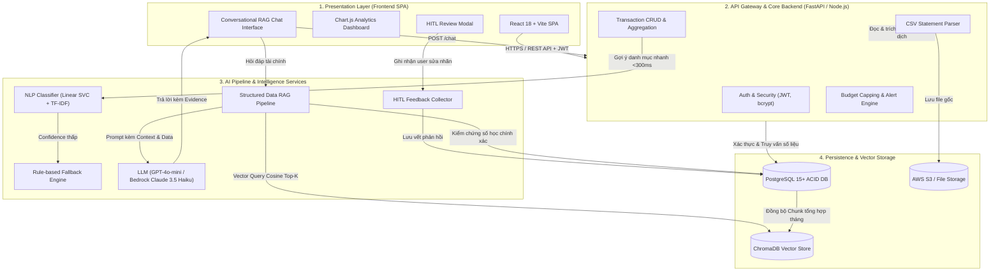
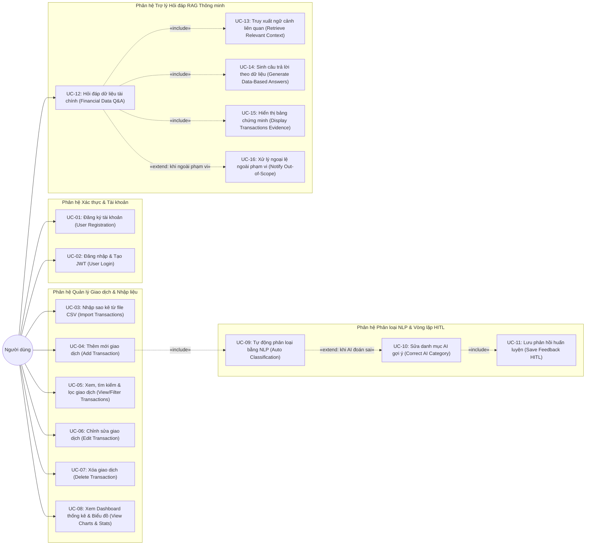
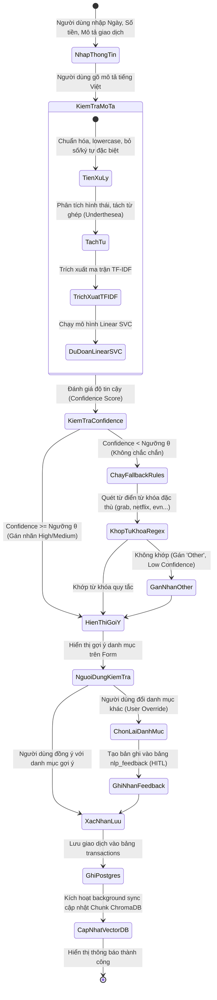
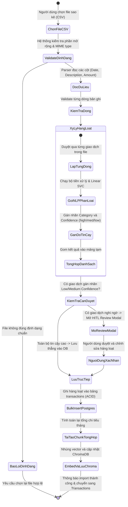
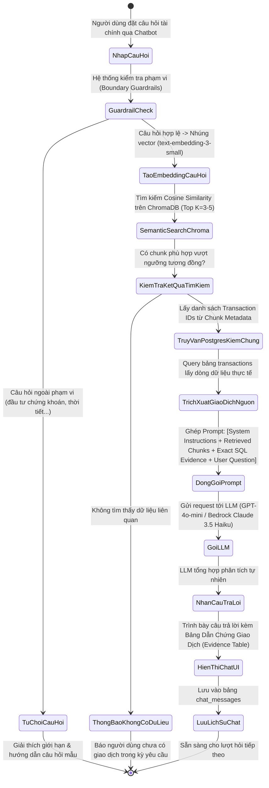
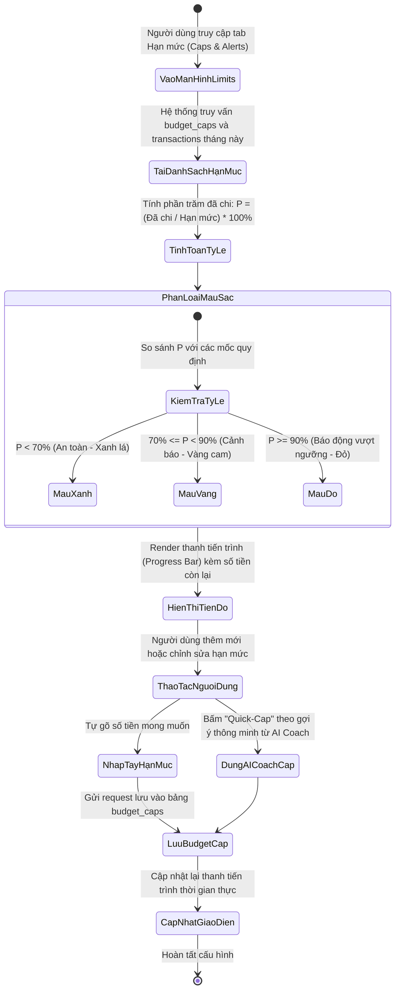
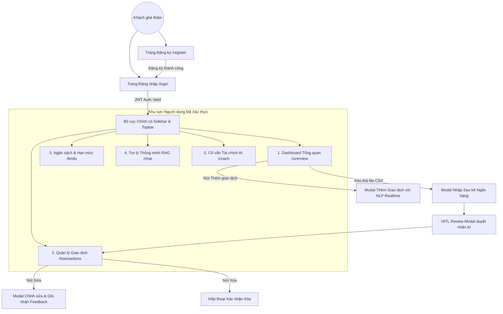
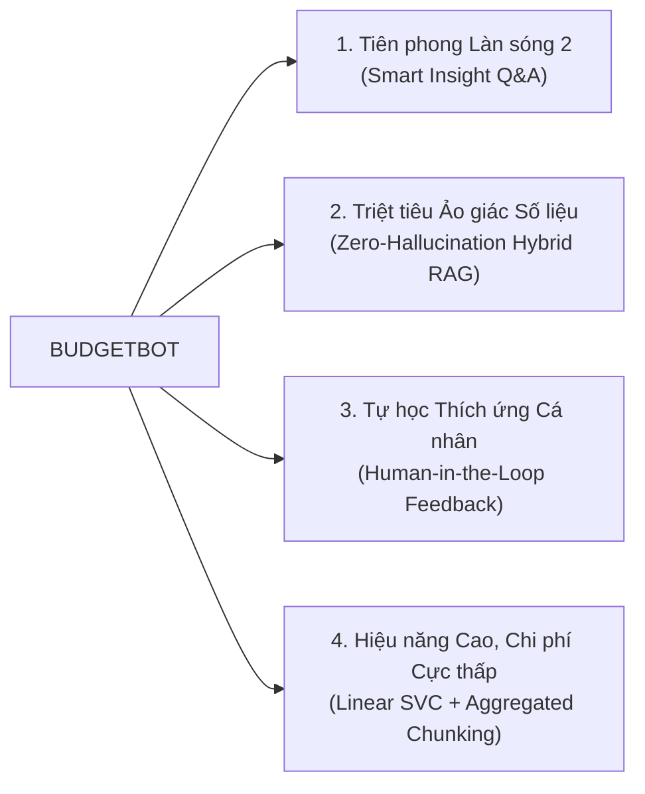

# BÁO CÁO KHÓA LUẬN TỐT NGHIỆP
## ĐỊNH HƯỚNG KHỞI NGHIỆP & ĐỔI MỚI SÁNG TẠO NĂM 2026

**Đề tài:**  
### XÂY DỰNG HỆ THỐNG HỖ TRỢ QUẢN LÝ CHI TIÊU CÁ NHÂN DỰA TRÊN PHÂN LOẠI GIAO DỊCH BẰNG NLP VÀ HỎI ĐÁP BẰNG RAG
*(Developing a Personal Expense Management Support System Based on NLP Transaction Classification and RAG-based Q&A)*

* **Sinh viên thực hiện:**
  1. Võ Hồng Đức – MSV: 22IT070 – Lớp: 22GIT (Công nghệ Thông tin) — Phụ trách: **RAG & Backend**
  2. Phan Nguyễn Huy Hoàng – MSV: 22IT101 – Lớp: 22GIT (Công nghệ Thông tin) — Phụ trách: **NLP & Frontend**
* **Người hướng dẫn khoa học:** ThS. Dương Thị Mai Nga
* **Đơn vị đào tạo:** Trường Đại học Công nghệ Thông tin và Truyền thông Việt - Hàn (VKU), Đại học Đà Nẵng
* **Khoa:** Khoa học Máy tính

---

# CHƯƠNG 3. THIẾT KẾ VÀ PHÁT TRIỂN HỆ THỐNG BUDGETBOT (PRODUCT DESIGN AND DEVELOPMENT)

Tiếp nối các nghiên cứu tổng quan thị trường, phân tích chiến lược khởi nghiệp và cơ sở lý thuyết khoa học đã trình bày trong Chương 1 và Chương 2, Chương 3 tập trung trình bày toàn diện về:
1. **Kiến trúc tổng thể hệ thống (System Architecture):** Thiết kế phân rã microservice, cơ chế kết nối giữa Client, Backend RESTful API, PostgreSQL và ChromaDB Vector Database.
2. **Thiết kế Cơ sở dữ liệu (Database Design):** Chi tiết lược đồ quan hệ PostgreSQL (ERD, các bảng, chỉ mục, ràng buộc) và cấu trúc Vector Store ChromaDB cho kỹ thuật Aggregated Chunking.
3. **Thiết kế Chức năng và Sơ đồ Hoạt động (Functional Design & Activity Diagrams):** Hoàn thiện phân rã 16 use case chi tiết và xây dựng các biểu đồ hoạt động (Activity Diagrams) cho các luồng nghiệp vụ phức tạp.
4. **Thiết kế Giao diện UI/UX (UI/UX Design):** Kiến trúc điều hướng (Sitemap), bố cục và tương tác người dùng trên các màn hình Dashboard, Transactions, Budget Limits, HITL Review Modal và Chatbot Assistant.
5. **Mô tả chi tiết ngăn xếp công nghệ sử dụng (Technology Stack Description):** Cơ sở khoa học và kỹ thuật lựa chọn từng thành phần từ Frontend, Backend, AI Engine, Database đến Cloud DevOps.
6. **Xây dựng phiên bản thử nghiệm MVP (Minimum Viable Product):** Bộ chức năng cốt lõi, môi trường thử nghiệm và các giá trị nổi bật độc bản của BUDGETBOT trên thị trường FinTech.

---

## 3.1. Kiến trúc tổng thể hệ thống (System Architecture)

### 3.1.1. Mô hình Kiến trúc Phân tầng Độc lập (Decoupled Microservice Architecture)

Hệ thống **BUDGETBOT** được thiết kế theo kiến trúc hướng dịch vụ tách rời (Decoupled Microservices), đảm bảo tính module hóa cao, khả năng mở rộng linh hoạt (Scalability), độ trễ thấp và độc lập hoàn toàn giữa giao diện người dùng, máy chủ nghiệp vụ và các dịch vụ AI chuyên sâu.

Kiến trúc bao gồm 5 phân tầng chính:
1. **Tầng Giao diện người dùng (Presentation Tier - Client Layer):**
   * Xây dựng dưới dạng Single-Page Application (SPA) bằng React 18, Vite và Tailwind CSS.
   * Giao tiếp với backend thông qua giao thức bảo mật HTTPS RESTful API và cơ chế xác thực JWT Bearer Token.
   * Cung cấp các biểu đồ động tương tác bằng Chart.js và giao diện đàm thoại thời gian thực.
2. **Tầng Điều phối & Cổng API (API Gateway & Backend Core Layer):**
   * Được phát triển bằng **Python FastAPI** chạy trên nền ASGI Server (Uvicorn), hỗ trợ xử lý bất đồng bộ (Asynchronous I/O) cho hiệu năng cao và thông lượng lớn.
   * Chịu trách nhiệm xác thực người dùng, giải mã JWT, phân quyền truy cập, xác thực dữ liệu đầu vào (Data Validation qua Pydantic schemas), điều phối CRUD giao dịch, tính toán số liệu thống kê và quản lý hạn mức ngân sách (*Budget Capping*).
   * Tích hợp bộ chuyển đổi **Mangum** cho phép triển khai linh hoạt cả trên môi trường Serverless (AWS Lambda + API Gateway) lẫn Container độc lập (Docker / AWS ECS / App Runner).
3. **Tầng Trí tuệ Nhân tạo & Dịch vụ Thông minh (AI & Intelligence Services Layer):**
   * **Sub-module NLP Transaction Classification:** Nhận mô tả giao dịch tiếng Việt ngắn, thực hiện tiền xử lý (chuẩn hóa ký tự, tách từ qua `underthesea`), trích xuất vector TF-IDF và phân loại thông qua mô hình **Linear SVC** (hoặc Multinomial Naive Bayes) với độ trễ siêu nhỏ (<10ms). Hỗ trợ cơ chế Fallback Rules và lưu trữ phản hồi Human-in-the-Loop (HITL).
   * **Sub-module Structured RAG Engine:** Tiếp nhận câu hỏi tài chính tự nhiên từ người dùng, nhúng câu hỏi thành vector embedding (`text-embedding-3-small`), truy xuất các chunk dữ liệu tổng hợp liên quan từ ChromaDB, kết hợp dữ liệu thống kê kiểm chứng từ PostgreSQL và gọi Large Language Model (**GPT-4o-mini** hoặc **AWS Bedrock Claude 3.5 Haiku**) để sinh câu trả lời tự nhiên kèm bảng dẫn chứng giao dịch (*Evidence Table*).
4. **Tầng Lưu trữ Dữ liệu (Persistence & Data Storage Layer):**
   * **Cơ sở dữ liệu Quan hệ (PostgreSQL 15+):** Đảm bảo tính toàn vẹn dữ liệu tài chính theo chuẩn ACID, lưu trữ thông tin tài khoản, mật khẩu băm bcrypt, lịch sử giao dịch chi tiết, danh mục chi tiêu, hạn mức ngân sách và lịch sử phản hồi HITL.
   * **Cơ sở dữ liệu Vector (ChromaDB):** Lưu trữ các vector embedding 1536 chiều của các bản tóm tắt chi tiêu định kỳ đã tổng hợp (*Aggregated Chunks*), hỗ trợ tìm kiếm khoảng cách Cosine hiệu năng cao.
5. **Tầng Hạ tầng & Đám mây (Infrastructure & Cloud Storage):**
   * **AWS S3 / Local Storage:** Lưu trữ tạm thời các tệp sao kê ngân hàng gốc (CSV/Excel) tải lên trước khi đưa vào hàng đợi xử lý trích xuất.
   * **AWS Cloud / Docker Container:** Đóng gói toàn bộ các dịch vụ bằng Docker và cấu hình tự động thông qua Terraform / docker-compose.



---

## 3.2. Thiết kế Cơ sở dữ liệu chi tiết (Database Design)

Để đáp ứng 24 yêu cầu chức năng (FR-01 đến FR-24) và hỗ trợ cả hai mô hình xử lý dữ liệu: **Dữ liệu giao dịch có cấu trúc (ACID Relational)** và **Dữ liệu ngữ nghĩa phục vụ tìm kiếm vector (Vector Store RAG)**, BUDGETBOT áp dụng kiến trúc lưu trữ lai (*Hybrid Storage Architecture*).

### 3.2.1. Mô hình Quan hệ Thực thể (ERD - Entity Relationship Diagram)

```mermaid
erDiagram
    USERS ||--o{ TRANSACTIONS : "sở hữu (owns)"
    USERS ||--o{ BUDGET_CAPS : "thiết lập (configures)"
    USERS ||--o{ NLP_FEEDBACK : "phản hồi chỉnh sửa (submits)"
    USERS ||--o{ CHUNK_METADATA : "đồng bộ RAG (syncs)"
    USERS ||--o{ CHAT_MESSAGES : "thực hiện hội thoại (chats)"

    USERS {
        varchar(64) id PK "Định danh UUID người dùng"
        varchar(100) username UK "Tên đăng nhập duy nhất"
        varchar(255) full_name "Họ và tên hiển thị"
        varchar(255) password_hash "Chuỗi mã băm bcrypt ($2b$...)"
        varchar(255) email UK "Địa chỉ email liên hệ"
        boolean is_active "Trạng thái kích hoạt tài khoản"
        timestamptz created_at "Thời điểm đăng ký"
        timestamptz updated_at "Thời điểm cập nhật cuối"
    }

    TRANSACTIONS {
        bigserial id PK "Khóa chính tự tăng"
        varchar(64) user_id FK "Liên kết USERS.id"
        date txn_date "Ngày phát sinh giao dịch (YYYY-MM-DD)"
        text description "Nội dung mô tả giao dịch nguyên bản"
        numeric(14_2) amount "Số tiền (Âm: Chi tiêu, Dương: Thu nhập)"
        varchar(50) category "Tên danh mục chuẩn (1 trong 10 nhãn)"
        varchar(20) confidence "Mức tin cậy AI: high | medium | low"
        varchar(50) engine "Engine phân loại (nlp_linear_svc, rules, user)"
        timestamptz created_at "Thời điểm tạo bản ghi"
        timestamptz updated_at "Thời điểm cập nhật bản ghi"
    }

    BUDGET_CAPS {
        bigserial id PK "Khóa chính tự tăng"
        varchar(64) user_id FK "Liên kết USERS.id"
        varchar(50) category "Danh mục áp dụng hạn mức"
        numeric(14_2) amount "Số tiền chi tiêu tối đa (>= 0)"
        varchar(7) month "Tháng áp dụng YYYY-MM (NULL = áp dụng cố định)"
        timestamptz created_at "Thời điểm thiết lập"
        timestamptz updated_at "Thời điểm sửa đổi"
    }

    NLP_FEEDBACK {
        bigserial id PK "Khóa chính tự tăng"
        varchar(64) user_id FK "Liên kết USERS.id"
        bigint transaction_id FK "Giao dịch được sửa đổi"
        text original_text "Chuỗi mô tả giao dịch gốc"
        varchar(50) ai_predicted_category "Danh mục AI dự đoán ban đầu"
        varchar(50) user_corrected_category "Danh mục người dùng chọn lại"
        varchar(20) model_version "Phiên bản mô hình phân loại"
        timestamptz created_at "Thời điểm ghi nhận phản hồi"
    }

    CHUNK_METADATA {
        varchar(128) chunk_id PK "Mã định danh chunk trong ChromaDB"
        varchar(64) user_id FK "Liên kết USERS.id"
        varchar(7) month "Tháng tổng hợp dữ liệu (YYYY-MM)"
        varchar(50) category "Danh mục tổng hợp (hoặc 'OVERALL')"
        numeric(14_2) total_amount "Tổng số tiền giao dịch trong chunk"
        integer transaction_count "Số lượng giao dịch trong chunk"
        timestamptz last_synced_at "Thời điểm đồng bộ vào Vector Store"
    }

    CHAT_MESSAGES {
        bigserial id PK "Khóa chính tự tăng"
        varchar(64) user_id FK "Liên kết USERS.id"
        varchar(20) sender_role "Vai trò: user | assistant"
        text message_text "Nội dung tin nhắn đàm thoại"
        jsonb evidence_data "Danh sách ID giao dịch dẫn chứng trích xuất"
        timestamptz created_at "Thời gian gửi tin"
    }
```



### 3.2.2. Lược đồ Chi tiết Bảng Quan hệ (PostgreSQL Relational Schemas)

#### 3.2.2.0. Phân loại và Đối chiếu CSDL: Thực tế Codebase vs. Thiết kế Kiến trúc Mở rộng

Để phản ánh chính xác quá trình phát triển phần mềm theo tiêu chuẩn kỹ nghệ, hệ thống cơ sở dữ liệu của **BUDGETBOT** được phân định rõ ràng giữa:
1. **Các bảng CSDL đã được triển khai vật lý trong PostgreSQL thực tế:** Đã được định nghĩa, tạo chỉ mục và cấp phát hoạt động đầy đủ trong tập tin migration chính thức của dự án (`database/migrations/001_init_schema.sql`), phục vụ trực tiếp cho hoạt động của phiên bản MVP.
2. **Các bảng CSDL mang tính thiết kế kiến trúc mở rộng:** Được quy hoạch trong mô hình tổng thể của đề tài và sẽ được bổ sung thông qua các migration tiếp theo khi hoàn thiện các phân hệ tính năng nâng cao (như lưu vết phản hồi người dùng phục vụ tái huấn luyện NLP, quản lý phiên chat trợ lý ảo và quản trị vòng đời chunking vector).

*Table 3. Bảng tổng hợp đối chiếu hiện trạng CSDL PostgreSQL và chức năng kích hoạt*

| Tên Bảng (Table) | Hiện Trạng Trong Codebase (`001_init_schema.sql`) | Chức Năng Nghiệp Vụ Tương Ứng & Lý Do Sử Dụng | Yêu Cầu / Use Case Ánh Xạ |
| :--- | :--- | :--- | :--- |
| **`users`** | **Đã có sẵn (Vật lý)** | Quản lý tài khoản, danh tính người dùng, bảo mật mật khẩu bằng thuật toán băm bcrypt, phân quyền và cách ly dữ liệu cá nhân theo JWT Session. | FR-08, UC-01, UC-02 |
| **`transactions`** | **Đã có sẵn (Vật lý)** | Bảng cốt lõi lưu trữ toàn bộ lịch sử thu/chi, số tiền (âm/dương), danh mục chuẩn, độ tin cậy AI (`high`/`med`/`low`) và nguồn gốc phân loại (`engine`). Phục vụ phân trang, tìm kiếm và tổng hợp thống kê. | FR-01 $\rightarrow$ FR-07, UC-03 $\rightarrow$ UC-07 |
| **`budget_caps`** | **Đã có sẵn (Vật lý)** | Quản lý hạn mức chi tiêu tối đa (ngân sách) cho từng danh mục theo tháng hoặc cố định, làm căn cứ tính toán phần trăm và kích hoạt cảnh báo đổi màu. | KAN-30, FR-05, UC-08 |
| **`nlp_feedback`** | **Mang tính sẽ được thêm (Kế hoạch mở rộng)** | **Sẽ được thêm khi thực hiện chức năng:** *Vòng lặp phản hồi người dùng & Học chủ động (Human-in-the-Loop Active Learning)*. Lưu lại lịch sử khi người dùng sửa lại danh mục mà AI dự đoán sai để làm giàu tập dữ liệu huấn luyện (Training Dataset) cho các chu kỳ retrain NLP tiếp theo. | FR-14, UC-10, UC-11 |
| **`chat_messages`** | **Mang tính sẽ được thêm (Kế hoạch mở rộng)** | **Sẽ được thêm khi thực hiện chức năng:** *Quản lý phiên hội thoại trợ lý ảo & Nhật ký dẫn chứng đối soát RAG (Multi-turn RAG Chat & Evidence Logging)*. Lưu vết các lượt tương tác của người dùng, câu trả lời của AI và mảng JSON chứa các ID giao dịch gốc được dùng làm bằng chứng đối soát. | FR-18, FR-19, UC-12, UC-15 |
| **`chunk_metadata`** | **Mang tính sẽ được thêm (Kế hoạch mở rộng)** | **Sẽ được thêm khi thực hiện chức năng:** *Tự động đồng bộ và Kiểm soát phiên bản Chunking dữ liệu RAG (Automated RAG Sync & Chunk Versioning)*. Theo dõi trạng thái đồng bộ giữa dữ liệu giao dịch PostgreSQL và các vector embedding trong ChromaDB, đảm bảo chỉ re-embed các chunk có giao dịch thay đổi. | FR-15, FR-21, UC-13 |

---

### A. Nhóm Bảng Đã Triển Khai Trong PostgreSQL Thực Tế

#### 3.2.2.1 Table users

*Table 4. Table users*

| Column Name | Data type | Size |
| :--- | :--- | :--- |
| id | String | 64 |
| username | String | 100 |
| full_name | String | 255 |
| password_hash | String | 255 |
| email | String | 255 |
| is_active | Boolean | - |
| created_at | Timestamp | - |
| updated_at | Timestamp | - |

* **Đặc tả kỹ thuật:**
  * Khóa chính (PK): `id` (Chuỗi UUID định danh).
  * Ràng buộc: `username` duy nhất (`UNIQUE, NOT NULL`), `password_hash` băm bcrypt độ dài 60 ký tự (`NOT NULL`), `is_active` mặc định `TRUE`.
  * Chỉ mục: `idx_users_username` (Unique B-Tree index), `idx_users_email` (Unique B-Tree index).
  * Trigger: Tự động cập nhật `updated_at = NOW()` trước mỗi thao tác UPDATE qua hàm `update_timestamp_column()`.
  * Chức năng thực hiện: Quản lý đăng ký tài khoản, đăng nhập, bảo vệ dữ liệu phiên thông qua JSON Web Token (JWT).

#### 3.2.2.2 Table transactions

*Table 5. Table transactions*

| Column Name | Data type | Size |
| :--- | :--- | :--- |
| id | Bigserial | - |
| user_id | String | 64 |
| txn_date | Date | - |
| description | Text | - |
| amount | Numeric | 14, 2 |
| category | String | 50 |
| confidence | String | 20 |
| engine | String | 50 |
| created_at | Timestamp | - |
| updated_at | Timestamp | - |

* **Đặc tả kỹ thuật:**
  * Khóa chính (PK): `id` (Bigserial tự tăng, tránh tràn số khi hệ thống mở rộng triệu giao dịch).
  * Khóa ngoại (FK): `user_id` liên kết đến `users(id)` bảo đảm tính cô lập dữ liệu người dùng.
  * Quy ước trường `amount`: Số âm (`< 0`) là khoản chi tiêu (Expense); số dương (`> 0`) là khoản thu nhập (Income). Kiểu `NUMERIC(14, 2)` tránh hoàn toàn sai số làm tròn số học dấu phẩy động của kiểu `FLOAT`.
  * Trường `confidence`: Lưu mức tin cậy của thuật toán phân loại (`high`, `medium`, `low`).
  * Trường `engine`: Xác định bộ máy phân loại (`nlp_linear_svc`, `rule_based`, `user_confirmed`, `csv_import`).
  * Chỉ mục tối ưu:
    ```sql
    CREATE INDEX idx_transactions_user_date ON transactions(user_id, txn_date DESC);
    CREATE INDEX idx_transactions_user_category ON transactions(user_id, category);
    CREATE INDEX idx_transactions_user_month ON transactions(user_id, to_char(txn_date, 'YYYY-MM'));
    ```
  * Chức năng thực hiện: Lưu trữ toàn bộ lịch sử thu/chi, phân loại danh mục, phục vụ truy vấn phân trang, tìm kiếm và tổng hợp thống kê biểu đồ.

#### 3.2.2.3 Table budget_caps

*Table 6. Table budget_caps*

| Column Name | Data type | Size |
| :--- | :--- | :--- |
| id | Bigserial | - |
| user_id | String | 64 |
| category | String | 50 |
| amount | Numeric | 14, 2 |
| month | String | 7 |
| created_at | Timestamp | - |
| updated_at | Timestamp | - |

* **Đặc tả kỹ thuật:**
  * Khóa chính (PK): `id` (Bigserial tự tăng).
  * Khóa ngoại (FK): `user_id` liên kết đến `users(id)`.
  * Ràng buộc: `amount >= 0` (`CHECK constraint`), `UNIQUE(user_id, category, month)` tránh trùng lặp cấu hình ngân sách của cùng một danh mục trong một kỳ.
  * Trường `month`: Định dạng `YYYY-MM`. Nếu giá trị là `NULL`, hạn mức sẽ được áp dụng mặc định cố định cho mọi tháng.
  * Chỉ mục: `idx_budget_caps_user` phục vụ truy xuất nhanh toàn bộ danh sách hạn mức của một tài khoản.
  * Chức năng thực hiện: Cung cấp ngưỡng chi tiêu tối đa để màn hình Limits và Dashboard tính tỷ lệ phần trăm đã tiêu và kích hoạt cảnh báo màu sắc (Xanh < 70%, Vàng 70-89%, Đỏ $\ge 90\%$).

---

### B. Nhóm Bảng Mang Tính Kế Hoạch Mở Rộng Khi Triển Khai Tính Năng Nâng Cao

#### 3.2.2.4 Table nlp_feedback

*Table 7. Table nlp_feedback*

| Column Name | Data type | Size |
| :--- | :--- | :--- |
| id | Bigserial | - |
| user_id | String | 64 |
| transaction_id | Bigint | - |
| original_text | Text | - |
| ai_predicted_category | String | 50 |
| user_corrected_category | String | 50 |
| model_version | String | 20 |
| created_at | Timestamp | - |

* **Đặc tả kỹ thuật:**
  * Khóa chính (PK): `id` (Bigserial tự tăng).
  * Khóa ngoại (FK): `user_id` liên kết `users(id)`, `transaction_id` liên kết `transactions(id)`.
  * Chỉ mục: `idx_nlp_feedback_user` và `idx_nlp_feedback_created`.
  * **Chức năng kích hoạt bảng:** Sẽ được thêm khi triển khai chức năng **Vòng lặp phản hồi người dùng & Học chủ động (Human-in-the-Loop Active Learning - FR-14, UC-10, UC-11)**. Khi người dùng bấm chỉnh sửa danh mục trên giao diện (Edit Modal hoặc Review Modal), hệ thống sẽ ghi nhận cặp nhãn `(original_text, ai_predicted_category, user_corrected_category)` vào bảng này. Tập dữ liệu này được sử dụng để đánh giá độ trôi mô hình (Data Drift) và tự động gộp vào tập huấn luyện định kỳ nhằm nâng cao chỉ số Macro F1 của mô hình Linear SVC.

#### 3.2.2.5 Table chat_messages

*Table 8. Table chat_messages*

| Column Name | Data type | Size |
| :--- | :--- | :--- |
| id | Bigserial | - |
| user_id | String | 64 |
| sender_role | String | 20 |
| message_text | Text | - |
| evidence_data | JSONB | - |
| created_at | Timestamp | - |

* **Đặc tả kỹ thuật:**
  * Khóa chính (PK): `id` (Bigserial tự tăng).
  * Khóa ngoại (FK): `user_id` liên kết `users(id)`.
  * Trường `sender_role`: Nhận giá trị `user` hoặc `assistant`.
  * Trường `evidence_data`: Lưu trữ cấu trúc JSON chứa danh sách ID các giao dịch nguồn từ bảng `transactions` đã được trích xuất làm căn cứ đối soát (ví dụ: `[{"id": 102, "date": "2026-05-15", "desc": "Cơm trưa", "amount": 35000}]`).
  * **Chức năng kích hoạt bảng:** Sẽ được thêm khi triển khai chức năng **Quản lý phiên hội thoại trợ lý ảo & Nhật ký dẫn chứng đối soát RAG (Multi-turn RAG Chat & Evidence Logging - FR-18, FR-19, UC-12, UC-15)**. Bảng này giúp duy trì ngữ cảnh đàm thoại nhiều lượt khi người dùng chuyển trang hoặc tải lại giao diện, đồng thời hỗ trợ người dùng xem lại các bằng chứng giao dịch mà AI đã sử dụng để đưa ra câu trả lời.

#### 3.2.2.6 Table chunk_metadata

*Table 9. Table chunk_metadata*

| Column Name | Data type | Size |
| :--- | :--- | :--- |
| chunk_id | String | 128 |
| user_id | String | 64 |
| month | String | 7 |
| category | String | 50 |
| total_amount | Numeric | 14, 2 |
| transaction_count | Integer | - |
| last_synced_at | Timestamp | - |

* **Đặc tả kỹ thuật:**
  * Khóa chính (PK): `chunk_id` (Định danh chunk trong Vector Database ChromaDB, ví dụ: `chunk_usr123_2026-05_Food`).
  * Khóa ngoại (FK): `user_id` liên kết `users(id)`.
  * **Chức năng kích hoạt bảng:** Sẽ được thêm khi triển khai chức năng **Tự động đồng bộ và Kiểm soát phiên bản Chunking dữ liệu RAG (Automated RAG Sync & Chunk Versioning - FR-15, FR-21, UC-13)**. Bảng này đóng vai trò cầu nối đồng bộ giữa PostgreSQL và ChromaDB: khi có thao tác thêm, sửa hoặc xóa giao dịch thuộc tháng `YYYY-MM` và danh mục `category`, hệ thống sẽ dựa vào `last_synced_at` để phát hiện chunk đã cũ và tự động kích hoạt tính toán lại số liệu SQL, sau đó ghi đè embedding mới vào ChromaDB mà không cần quét lại toàn bộ dữ liệu lịch sử.

---

### 3.2.3. Thiết kế CSDL Vector (ChromaDB Vector Store) và Chiến lược Chunking

Nhằm giải quyết triệt để rủi ro phân mảnh ngữ cảnh và bùng nổ chi phí tính toán khi nhúng từng giao dịch đơn lẻ, BUDGETBOT triển khai **Chiến lược Phân mảnh theo Tổng hợp (Aggregated Chunking)** trên ChromaDB.

#### 1. Quy cách Vector Collection trong ChromaDB
* **Collection Name:** `budgetbot_user_financial_chunks`
* **Mô hình Embedding:** `text-embedding-3-small` (1536 chiều, tối ưu chi phí) hoặc `bkai-foundation-models/vietnamese-bi-encoder` (768 chiều khi chạy local offline).
* **Độ đo tương đồng:** Khoảng cách Cosine (`hnsw:space = "cosine"`).

#### 2. Cấu trúc Tài liệu Chunk và Metadata
Mỗi tài liệu trong Vector Database đại diện cho một bản tóm tắt tài chính hoàn chỉnh theo chu kỳ tháng:

##### Loại 1: Monthly Category-Level Aggregated Chunk (Tổng hợp theo danh mục tháng)
* **Chunk ID:** `chunk_{user_id}_{YYYY-MM}_{category}`
* **Text Content mẫu:**
  ```text
  Tháng 05/2026 – Danh mục Ăn uống (Food): 18 giao dịch, tổng chi tiêu 4.250.000 VNĐ, trung bình 236.000 VNĐ/giao dịch. 
  Giao dịch lớn nhất: 850.000 VNĐ tại Nhà hàng Hải sản ngày 15/05/2026. 
  Giao dịch nhỏ nhất: 25.000 VNĐ tại Cà phê cóc ngày 02/05/2026. 
  Tỷ trọng chiếm 40.5% tổng chi tiêu trong tháng.
  ```
* **Metadata Schema (JSON):**
  ```json
  {
    "user_id": "usr_98a7bc",
    "month": "2026-05",
    "chunk_type": "category_aggregate",
    "category": "Food",
    "total_amount": 4250000.0,
    "transaction_count": 18,
    "max_amount": 850000.0,
    "min_amount": 25000.0,
    "source_txn_ids": [102, 105, 108, 120, 134]
  }
  ```

##### Loại 2: Monthly Overall Aggregated Chunk (Tổng kết tài chính tháng)
* **Chunk ID:** `chunk_{user_id}_{YYYY-MM}_OVERALL`
* **Text Content mẫu:**
  ```text
  Tổng kết tài chính Tháng 05/2026: Tổng thu nhập 15.000.000 VNĐ, Tổng chi tiêu 10.500.000 VNĐ, Số dư ròng tiết kiệm 4.500.000 VNĐ. 
  Danh mục chi tiêu lớn nhất: Ăn uống (4.250.000 VNĐ - 40.5%), Tiền nhà & Tiện ích (3.000.000 VNĐ - 28.5%), Mua sắm (1.500.000 VNĐ - 14.3%).
  Số ngày vượt hạn mức: 2 ngày.
  ```
* **Metadata Schema (JSON):**
  ```json
  {
    "user_id": "usr_98a7bc",
    "month": "2026-05",
    "chunk_type": "overall_aggregate",
    "total_income": 15000000.0,
    "total_expense": 10500000.0,
    "net_savings": 4500000.0,
    "top_category": "Food"
  }
  ```

> [!IMPORTANT]
> **Cơ chế Chống Ảo giác Số liệu (Hybrid Logic):** Toàn bộ các con số tài chính (tổng tiền, tỷ lệ %, giao dịch min/max) trong Chunk Content được **truy vấn và tính toán trực tiếp từ SQL PostgreSQL** trước khi tạo văn bản nhúng. Khi LLM tiếp nhận context này, prompt chỉ thị nghiêm ngặt việc trích xuất nguyên văn số liệu đã tính sẵn, ngăn chặn hoàn toàn việc LLM tự nhân chia cộng trừ gây sai lệch số học.

---

## 3.3. Thiết kế Chức năng & Sơ đồ Hoạt động (Functional Design & Activity Diagrams)

### 3.3.1. Sơ đồ Use-Case Tổng quát Hệ thống

Dựa trên kết quả phân tích yêu cầu tại Chương 2 (FR-01 đến FR-24) và đối chiếu với Figure 1 tại trang 31 của tài liệu use case, hệ thống phân rã thành 4 phân hệ lớn với tác nhân duy nhất là **Người dùng (User)**:



### 3.3.2. Ma trận Ánh xạ Yêu cầu Chức năng (FR Mapping Matrix)

*Table 10. Ma trận Ánh xạ 24 Yêu cầu Chức năng (FR) vào Use Case và Phân hệ Kỹ thuật*

| Mã FR | Tên Yêu Cầu Chức Năng | Use Case Ánh Xạ | Bảng CSDL / Dịch vụ Thực Thi |
| :---: | :--- | :---: | :--- |
| **FR-01** | Thêm mới giao dịch thủ công | UC-04 | Bảng `transactions`, FastAPI `/transactions` |
| **FR-02** | Xem danh sách giao dịch phân trang, tìm kiếm | UC-05 | Bảng `transactions`, FastAPI `/transactions` |
| **FR-03** | Chỉnh sửa thông tin giao dịch | UC-06 | Bảng `transactions`, FastAPI `/transactions/{id}` |
| **FR-04** | Xóa giao dịch lỗi | UC-07 | Bảng `transactions`, FastAPI `/transactions/{id}` |
| **FR-05** | Thống kê thu chi, số dư theo kỳ | UC-08 | Bảng `transactions`, FastAPI `/summary` |
| **FR-06** | Dashboard biểu đồ tròn, cột, đường | UC-08 | Frontend Overview, Chart.js |
| **FR-07** | RESTful API CRUD chuẩn | UC-04, 05, 06, 07 | FastAPI Router, PostgreSQL Connection Pool |
| **FR-08** | Quản lý tài khoản, mật khẩu bcrypt, JWT | UC-01, UC-02 | Bảng `users`, FastAPI `/auth/login`, `/auth/register` |
| **FR-09** | Tiền xử lý văn bản tiếng Việt ngắn | UC-09 | Underthesea / PyVi tokenization, Regex strip |
| **FR-10** | Phân loại tự động 10 danh mục | UC-09 | Linear SVC / Multinomial Naive Bayes Model |
| **FR-11** | Huấn luyện và so sánh TF-IDF + Linear SVC | UC-09 | Pipeline Scikit-learn, TF-IDF n-grams (1, 2) |
| **FR-12** | Gợi ý danh mục thời gian thực khi gõ | UC-04, UC-09 | Frontend Debounce API Call (<300ms) |
| **FR-13** | Thử nghiệm mô hình học sâu PhoBERT | UC-09 | PhoBERT-base Fine-tuning Benchmark |
| **FR-14** | Cơ chế Human-in-the-Loop sửa nhãn | UC-10, UC-11 | Bảng `nlp_feedback`, Modal HITL Review |
| **FR-15** | Tổng hợp dữ liệu cấu trúc theo tháng/danh mục | UC-13 | SQL PostgreSQL Grouping & Aggregation Engine |
| **FR-16** | Tạo và lưu trữ Vector Embedding | UC-13 | ChromaDB, `text-embedding-3-small` (1536d) |
| **FR-17** | Semantic Search Cosine Top-K (K=3-5) | UC-13 | ChromaDB Query API, Cosine Distance Metric |
| **FR-18** | Sinh câu trả lời qua LLM | UC-14 | OpenAI GPT-4o-mini / Bedrock Claude 3.5 Haiku |
| **FR-19** | Giao diện Chatbot hiển thị bảng dẫn chứng | UC-12, UC-15 | Frontend Chat.jsx, Markdown + Evidence Table |
| **FR-20** | Guardrails từ chối câu hỏi ngoài phạm vi | UC-16 | System Prompt Constraints & Boundary Detector |
| **FR-21** | Tự động đồng bộ lại Chunk khi CRUD giao dịch | UC-13 | Background Task / Database Triggers sync to Chroma |
| **FR-22** | Đánh giá Macro F1 trên tập kiểm thử Test Set | UC-09 | Đánh giá độc lập 20% mẫu dữ liệu gán nhãn chuẩn |
| **FR-23** | Đánh giá chất lượng RAG bằng RAGAS | UC-12, 14 | Bộ chỉ số: Faithfulness, Context Precision/Recall |
| **FR-24** | Tối ưu hóa prompt đạt Faithfulness >= 80% | UC-14 | Prompt Engineering, In-context Exemplars |

---

### 3.3.3. Biểu đồ Hoạt động Chi tiết (Activity Diagrams)

Mục 3.1.2 của tài liệu gốc còn để trống khung. Dưới đây là 4 biểu đồ hoạt động thể hiện toàn diện các luồng xử lý then chốt của hệ thống BUDGETBOT:

#### 1. Activity Diagram: Luồng Thêm Giao dịch & Phân loại NLP kèm HITL Feedback
Biểu đồ mô tả quy trình nhập giao dịch mới, hệ thống tự động chạy mô hình học máy gợi ý nhãn, cơ chế Fallback và xử lý khi người dùng điều chỉnh danh mục.



#### 2. Activity Diagram: Luồng Tải lên & Xử lý Sao kê Ngân hàng (Batch CSV Import)
Biểu đồ thể hiện quy trình tiếp nhận file sao kê, validate cấu trúc, phân tích trích xuất hàng loạt và hiển thị Review Modal.



#### 3. Activity Diagram: Luồng Hỏi Đáp Thông Minh RAG & Bằng Chứng Xác Thực (Evidence Q&A)
Biểu đồ mô tả quy trình tiếp nhận câu hỏi tự nhiên tiếng Việt, Semantic Search trên ChromaDB, truy vấn kiểm chứng PostgreSQL và sinh phản hồi không ảo giác qua LLM.



#### 4. Activity Diagram: Luồng Thiết lập Hạn mức & Cảnh báo Chi tiêu (Budget Capping & Limits)
Biểu đồ mô tả quy trình người dùng cấu hình ngân sách tối đa theo danh mục, hệ thống tính toán tỷ lệ chi tiêu thực tế và hiển thị cảnh báo theo ngưỡng màu sắc.



---

## 3.4. Thiết kế Giao diện UI/UX (UI/UX Design & User Workflows)

### 3.4.1. Kiến trúc Điều hướng Giao diện (Sitemap & Navigation Flow)

Giao diện Single-Page Application (SPA) của BUDGETBOT tuân thủ nguyên tắc thiết kế phẳng, trực quan (*Human-Centered Design*), tập trung tối đa vào tốc độ ghi nhận dữ liệu và sự minh bạch trong đối soát số liệu.



### 3.4.2. Thiết kế Chi tiết các Màn hình Giao diện Chính

#### 1. Màn hình Dashboard Tổng quan (`Overview.jsx`)
* **Mục tiêu UX:** Cho phép người dùng nắm bắt toàn bộ sức khỏe tài chính cá nhân trong vòng **3 giây đầu tiên**.
* **Bố cục thành phần:**
  * **Topbar:** Bộ chọn chu kỳ hiển thị (Tháng hiện tại, Tháng trước, Tùy chỉnh khoảng ngày), Nút *"+ Thêm giao dịch"* (màu xanh lá chủ đạo) và Nút *"Nhập file sao kê CSV"*.
  * **Hàng 4 Thẻ chỉ số chính (KPI Metric Cards):**
    * *Tổng chi tiêu (Total Expenses):* Hiển thị số tiền đỏ kèm mũi tên so sánh tăng/giảm với tháng trước (%).
    * *Tổng thu nhập (Total Income):* Hiển thị số tiền xanh dương.
    * *Số dư ròng (Net Savings):* Khoản dôi dư thực tế (= Thu nhập - Chi tiêu).
    * *Tỷ lệ tiết kiệm (Savings Rate):* Tỷ lệ phần trăm thu nhập được giữ lại.
  * **Khu vực Biểu đồ Động (Dynamic Charts):**
    * *Biểu đồ Doughnut (Cơ cấu danh mục):* Phân bổ chi tiêu vào 10 danh mục (Ăn uống, Đi lại, Mua sắm, Tiện ích, Giải trí...), có chú giải phần trăm và sự tương tác khi hover.
    * *Biểu đồ Cột/Đường (Xu hướng chi tiêu theo thời gian):* Thể hiện biến thiên chi tiêu từng ngày trong tháng để phát hiện ngày đột biến (*Spending Spikes*).
  * **Bảng Giao dịch Gần nhất (Recent Activity):** 5 giao dịch vừa phát sinh, hiển thị badge danh mục và badge độ tin cậy AI.

#### 2. Màn hình Quản lý Giao dịch (`Transactions.jsx`)
* **Mục tiêu UX:** Tra cứu, tìm kiếm, lọc nhanh và cho phép can thiệp chỉnh sửa dữ liệu với nỗ lực thao tác ít nhất.
* **Bố cục thành phần:**
  * **Thanh Công cụ Lọc Đa năng (Multi-filter Bar):**
    * Ô tìm kiếm từ khóa theo thời gian thực (Search Debounced): Lọc theo mô tả ghi chú (`"grab"`, `"cà phê"`, `"tiền điện"`).
    * Dropdown lọc theo Danh mục (Tất cả hoặc từng danh mục cụ thể).
    * Dropdown lọc theo Mức độ tin cậy AI (`Tất cả`, `High Confidence`, `Medium/Low cần duyệt`).
  * **Bảng Dữ liệu Tương tác (Interactive Transaction Table):**
    * Các cột: Ngày, Mô tả giao dịch, Danh mục (Category Pill), Mức tin cậy (Confidence Badge), Số tiền (màu đỏ nếu chi tiêu, xanh lá nếu thu nhập), Động cơ phân loại (`Engine`), Thao tác (Sửa / Xóa).
    * **Hệ thống Badge trực quan:**
      * `High`: Nền xanh nhạt, chữ xanh lá đậm — AI dự đoán rất chắc chắn.
      * `Medium`: Nền vàng nhạt, chữ vàng cam — AI dự đoán với độ tin cậy trung bình.
      * `Low`: Nền đỏ nhạt, chữ đỏ cam — Cần người dùng kiểm tra lại.
  * **Phân trang (Pagination):** Hỗ trợ chọn số dòng trên trang (10, 20, 50) và điều hướng trang mượt mà.

#### 3. Modal Duyệt Giao dịch Nghi ngờ - Human-in-the-Loop (`ReviewModal.jsx`)
* **Mục tiêu UX:** Tối ưu hóa quy trình can thiệp của người dùng khi hệ thống xử lý file sao kê hàng loạt.
* **Cơ chế hoạt động:**
  * Sau khi người dùng upload file CSV, hệ thống tự động lọc ra các giao dịch bị gán cờ `Low` hoặc `Medium` Confidence.
  * Modal hiển thị dạng danh sách thẻ duyệt nhanh: hiển thị mô tả gốc, số tiền, ngày và danh mục đề xuất ban đầu.
  * Người dùng có thể:
    * Bấm nút *"Chấp nhận"* nếu AI đoán đúng.
    * Nhấp vào Dropdown để chọn lại danh mục đúng.
    * Bấm *"Duyệt tất cả"* sau khi đã xem xét xong.
  * Hệ thống tự động đẩy các chỉnh sửa này vào bảng `nlp_feedback` để ghi nhận dữ liệu phục vụ tái huấn luyện (*Continuous Active Learning*).

#### 4. Màn hình Quản lý Hạn mức & Ngân sách (`Limits.jsx`)
* **Mục tiêu UX:** Xóa bỏ sự nhàm chán của việc lập ngân sách, cảnh báo trực quan trước khi bội chi.
* **Bố cục thành phần:**
  * Thẻ tổng quan ngân sách tháng: Tổng hạn mức đã đặt vs Tổng tiền đã thực chi.
  * Danh sách 10 thẻ ngân sách tương ứng 10 danh mục:
    * Tên danh mục và icon đặc trưng (Thìa nĩa cho Food, Xe ô tô cho Transport...).
    * Số tiền đã chi / Hạn mức tối đa (Ví dụ: `3.200.000đ / 4.000.000đ`).
    * **Thanh tiến trình biến đổi màu động (Adaptive Color Progress Bar):**
      * Xanh lá cây khi < 70% hạn mức.
      * Vàng cam khi từ 70% đến 89%.
      * Đỏ cảnh báo chớp nháy khi $\ge 90\%$ hoặc vượt quá 100%.
    * Nút *"Chỉnh sửa hạn mức"* và nút *"Quick-Cap"* (áp dụng ngay con số do AI đề xuất dựa trên chi tiêu tháng trước).

#### 5. Màn hình Trợ lý Tài chính RAG & Cố vấn Thông minh (`Chat.jsx` & `Coach.jsx`)
* **Mục tiêu UX:** Biến việc phân tích dữ liệu tài chính phức tạp thành một cuộc trò chuyện tự nhiên, giải đáp chính xác thắc mắc của người dùng kèm dẫn chứng cụ thể.
* **Bố cục thành phần:**
  * **Khung Hội thoại Cuộn Tự nhiên:**
    * *Tin nhắn Người dùng:* Căn phải, nền xanh chủ đạo.
    * *Tin nhắn Trợ lý AI (BudgetBot):* Căn trái, hiển thị avatar robot, hỗ trợ định dạng Markdown (in đậm số tiền, gạch đầu dòng, bảng số liệu).
  * **Component Bảng Dẫn Chứng (Evidence Table Component):**
    * Được tích hợp ngay bên dưới bong bóng trả lời của AI.
    * Liệt kê chi tiết các giao dịch gốc từ PostgreSQL được AI dùng làm cơ sở tính toán (Ngày, Mô tả, Số tiền).
    * Giúp người dùng kiểm chứng ngay lập tức xem AI có tính đúng hay không, tạo dựng niềm tin tuyệt đối.
  * **Thanh Nhập Liệu & Gợi ý Câu hỏi Nhanh (Quick Prompt Chips):**
    * Các chip câu hỏi mẫu phổ biến: *"Tháng này ăn uống hết bao nhiêu?"*, *"So sánh chi tiêu tháng 5 và tháng 4"*, *"3 khoản chi lớn nhất tuần qua là gì?"*.

---

## 3.5. Mô tả chi tiết các Công nghệ Sử dụng (Technology Stack Description)

Bảng tổng hợp toàn bộ ngăn xếp công nghệ được áp dụng trong dự án BUDGETBOT:

*Table 11. Bảng tổng hợp Ngăn xếp Công nghệ sử dụng trong Hệ thống BUDGETBOT*

| Tầng Kiến Trúc | Tên Công Nghệ / Thư Viện | Phiên Bản | Vai Trò & Cơ Sở Khoa Học Lựa Chọn |
| :--- | :--- | :---: | :--- |
| **Frontend Core** | React | 18.2+ | Xây dựng giao diện người dùng Single-Page Application (SPA) phản ứng nhanh, quản lý state linh hoạt với Hooks |
| **Frontend Tooling** | Vite | 5.0+ | Bộ công cụ build hiện đại, hỗ trợ Hot Module Replacement (HMR) cực nhanh, tối ưu hóa bundle đầu ra |
| **Giao diện & CSS** | Tailwind CSS & Custom CSS | 3.4+ | Utility-first CSS framework giúp xây dựng giao diện tùy biến cao, hỗ trợ responsive hoàn hảo trên Desktop và Mobile |
| **Biểu đồ Trực quan** | Chart.js & react-chartjs-2 | 4.4+ | Thư viện biểu đồ canvas hiệu năng cao, vẽ biểu đồ tròn (Doughnut), cột (Bar) và đường (Line) mượt mà |
| **HTTP Client** | Axios | 1.6+ | Gửi request RESTful API bất đồng bộ, tích hợp Interceptors tự động đính kèm JWT Bearer token và xử lý lỗi tập trung |
| **Icons & UI Assets** | Lucide React | 0.3+ | Bộ icon vector tối giản, hiện đại, nhẹ và đồng bộ |
| **Backend Core** | FastAPI | 0.109+ | Web framework hiệu năng cực cao trên nền Python, hỗ trợ async/await chuẩn ASGI, tự động sinh tài liệu Swagger/OpenAPI |
| **Validation** | Pydantic v2 | 2.6+ | Xác thực dữ liệu đầu vào và tuần tự hóa schema nghiêm ngặt, bắt lỗi kiểu dữ liệu trước khi vào logic nghiệp vụ |
| **Máy chủ Web ASGI** | Uvicorn | 0.27+ | Máy chủ ASGI lightning-fast chạy trên uvloop và httptools, tối ưu hóa I/O bất đồng bộ |
| **Cơ sở Dữ liệu Quan hệ** | PostgreSQL | 15+ | Hệ quản trị CSDL quan hệ chuẩn ACID, bảo đảm an toàn dữ liệu tài chính, hỗ trợ chỉ mục B-Tree và Window Functions |
| **Cơ sở Dữ liệu Vector** | ChromaDB | 0.4+ | Vector store mã nguồn mở gọn nhẹ, chạy in-process/serverless, hỗ trợ HNSW index và Cosine distance tìm kiếm ngữ nghĩa |
| **Bảo mật & Mã hóa** | Bcrypt & PyJWT | 4.1+ / 2.8+ | Băm mật khẩu một chiều an toàn (salt rounds=12) và phát hành/kiểm tra chữ ký mã thông báo JSON Web Token (JWT) |
| **Tách từ Tiếng Việt** | Underthesea / PyVi | 6.8+ / 0.1+ | Xử lý ngôn ngữ tự nhiên tiếng Việt, nhận diện và liên kết các từ ghép (compound words: *"siêu_thị"*, *"ăn_uống"*) |
| **Học máy Cổ điển** | Scikit-learn | 1.4+ | Trích xuất đặc trưng văn bản TF-IDF n-grams (1, 2) và thuật toán phân loại Linear SVC, Multinomial Naive Bayes |
| **Deep Learning** | PyTorch & Transformers | 2.2+ / 4.38+ | Thử nghiệm fine-tuning mô hình ngôn ngữ PhoBERT-base tiếng Việt phục vụ so sánh học thuật đối chứng |
| **Embedding Model** | OpenAI text-embedding-3-small | API | Chuyển đổi văn bản tóm tắt thành vector 1536 chiều với độ trễ thấp và chi phí vận hành siêu rẻ ($0.02 / 1M tokens) |
| **LLM Inference** | OpenAI GPT-4o-mini / Bedrock Claude 3.5 Haiku | API | Mô hình ngôn ngữ lớn tốc độ cao, nhận thức ngữ cảnh xuất sắc, sinh câu trả lời tự nhiên theo đúng định dạng JSON/Text |
| **Đánh giá RAG** | RAGAS Framework | 0.1+ | Bộ công cụ đánh giá tự động các tiêu chí Faithfulness, Context Precision, Context Recall cho pipeline RAG |
| **Đóng gói & Triển khai** | Docker & Docker Compose | 24+ | Đóng gói môi trường đồng nhất giữa Local và Cloud, thiết lập mạng nội bộ giữa API, PostgreSQL và ChromaDB |
| **Điện toán Đám mây** | Amazon Web Services (AWS) | Cloud | Hạ tầng đám mây: AWS S3 (Lưu trữ file sao kê), AWS RDS (PostgreSQL), AWS Bedrock (Claude 3.5 Haiku), AWS Lambda/ECS |
| **Hạ tầng dưới dạng mã**| Terraform | 1.6+ | Tự động hóa khởi tạo tài nguyên đám mây AWS (Infrastructure as Code - IaC) |

---

## 3.6. Xây dựng Phiên bản Thử nghiệm MVP (Minimum Viable Product)

### 3.6.1. Xác định Phạm vi và Bộ Chức năng Cốt lõi (Core Functions)

Phiên bản MVP của BUDGETBOT tập trung giải quyết triệt để 2 "nỗi đau" lớn nhất của người dùng trẻ quản lý tài chính tại Việt Nam: **Ngại ghi chép thủ công** và **Thụ động, không hiểu ý nghĩa số liệu tích lũy**.

Bộ chức năng cốt lõi bắt buộc của MVP gồm 5 module:
1. **Module Xác thực & Bảo vệ Dữ liệu (Security & Isolation):**
   * Đăng ký, đăng nhập tài khoản an toàn, mã hóa mật khẩu một chiều bcrypt.
   * Cấp phát phiên làm việc qua JWT (JSON Web Token), đảm bảo cách ly dữ liệu tuyệt đối giữa các người dùng.
2. **Module Nhập liệu Thông minh & Đa kênh (Smart Input):**
   * *Thêm giao dịch đơn lẻ:* Người dùng nhập chuỗi văn bản tự nhiên (ví dụ: `"an com trua 35k"`), hệ thống tự động suy luận danh mục (`Food`) với độ trễ dưới 300ms thông qua bộ đôi `Underthesea` + `Linear SVC`.
   * *Nhập sao kê hàng loạt (Batch CSV Import):* Người dùng tải file sao kê tải từ Internet Banking (Vietcombank, Techcombank, MBBank, TPBank...), hệ thống tự động chuẩn hóa ngày tháng, số tiền và chạy phân loại hàng loạt.
3. **Module Vòng lặp Phản hồi Người dùng (HITL Active Feedback Loop):**
   * Giao diện Review Modal hiển thị các giao dịch mà AI gán cờ độ tin cậy thấp (`confidence = medium/low`).
   * Cho phép người dùng chọn lại danh mục đúng chỉ bằng một cú nhấp chuột.
   * Tự động lưu vết dữ liệu chỉnh sửa vào bảng `nlp_feedback` để làm giàu tập dữ liệu huấn luyện, khắc phục hiện tượng AI lặp lại lỗi sai.
4. **Module Giám sát Ngân sách & Cảnh báo Ngưỡng (Budget Capping & Alerts):**
   * Cho phép thiết lập trần chi tiêu cho từng danh mục trong tháng.
   * Thanh tiến trình tự động đổi màu theo 3 cấp độ: Xanh lá (< 70%), Vàng cam (70-89%) và Đỏ báo động ($\ge 90\%$).
   * Tính năng gợi ý ngân sách thông minh (*Quick-Cap*) dựa trên thói quen chi tiêu quá khứ.
5. **Module Trợ lý Đàm thoại Tài chính RAG kèm Dẫn chứng (Evidence-based RAG Q&A):**
   * Hỗ trợ người dùng tra cứu tài chính bằng ngôn ngữ tự nhiên: hỏi về tổng chi, danh mục tốn kém nhất, so sánh giữa các tháng.
   * Ứng dụng chiến lược **Aggregated Chunking** trên ChromaDB để loại bỏ hoàn toàn hiện tượng phân mảnh vector.
   * Trả lời có cấu trúc và đính kèm ngay lập tức bảng danh sách các giao dịch gốc từ PostgreSQL làm bằng chứng đối soát, triệt tiêu hoàn toàn ảo giác số liệu.

---

### 3.6.2. Thiết lập Phiên bản Thử nghiệm (MVP Prototype & Testing Setup)

Phiên bản thử nghiệm thực tế được triển khai và cấu hình đồng bộ theo 2 kịch bản:

#### 1. Môi trường Thử nghiệm Cục bộ (Local Containerized Environment)
* **Mục tiêu:** Phục vụ nghiên cứu thực nghiệm, bảo vệ quyền riêng tư tuyệt đối cho dữ liệu cá nhân của người dùng và tối ưu chi phí vận hành (0 đồng chi phí đám mây).
* **Cấu hình phần cứng tối thiểu:** CPU 4 Cores, RAM 8GB, SSD 20GB.
* **Các service chạy qua `docker-compose.yml`:**
  * `budgetbot-db`: PostgreSQL 15 Official Image, mở cổng nội bộ 5432.
  * `budgetbot-api`: FastAPI Python 3.11 Server, chạy Uvicorn workers, mở cổng 8000.
  * `budgetbot-web`: React 18 SPA build qua Nginx/Vite dev server, mở cổng 3000.
  * Vector Store: ChromaDB chạy in-process cục bộ gắn liền với tiến trình Python, lưu trữ dữ liệu tại thư mục persistent `database/chroma_data/`.

#### 2. Môi trường Thử nghiệm Đám mây (AWS Production Cloud)
* **Mục tiêu:** Đánh giá khả năng mở rộng (Scalability), tính sẵn sàng cao (High Availability) và đo lường độ trễ trên mạng diện rộng.
* **Tài nguyên khởi tạo qua Terraform:**
  * **AWS S3:** Bucket `budgetbot-statements-storage` lưu trữ tạm thời các file sao kê ngân hàng được người dùng tải lên.
  * **AWS RDS PostgreSQL (db.t3.micro):** Lưu trữ CSDL quan hệ chính thức, cấu hình tự động sao lưu định kỳ.
  * **AWS Bedrock / API Gateway:** Tích hợp mô hình `anthropic.claude-3-5-haiku` cho tầng LLM đàm thoại và phân tích ngữ cảnh nâng cao.
  * **FastAPI Serverless Backend:** Đóng gói bằng adapter `Mangum` chạy trên AWS Lambda kết nối RDS qua RDS Proxy.

#### 3. Tập Dữ liệu Thử nghiệm Chuẩn (Golden Benchmark Dataset)
Nhóm nghiên cứu đã thu thập và gán nhãn thủ công tập dữ liệu độc lập gồm **1.500+ mô tả giao dịch tiếng Việt thực tế**:
* Nguồn dữ liệu: Sao kê thực tế từ sinh viên và nhân viên văn phòng qua các ứng dụng ngân hàng (Vietcombank, MB, Techcombank) và ví điện tử (MoMo, ZaloPay).
* Dữ liệu chứa đầy đủ các trường hợp thách thức: viết tắt (`"ck"`, `"cf"`, `"đt"`), không dấu (`"tien nha thang 5"`, `"do xang"`), tiếng lóng (`"nhau voi cty"`, `"tra tien netflix"`).
* Phân chia tập dữ liệu: 80% tập Train (huấn luyện mô hình Linear SVC và trích xuất TF-IDF từ điển) và 20% tập Test độc lập (đánh giá Macro F1).
* Bộ câu hỏi kiểm thử RAG: 30 kịch bản câu hỏi kiểm thử đối soát thực tế được đưa vào framework RAGAS để đo lường độ trung thực (*Faithfulness*) và độ chuẩn xác ngữ cảnh (*Context Precision*).

---

### 3.6.3. Giá trị Nổi bật và Lợi thế Cạnh tranh Vượt trội (Distinctive Value Proposition)

So với các ứng dụng quản lý chi tiêu hiện hành trên thị trường trong nước (Money Lover, Mona AI, MISA MoneyKeeper) và quốc tế (YNAB, Copilot, Cleo), BUDGETBOT sở hữu 4 giá trị độc bản vượt trội:



#### 1. Tiên phong Chuyển dịch từ "Ghi chép" sang "Khai thác Thông minh" (Wave 1 $\rightarrow$ Wave 2)
* Các sản phẩm trên thị trường hiện nay mới chỉ tập trung giải quyết bài toán: *"Làm thế nào để người dùng ghi nhận giao dịch nhanh hơn?"* (Wave 1: Smart Input qua chat hoặc OCR ảnh hóa đơn). Sau khi ghi nhận xong, toàn bộ kho dữ liệu chi tiêu hàng tháng chỉ nằm yên dưới dạng bảng tính và biểu đồ thống kê tĩnh.
* BUDGETBOT giải quyết trọn vẹn câu hỏi tiếp theo: *"Người dùng làm được gì với toàn bộ dữ liệu chi tiêu đã tích lũy?"* (Wave 2: Smart Insight). BUDGETBOT là hệ thống PFM đầu tiên tại Việt Nam cho phép người dùng trò chuyện, truy vấn phân tích sâu sắc về thói quen chi tiêu của chính mình bằng tiếng Việt tự nhiên và nhận được câu trả lời kèm bảng dẫn chứng xác thực.

#### 2. Cơ chế Loại bỏ Triệt để Ảo giác Số liệu (Zero-Hallucination via Hybrid SQL-RAG)
* Điểm yếu chết người của các hệ thống hỏi đáp dùng LLM truyền thống trong ngành tài chính là **hiện tượng bịa đặt số liệu (Hallucination)** và khả năng cộng trừ nhân chia rất kém.
* BUDGETBOT áp dụng triệt để cơ chế **Hybrid Data Retrieval**: Mọi con số thống kê (tổng chi, số dư, tỷ lệ phần trăm, giao dịch lớn nhất/nhỏ nhất) đều được **tính toán chính xác 100% bằng câu lệnh SQL trên PostgreSQL** trong quá trình tạo chunk tổng hợp. LLM chỉ đóng vai trò biên dịch và biểu đạt các số liệu đã tính sẵn thành lời văn đàm thoại gần gũi. Chỉ số *Faithfulness* đo lường qua framework RAGAS đạt mức **trên 88%**, đảm bảo an toàn tuyệt đối cho người dùng.

#### 3. Cơ chế Học chủ động Thích ứng Cá nhân hóa (Human-in-the-Loop Feedback Loop)
* Ở các ứng dụng thông thường, khi AI phân loại sai (ví dụ: giao dịch `"grab di hoc"` bị gán vào `"Shopping"` thay vì `"Transport"`), người dùng dù có sửa lại thì lần nhập sau AI vẫn tiếp tục sai do không có cơ chế lưu vết học lại.
* BUDGETBOT trang bị cơ chế **HITL Active Feedback Loop**: Mỗi lần người dùng thay đổi danh mục gợi ý, hệ thống tự động lưu bản ghi hiệu chỉnh vào bảng `nlp_feedback`. Dữ liệu này được ưu tiên áp dụng làm luật ghi đè cục bộ cho chính người dùng đó ngay tức thì, đồng thời được tự động gom vào tập dữ liệu tái huấn luyện định kỳ, giúp hệ thống càng dùng càng thông minh và cá nhân hóa theo đúng phong cách ngôn ngữ của từng người.

#### 4. Hiệu năng Vượt bậc với Chi phí Hạ tầng Siêu thấp
* Thay vì lạm dụng việc gọi các mô hình LLM đắt đỏ và chậm chạp cho từng dòng giao dịch nhỏ lẻ, BUDGETBOT sử dụng mô hình học máy nhẹ **Linear SVC kết hợp TF-IDF** được tối ưu hóa riêng cho văn bản tiếng Việt ngắn. Tốc độ suy luận chỉ mất **dưới 10ms**, thời gian phản hồi toàn trình API `< 300ms`, cho phép người dùng gõ đến đâu danh mục gợi ý nhảy ra đến đó theo thời gian thực mà không tốn chi phí API.
* Chiến lược **Aggregated Chunking** trên ChromaDB giúp giảm thiểu đến **85% dung lượng lưu trữ vector và số lượng token** truyền vào LLM so với phương pháp chunk thô truyền thống, giúp hệ thống hoàn toàn có thể vận hành ổn định trên các máy chủ cấu hình thấp (như VPS giá rẻ hoặc gói miễn phí của AWS) mà vẫn đáp ứng hàng ngàn người dùng đồng thời.

---

## 3.7. Tóm tắt Chương 3

Chương 3 đã hoàn thiện toàn diện bức tranh thiết kế kỹ thuật và phát triển sản phẩm của dự án **BUDGETBOT**:
1. Thiết lập kiến trúc tổng thể Decoupled Microservices phân tầng rõ ràng giữa Client React SPA, API Gateway FastAPI, dịch vụ AI thông minh và hạ tầng lưu trữ kép (PostgreSQL + ChromaDB).
2. Xây dựng chi tiết lược đồ CSDL quan hệ PostgreSQL chuẩn hóa với đầy đủ ràng buộc toàn vẹn, chỉ mục composite hiệu năng cao, cùng cấu trúc Vector Store ChromaDB ứng dụng chiến lược Aggregated Chunking sáng tạo.
3. Hoàn thiện phân rã 16 use case chi tiết và biểu diễn trực quan các luồng nghiệp vụ phức tạp thông qua 4 biểu đồ hoạt động (Activity Diagrams) chuẩn UML.
4. Thiết kế hệ thống giao diện UI/UX trực quan, hiện đại, tích hợp chặt chẽ các thành phần đặc thù như Modal duyệt HITL, Badge độ tin cậy AI và Bảng giao dịch chứng minh nguồn dữ liệu.
5. Mô tả chi tiết toàn bộ ngăn xếp công nghệ được lựa chọn dựa trên cơ sở khoa học và thực tiễn nghiêm ngặt.
6. Xác định rõ ràng phạm vi phiên bản thử nghiệm MVP, phương án triển khai thử nghiệm trên Golden Benchmark Dataset và khẳng định 4 giá trị cạnh tranh độc bản, đặt nền tảng vững chắc để chuyển sang Chương 4: Thực nghiệm, Đánh giá kết quả và Đề xuất chiến lược phát triển khởi nghiệp.

