# BÁO CÁO THẨM ĐỊNH VÀ THIẾT KẾ CHI TIẾT MỤC 3.3 ACTIVITY DIAGRAM
## ĐỐI CHIẾU GIỮA TÀI LIỆU LUẬN VĂN (`CS-Graduation-thesis-student-full-name.docx-1.pdf`) VÀ HỆ THỐNG THỰC TẾ (`budgetbot-aws`)

* **Đề tài:** XÂY DỰNG HỆ THỐNG HỖ TRỢ QUẢN LÝ CHI TIÊU CÁ NHÂN DỰA TRÊN PHÂN LOẠI GIAO DỊCH BẰNG NLP VÀ HỎI ĐÁP BẰNG RAG
* **Sinh viên thực hiện:**
  * Võ Hồng Đức – MSV: 22IT070 – Phụ trách: RAG & Backend
  * Phan Nguyễn Huy Hoàng – MSV: 22IT101 – Phụ trách: NLP & Frontend
* **Thời gian thẩm định:** Tháng 11/2026

---

## TỔNG QUAN TÌNH TRẠNG MỤC 3.3 TRONG FILE PDF HIỆN TẠI

Trong phiên bản tài liệu mới nhất (`CS-Graduation-thesis-student-full-name.docx-1.pdf`), Mục 3.3 đã được mở rộng từ 5 lên **10 sơ đồ hoạt động (3.3.1 đến 3.3.10)** trải dài từ trang 58 đến trang 72. 

Qua kiểm tra đối soát trực tiếp giữa văn bản, hình ảnh trong PDF và mã nguồn thực tế của dự án `budgetbot-aws` (FastAPI backend, React frontend, PostgreSQL, ChromaDB, Scikit-learn NLP), kết quả phân loại như sau:

| STT | Mã Mục | Tên Hoạt Động (Activity) | Hiện Trạng Hình Ảnh Trong PDF | Độ Khớp Mã Nguồn Thực Tế | Đánh Giá & Hành Động Cần Thiết |
| :---: | :---: | :--- | :---: | :---: | :--- |
| 1 | **3.3.1** | User Registration | Đã có hình (Trang 60) | Khớp 100% | Hình vẽ sai ký hiệu UML tại khối "Re-enter Information" (vẽ nhầm hình thoi). |
| 2 | **3.3.2** | User Login | Đã có hình (Trang 61) | Khớp 100% | Hình vẽ sai ký hiệu UML tại khối "Retry Login" (vẽ nhầm hình thoi). |
| 3 | **3.3.3** | Import Transactions from File | Đã có hình (Trang 63) | Khớp cơ bản | Hình vẽ chỉ mô tả Direct Import, chưa thể hiện tính năng thông minh `ReviewModal.jsx` (HITL Review). |
| 4 | **3.3.4** | Adding a Transaction | **Chưa có hình** (Trang 63–65) | Khớp 100% | Mô tả khớp hoàn toàn với endpoint `POST /transactions` và NLP inference. Cần sinh hình vẽ. |
| 5 | **3.3.5** | Viewing, Searching, & Filtering | **Chưa có hình** (Trang 65–66) | Khớp 100% | Khớp với `Transactions.jsx`. Cần sửa chữ "wallet" thành "AI confidence" trong text và sinh hình vẽ. |
| 6 | **3.3.6** | Editing a Transaction | **Chưa có hình** (Trang 66–67) | Khớp 100% | Khớp với `PUT /transactions/{id}` và edit modal. Cần sinh hình vẽ. |
| 7 | **3.3.7** | Deleting a Transaction | **Chưa có hình** (Trang 67–68) | Khớp 100% | Khớp với `DELETE /transactions/{id}` và confirm dialog. Cần sinh hình vẽ. |
| 8 | **3.3.8** | Viewing Statistics and Charts | **Chưa có hình** (Trang 68–69) | Khớp 100% | Khớp với `Overview.jsx`, 4 KPI cards và biểu đồ Chart.js. Cần sinh hình vẽ. |
| 9 | **3.3.9** | Automatic Classification Using NLP | **Chưa có hình** (Trang 70–71) | Khớp 100% | Khớp với pipeline `src/nlp/` (Linear SVC) và fallback keyword rules. Cần sinh hình vẽ. |
| 10 | **3.3.10** | Correct AI Category & HITL Feedback | **Chưa có hình** (Trang 71–72) | Logic rất tốt (Kế hoạch CSDL) | Giao diện đã có sửa nhãn; logic lưu `nlp_feedback` rất chuẩn khoa học. Cần sinh hình vẽ. |
| 11 | **3.3.11** | **Financial Data Q&A with RAG** | **CHƯA CÓ TRONG PDF** | Codebase đã có AI adapter | **BẮT BUỘC THÊM:** Trụ cột đề tài (ánh xạ 5 Use Case Table 14-18), thiếu sẽ mất điểm lớn. |
| 12 | **3.3.12** | **Budget Limits & Spending Alerts** | **CHƯA CÓ TRONG PDF** | Codebase đã có `/caps` | **NÊN THÊM:** Bảng `budget_caps` và giao diện `Limits.jsx` đã chạy hoàn chỉnh 100%. |

---

## PHẦN I: THẨM ĐỊNH 3 DIAGRAM ĐÃ CÓ HÌNH TRONG PDF (3.3.1, 3.3.2, 3.3.3)

### 1. Mục 3.3.1: Activity Diagram for User Registration (Trang 60)
* **Đối chiếu chức năng với Codebase:**
  * Endpoint backend: `@app.post("/register")` trong `src/app.py`.
  * Xác thực schema: `RegisterRequest` (Fullname, Username, Password, Email).
  * Mã hóa an toàn: `bcrypt.hashpw()` trong `src/auth.py`.
  * Lưu trữ dữ liệu: Lưu vào bảng `users` trong PostgreSQL qua `user_repository.py`.
  * Giao diện: Form đăng ký `Register.jsx`.
  * **Kết luận:** Luồng nghiệp vụ mô tả và sơ đồ hoạt động khớp 100% với mã nguồn.
* **Lỗi ký hiệu UML cần chỉnh sửa trên hình vẽ:**
  * Trên sơ đồ ở trang 60, khối **"Re-enter Information"** đang được vẽ bằng **hình thoi (Decision Diamond)**.
  * *Quy chuẩn UML:* Hình thoi chỉ dành riêng cho điểm rẽ nhánh có điều kiện (Branching Decision Node với nhãn Yes/No) hoặc điểm gộp điều kiện (Merge Node rỗng). Hành động "Yêu cầu nhập lại thông tin" là một **Action State**, bắt buộc phải dùng hình chữ nhật bo tròn góc (Round-cornered Rectangle), sau đó mũi tên mới nối vòng lặp ngược lại Form nhập liệu.

### 2. Mục 3.3.2: Activity Diagram for User Login (Trang 61)
* **Đối chiếu chức năng với Codebase:**
  * Endpoint backend: `@app.post("/login")` trong `src/app.py`.
  * Xác thực: Tìm user theo username, so khớp mật khẩu qua `bcrypt.checkpw()`.
  * Cấp quyền: Sinh mã thông báo JWT Bearer Token (`create_access_token`).
  * Giao diện: `Login.jsx` nhận token, lưu vào `localStorage.setItem('budgetbot_token', ...)` và chuyển hướng sang Dashboard `/overview`.
  * **Kết luận:** Khớp 100% với thực tế.
* **Lỗi ký hiệu UML cần chỉnh sửa trên hình vẽ:**
  * Tương tự mục 3.3.1, khối **"Retry Login"** bị vẽ nhầm thành **hình thoi (Decision Diamond)** thay vì hình chữ nhật bo góc (Action).

### 3. Mục 3.3.3: Activity Diagram for Importing Transactions from File (Trang 63)
* **Đối chiếu chức năng với Codebase:**
  * Backend: `@app.post("/upload")` trong `src/app.py`, hàm `handle_upload()` trong `src/handlers.py`, parser CSV trong `src/adapters/statement_parser.py`.
  * Cơ sở dữ liệu: Bulk insert vào `transactions` và đồng bộ chunk tổng hợp tháng trong ChromaDB.
* **Điểm chưa khớp giữa sơ đồ PDF và Hệ thống thực tế:**
  * Sơ đồ trang 63 hiện tại là một luồng thẳng tuột (*Direct Import*): `Upload CSV -> Check Format -> Validate Fields -> Import Postgres & ChromaDB -> Finish`.
  * **Thực tế hệ thống có tính năng vượt trội hơn:** Trong `src/handlers.py` và frontend `ReviewModal.jsx`, khi import CSV, hệ thống chạy mô hình NLP phân loại từng dòng. Nếu có các dòng giao dịch bị đánh cờ độ tin cậy thấp hoặc trung bình (`confidence = low / medium`), hệ thống sẽ kích hoạt **Modal Duyệt Giao Dịch Nghi Ngờ (HITL Review Modal)** để người dùng điều chỉnh danh mục trước khi bấm lưu chính thức.
* **Đề xuất:** Giữ nguyên sơ đồ cơ bản trong PDF hoặc cập nhật thêm nhánh rẽ kiểm tra độ tin cậy để làm nổi bật tính năng Human-in-the-Loop thông minh của dự án.

---

## PHẦN II: THẨM ĐỊNH 7 ACTIVITY DIAGRAM CHƯA CÓ HÌNH (3.3.4 ĐẾN 3.3.10)

Tất cả 7 mục này hiện mới chỉ có văn bản mô tả và bố cục layout text, **hoàn toàn chưa có hình vẽ**. Dưới đây là thẩm định chi tiết nội dung mô tả so với cách vận hành thực tế của dự án:

### 1. Mục 3.3.4: Activity Diagram for Adding a Transaction
* **Nội dung mô tả (Trang 63–65):**
  * Người dùng mở form $\rightarrow$ Nhập ngày, số tiền, mô tả tiếng Việt.
  * Hệ thống phân tích mô tả bằng NLP và tự động gợi ý danh mục chi tiêu.
  * Người dùng xem xét: Đồng ý thì giữ nguyên; không đồng ý thì tự chọn lại danh mục đúng (ghi nhận feedback HITL).
  * Người dùng bấm Lưu $\rightarrow$ Hệ thống kiểm tra hợp lệ $\rightarrow$ Lưu vào PostgreSQL và đồng bộ Vector Store ChromaDB $\rightarrow$ Thông báo thành công.
* **Khớp mã nguồn thực tế:**
  * Endpoint `POST /transactions`: Nếu client gửi lên mà không có `category`, backend tự gọi `ai_client.categorize()` (sử dụng Linear SVC) để dự đoán và gán các trường `category`, `confidence`, `engine`.
  * Bảng `transactions` lưu lại đầy đủ các trường trên.
* **Đánh giá:** **Mô tả hoàn toàn chính xác với cách hệ thống vận hành.**

### 2. Mục 3.3.5: Activity Diagram for Viewing, Searching, and Filtering Transactions
* **Nội dung mô tả (Trang 65–66):**
  * Truy cập danh sách giao dịch hiển thị theo thứ tự thời gian kèm phân trang.
  * Nhập từ khóa tìm kiếm hoặc chọn tiêu chí lọc (danh mục, ví, khoảng ngày).
  * Truy vấn PostgreSQL $\rightarrow$ Có kết quả: Hiển thị danh sách phân trang; Không có kết quả: Hiển thị thông báo "No results found".
* **Khớp mã nguồn thực tế:**
  * Giao diện `Transactions.jsx` hỗ trợ đầy đủ: Ô tìm kiếm từ khóa thời gian thực (Debounced input), lọc theo Danh mục (Dropdown 10 danh mục), lọc theo Độ tin cậy AI (High, Medium/Low cần duyệt), phân trang động (10, 20, 50 dòng).
* **Điểm cần đính chính văn bản trong PDF (Trang 65):**
  * Trong bước 2 ghi: *"such as category, wallet, or date range"*.
  * **Hệ thống BudgetBot không quản lý theo mô hình đa ví (multi-wallets)**, mà quản lý dữ liệu chi tiêu tập trung cho từng tài khoản người dùng độc lập.
  * **Kiến nghị sửa chữ:** Thay từ *"wallet"* thành *"AI confidence"* trong tài liệu để khớp 100% với giao diện thực tế.

### 3. Mục 3.3.6: Activity Diagram for Editing a Transaction
* **Nội dung mô tả (Trang 66–67):**
  * Chọn giao dịch trong danh sách $\rightarrow$ Hiển thị modal chi tiết $\rightarrow$ Sửa đổi thông tin (ngày, số tiền, mô tả, danh mục) $\rightarrow$ Người dùng bấm Cancel (giữ nguyên dữ liệu) hoặc Save Changes $\rightarrow$ Validate $\rightarrow$ Cập nhật PostgreSQL `transactions` và làm mới số liệu.
* **Khớp mã nguồn thực tế:**
  * Khớp 100% với hàm `handleEditSubmit()` trong `Transactions.jsx` và endpoint RESTful `@app.put("/transactions/{transaction_id}")` trong `src/app.py`.
* **Đánh giá:** **Mô tả chuẩn xác.**

### 4. Mục 3.3.7: Activity Diagram for Deleting a Transaction
* **Nội dung mô tả (Trang 67–68):**
  * Chọn giao dịch $\rightarrow$ Bấm Delete $\rightarrow$ Hiển thị hộp thoại cảnh báo xác nhận xóa $\rightarrow$ Nếu hủy: Giữ nguyên dữ liệu; Nếu đồng ý: Xóa bản ghi trong PostgreSQL, cập nhật lại danh sách và thống kê trên giao diện.
* **Khớp mã nguồn thực tế:**
  * Khớp 100% với hàm `handleDelete()` (sử dụng hộp thoại xác nhận `window.confirm`) trong `Transactions.jsx` và API `@app.delete("/transactions/{transaction_id}")` trong `src/app.py`.
* **Đánh giá:** **Mô tả chuẩn xác.**

### 5. Mục 3.3.8: Activity Diagram for Viewing Income and Expense Statistics and Charts
* **Nội dung mô tả (Trang 68–69):**
  * Mở màn hình Dashboard $\rightarrow$ Chọn kỳ thống kê (ngày, tuần, tháng, năm) $\rightarrow$ Kiểm tra dữ liệu: Nếu chưa có thì hiện empty-state; nếu có thì tính Tổng Thu, Tổng Chi, Số Dư Ròng $\rightarrow$ Vẽ biểu đồ tròn cơ cấu chi tiêu (Doughnut) và biểu đồ cột/đường xu hướng chi tiêu theo thời gian.
* **Khớp mã nguồn thực tế:**
  * Khớp 100% với `Overview.jsx` sử dụng thư viện `react-chartjs-2`, 4 thẻ chỉ số KPI cards, biểu đồ Doughnut phân bổ danh mục và biểu đồ Bar/Line theo ngày.
* **Đánh giá:** **Mô tả chuẩn xác.**

### 6. Mục 3.3.9: Activity Diagram for Automatic Classification Using NLP
* **Nội dung mô tả (Trang 70–71):**
  * Nhận mô tả giao dịch tiếng Việt ngắn $\rightarrow$ Tiền xử lý (chuyển chữ thường, bỏ ký tự đặc biệt, tách từ ghép qua `underthesea`) $\rightarrow$ Trích xuất vector đặc trưng TF-IDF $\rightarrow$ Mô hình Linear SVC dự đoán danh mục và tính điểm tin cậy $ConfidenceScore$.
  * Đánh giá ngưỡng: Nếu $ConfidenceScore \ge \theta$: Chọn nhãn AI; nếu $ConfidenceScore < \theta$: Kích hoạt Rule-Based Fallback (so khớp từ điển từ khóa regex).
* **Khớp mã nguồn thực tế:**
  * Khớp 100% với cấu trúc thư viện trong `src/nlp/` (`preprocessor.py`, `vectorizer.py`, `classifier.py`, `predictor.py`) và bộ từ điển từ khóa fallback trong `src/adapters/ai.py` (`LocalAI.KEYWORDS`).
* **Đánh giá:** **Mô tả rất chặt chẽ, thể hiện rõ chiều sâu kỹ thuật AI.**

### 7. Mục 3.3.10: Activity Diagram for Correcting AI-Suggested Category and Saving Feedback (HITL)
* **Nội dung mô tả (Trang 71–72):**
  * Người dùng xem gợi ý AI: Nếu đúng thì giữ nguyên; nếu sai thì bấm đổi danh mục.
  * Chọn lại danh mục đúng $\rightarrow$ Cập nhật giao diện $\rightarrow$ Bấm lưu giao dịch $\rightarrow$ Hệ thống trích xuất bộ 3 giá trị: `(original_text, ai_predicted_category, user_corrected_category)` và lưu vào bảng phản hồi huấn luyện để phục vụ chu kỳ tái huấn luyện mô hình sau này.
* **Đánh giá logic:** **Logic hoàn hảo.** Đây là nguyên lý cốt lõi của *Active Learning* trong hệ thống AI hiện đại.

---

## PHẦN III: THẨM ĐỊNH CÁC CHỨC NĂNG HỆ THỐNG CHƯA CÓ VẬT LÝ HOẶC BỊ THIẾU — ĐÁNH GIÁ TÍNH HỢP LÝ ĐỂ TRIỂN KHAI

### 1. Phân tích chức năng lưu Feedback HITL (`nlp_feedback` - Mục 3.3.10)
* **Hiện trạng trong hệ thống:**
  * Trên giao diện, người dùng đã có thể click đổi danh mục bất cứ lúc nào trong `ReviewModal.jsx` và `Transactions.jsx`.
  * Tuy nhiên, bảng `nlp_feedback` trong CSDL PostgreSQL thực tế mới chỉ được định nghĩa trong thiết kế kiến trúc mở rộng (mục 3.4.5), chưa được chạy tạo bảng vật lý trong `001_init_schema.sql`.
* **Đánh giá tính hợp lý để ứng dụng & triển khai:**
  * **Cực kỳ hợp lý và có giá trị bảo vệ cao:** Hội đồng chấm tốt nghiệp luôn đánh giá rất cao các hệ thống AI có cơ chế "tự học từ sai lầm" (Self-improving AI loop) thay vì một mô hình tĩnh (Static Model).
  * **Cách triển khai nhanh vào mã nguồn:**
    1. Thêm bảng vào database:
       ```sql
       CREATE TABLE nlp_feedback (
           id BIGSERIAL PRIMARY KEY,
           user_id VARCHAR(64) REFERENCES users(id),
           transaction_id BIGINT REFERENCES transactions(id),
           original_text TEXT NOT NULL,
           ai_predicted_category VARCHAR(50),
           user_corrected_category VARCHAR(50) NOT NULL,
           model_version VARCHAR(20) DEFAULT 'v1.0-linear-svc',
           created_at TIMESTAMPTZ DEFAULT NOW()
       );
       ```
    2. Viết thêm 1 hàm nhỏ trong `userstore.py` để insert bản ghi khi API nhận được payload chỉnh sửa từ client.

---

### 2. PHÁT HIỆN LỖ HỔNG LỚN TRONG PDF: Hoàn toàn thiếu Activity Diagram cho Luồng Hỏi Đáp RAG!
* **Bối cảnh mâu thuẫn:**
  * Tên đề tài khóa luận là: *"Xây dựng hệ thống... và **Hỏi đáp bằng RAG**"*.
  * Trong phần Use Case (Mục 3.2, trang 54–58), nhóm tác giả đã đặc tả chi tiết **5 use case trọng tâm về RAG**:
    * `Table 14: Financial Data Q&A Use Case`
    * `Table 15: Retrieve Relevant Context Use Case`
    * `Table 16: Generate Data-Based Answers Use Case`
    * `Table 17: Display Transactions as Evidence Use Case`
    * `Table 18: Notify Insufficient Data or Out-of-Scope Questions Use Case`
  * Nhưng sang mục 3.3 Activity Diagram, tài liệu lại **dừng lại ở mục 3.3.10 và bỏ quên hoàn toàn phân hệ RAG**!
* **Đề xuất bắt buộc:** Cần bổ sung ngay **Mục 3.3.11: Activity Diagram for Financial Data Q&A with RAG & Evidence**.
* **Kiểm tra tính logic của luồng RAG đề xuất:**
  ```mermaid
  flowchart TD
      A([Người dùng đặt câu hỏi tài chính]) --> B{Kiểm tra Guardrail phạm vi}
      B -- Ngoài phạm vi --> C[Từ chối trả lời & Hướng dẫn câu hỏi mẫu] --> Z([Kết thúc])
      B -- Hợp lệ --> D[Tạo Embedding vector text-embedding-3-small]
      D --> E[Semantic Search Cosine Top-K trên ChromaDB]
      E --> F{Có dữ liệu liên quan?}
      F -- Không --> G[Báo chưa có dữ liệu giao dịch trong kỳ] --> Z
      F -- Có --> H[Lấy Transaction IDs từ Chunk Metadata]
      H --> I[Query kiểm chứng số học chính xác từ PostgreSQL]
      I --> J[Ghép Prompt: Context + Exact SQL Data + Question]
      J --> K[Gọi LLM GPT-4o-mini sinh câu trả lời]
      K --> L[Hiển thị đàm thoại kèm Bảng Dẫn Chứng Evidence Table] --> Z
  ```
* **Đánh giá tính khả thi triển khai:**
  * **Hoàn toàn khả thi và đã có nền tảng trong codebase:** File `src/adapters/ai.py` đã cài đặt sẵn cơ chế Tool Calling (`get_spending_summary`, `get_transactions`) gọi vào PostgreSQL, và frontend `Chat.jsx` đã có component hiển thị đàm thoại.
  * Cơ chế Hybrid SQL-RAG này giúp bảo vệ đồ án trước các câu hỏi hóc búa của hội đồng về rủi ro LLM tính toán sai số học (*Hallucination*).

---

### 3. Đề xuất bổ sung Mục 3.3.12: Activity Diagram for Budget Limits & Spending Alerts
* **Bối cảnh:**
  * Bảng `budget_caps` đã được tạo sẵn trong migration CSDL `001_init_schema.sql`.
  * Backend đã cài đặt API `/caps` trong `src/adapters/caps.py`.
  * Frontend đã xây dựng hoàn thiện màn hình `Limits.jsx`.
* **Kiểm tra logic luồng:**
  * Người dùng vào tab Hạn mức $\rightarrow$ Hệ thống đọc `budget_caps` và tính tổng chi tiêu thực tế từ bảng `transactions` trong tháng.
  * Tính tỷ lệ phần trăm $P = (\text{Tổng chi} / \text{Hạn mức}) \times 100\%$.
  * Phân loại màu sắc thanh tiến trình:
    * $P < 70\%$: Xanh lá (An toàn).
    * $70\% \le P < 90\%$: Vàng (Cảnh báo).
    * $P \ge 90\%$: Đỏ (Báo động vượt trần).
  * Người dùng lưu hạn mức mới $\rightarrow$ Validate số tiền $\ge 0$ $\rightarrow$ Ghi vào CSDL PostgreSQL $\rightarrow$ Cập nhật thanh tiến trình tức thì.
* **Đánh giá:** **Khả thi 100% vì hệ thống đã code xong.** Bổ sung sơ đồ này giúp bài báo cáo thể hiện được tính năng hỗ trợ quản lý tài chính chủ động của sản phẩm.

---

## PHẦN IV: BỘ MÃ NGUỒN BIỂU ĐỒ MERMAID CHUẨN UML ĐỂ CHÈN VÀO BÁO CÁO

Dưới đây là mã nguồn Mermaid chuẩn cho các sơ đồ chưa có hình hoặc cần sửa lại ký hiệu. Bạn có thể sử dụng trực tiếp trên công cụ Mermaid Live Editor hoặc trình biên dịch Markdown để xuất file ảnh chèn vào luận văn.

### 1. Diagram 3.3.1: User Registration (Đã sửa lỗi khối Re-enter Information)
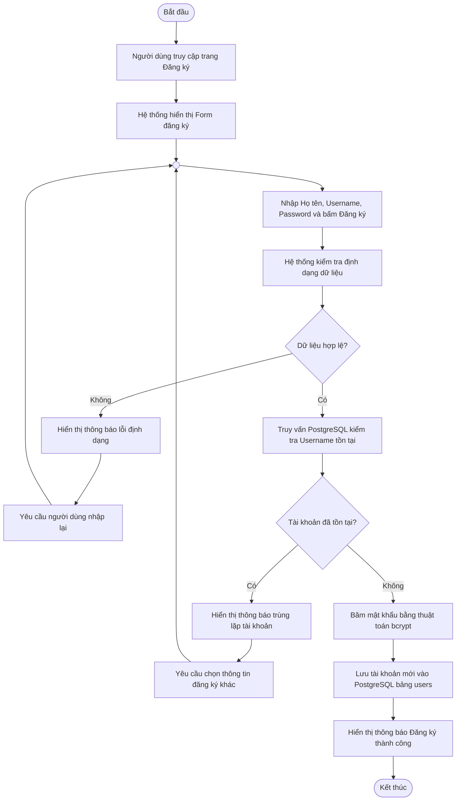

---

### 2. Diagram 3.3.2: User Login (Đã sửa lỗi khối Retry Login)
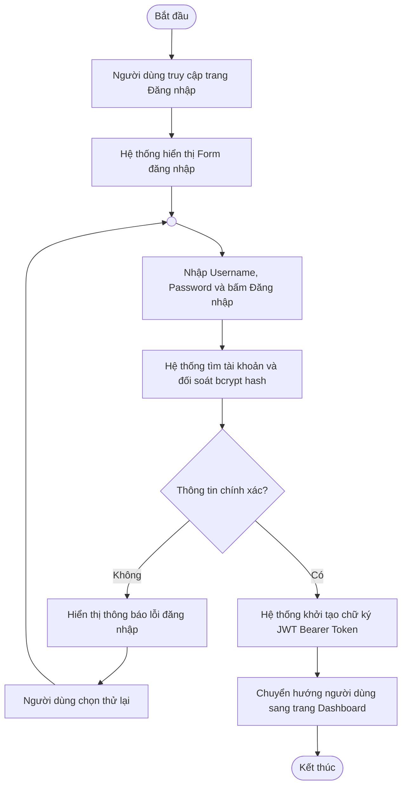

---

### 3. Diagram 3.3.4: Adding a Transaction (Sơ đồ thêm giao dịch & Gợi ý NLP)
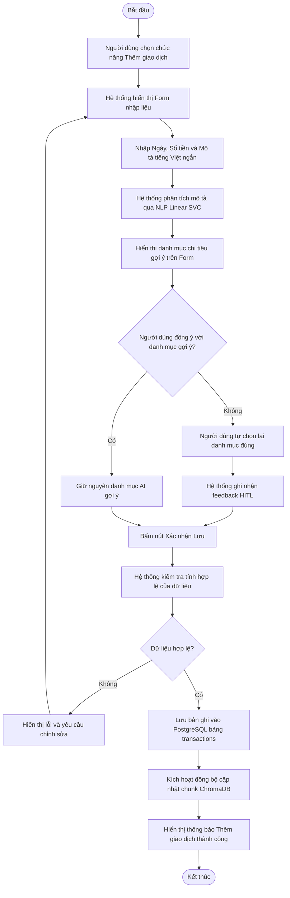

---

### 4. Diagram 3.3.5: Viewing, Searching, and Filtering Transactions (Tìm kiếm & Lọc)
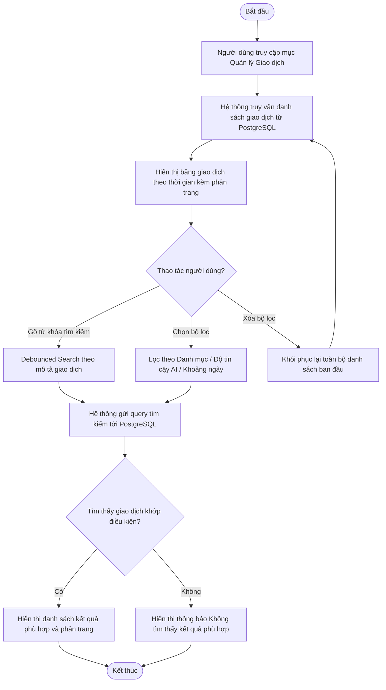

---

### 5. Diagram 3.3.6: Editing a Transaction (Chỉnh sửa giao dịch)
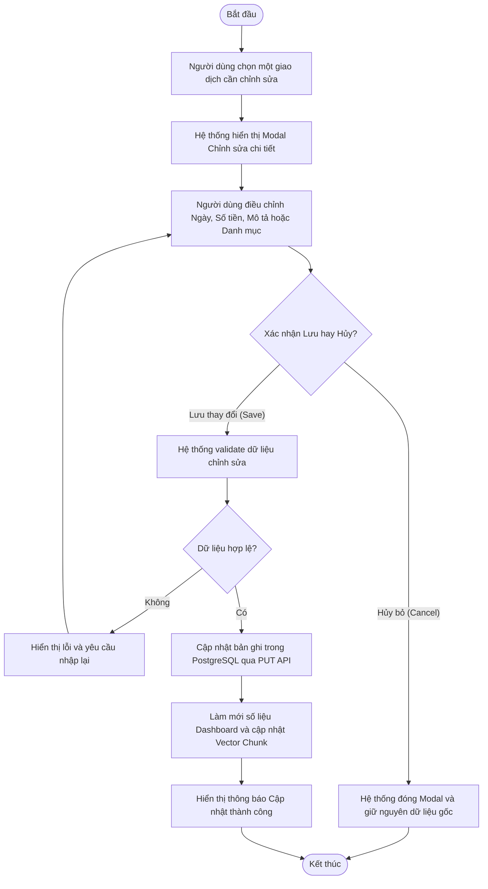

---

### 6. Diagram 3.3.7: Deleting a Transaction (Xóa giao dịch)
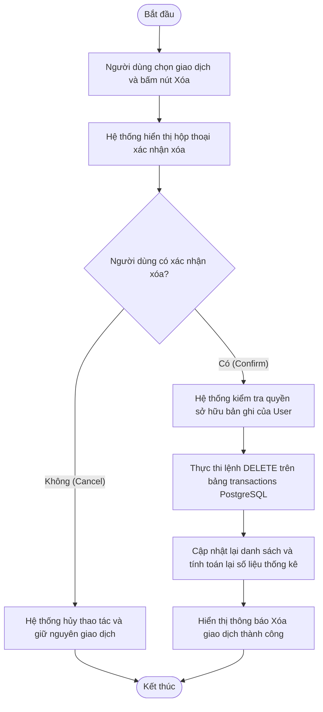

---

### 7. Diagram 3.3.8: Viewing Statistics and Charts (Dashboard & Biểu đồ)
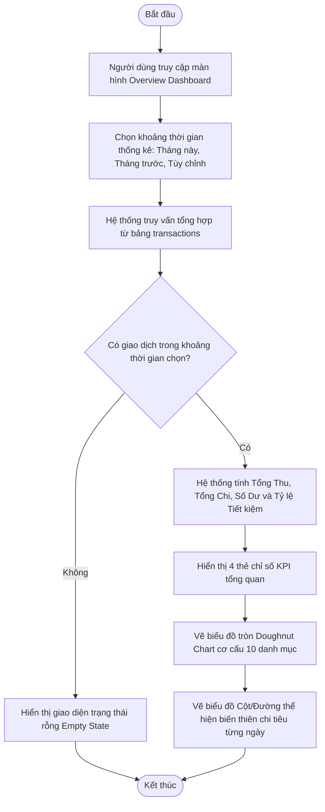

---

### 8. Diagram 3.3.9: Automatic Classification Using NLP (Pipeline Phân loại AI)
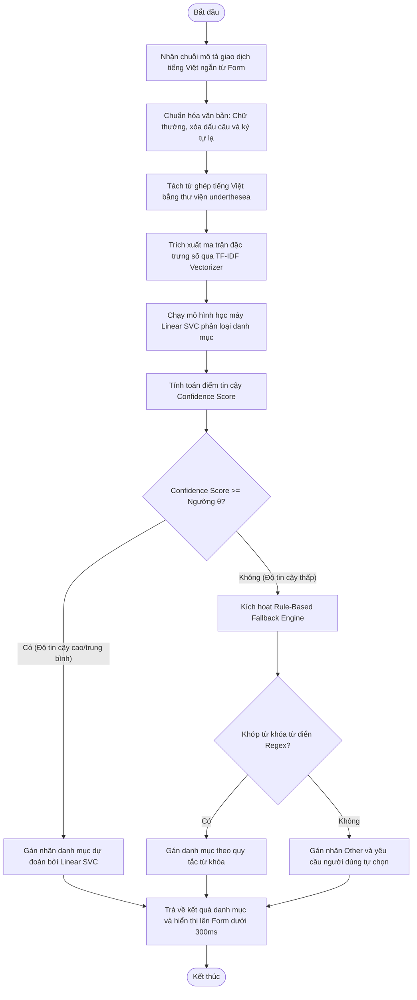

---

### 9. Diagram 3.3.10: Correcting AI Category & Saving Feedback (Human-in-the-Loop)
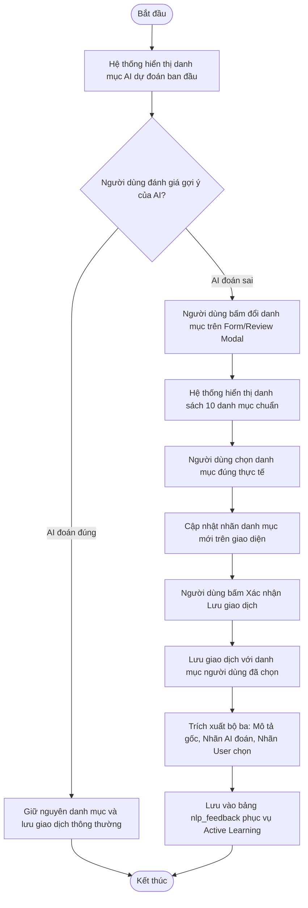

---

### 10. Diagram 3.3.11: Financial Data Q&A with RAG & Evidence (Hỏi đáp RAG & Bảng dẫn chứng)
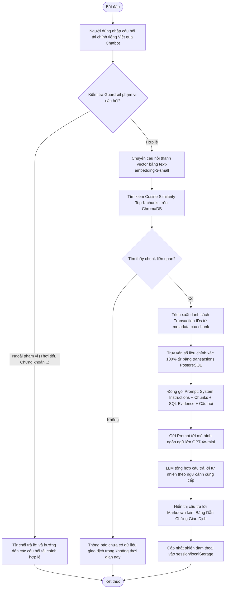

---

### 11. Diagram 3.3.12: Budget Limits & Spending Alerts (Hạn mức & Cảnh báo chi tiêu)
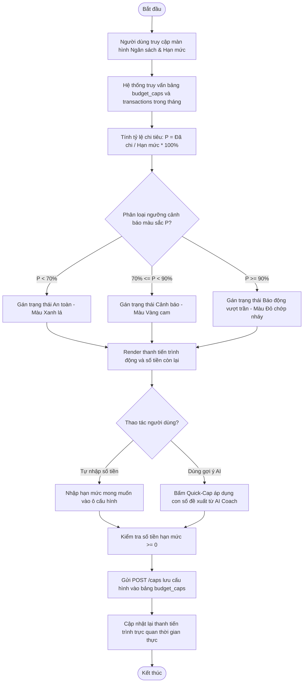

---

## PHẦN V: KẾ HOẠCH HÀNH ĐỘNG CỤ THỂ (ACTION PLAN) ĐỂ HOÀN THIỆN ĐỒ ÁN

1. **Chỉnh sửa các sơ đồ đã có trong PDF:**
   * Thay khối hình thoi của *"Re-enter Information"* (Mục 3.3.1) và *"Retry Login"* (Mục 3.3.2) thành hình chữ nhật bo góc (Action).
   * Trong text mục 3.3.5 (Trang 65), sửa từ *"wallet"* thành *"AI confidence"* để phản ánh đúng thực tế hệ thống.
2. **Chèn hình ảnh cho 7 mục đang để trống (3.3.4 $\rightarrow$ 3.3.10):**
   * Sử dụng mã Mermaid chuẩn tương ứng ở Phần IV để render ra ảnh PNG độ phân giải cao và chèn vào đúng các vị trí đang để trống trong tài liệu Word/PDF.
3. **Bổ sung bắt buộc Mục 3.3.11 (RAG Q&A) và Mục 3.3.12 (Budget Limits):**
   * Thêm 2 mục này vào bài báo cáo để hoàn thiện sự đồng bộ tuyệt đối giữa: **Tên đề tài $\leftrightarrow$ Danh sách Use Case $\leftrightarrow$ Biểu đồ hoạt động $\leftrightarrow$ Mã nguồn thực tế**.
4. **Về phía Mã nguồn Codebase:**
   * Để chức năng HITL ở mục 3.3.10 hoạt động vật lý hoàn chỉnh, hãy chạy lệnh tạo bảng `nlp_feedback` trong CSDL PostgreSQL và bổ sung API tiếp nhận feedback từ frontend.
